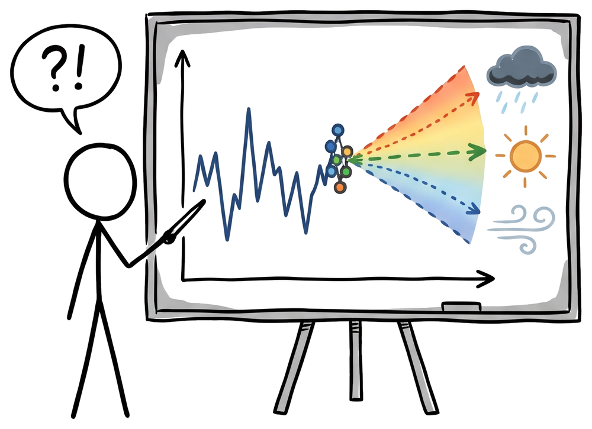
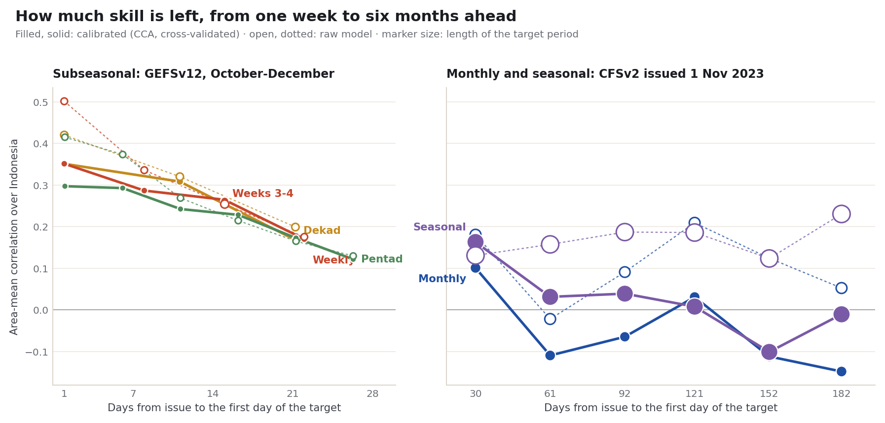
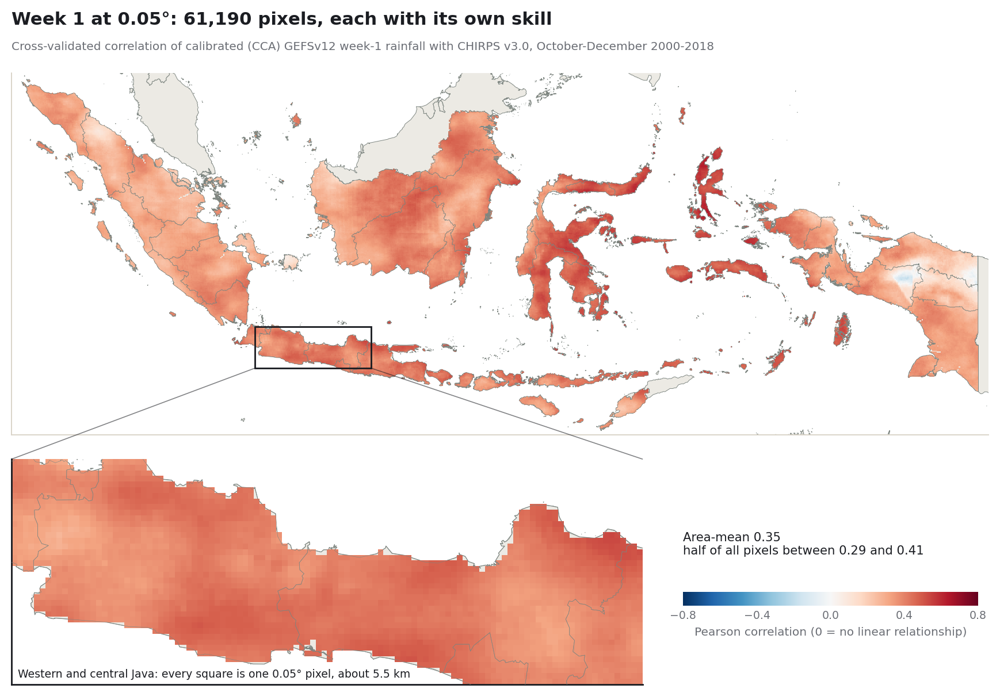
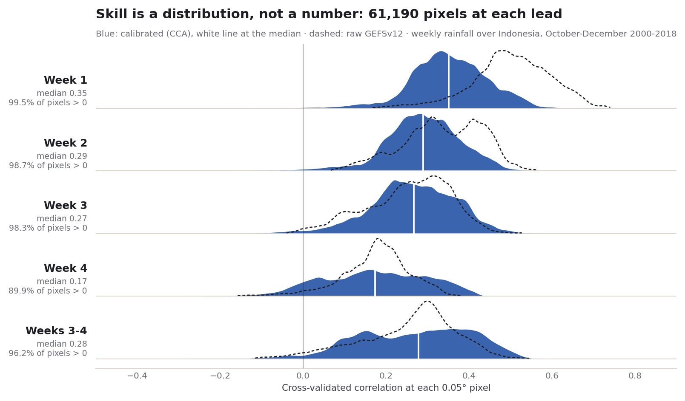

  <picture>
    <source media="(prefers-color-scheme: dark)" srcset="docs/assets/logo/logo-dark.png">
    <source media="(prefers-color-scheme: light)" srcset="docs/assets/logo/logo-light.png">
    
  </picture>

# PyCPT Tutorial

A practical, evidence-first tutorial on calibrating seasonal and subseasonal rainfall
forecasts with [PyCPT](https://iri-pycpt.github.io/) and CPT, worked through with real
data over Indonesia.

**Read it online: <https://bennyistanto.github.io/pycpt-tutorial>**

The chapters and case studies are executed notebooks, or stories built from them,
using real model and observation data. Numbers in the text come from the executed
outputs, and the chapter, case and methods pages end with their references.

A casual weekend project by [Benny Istanto](https://github.com/bennyistanto).
It is not an official PyCPT tutorial and is not affiliated with, endorsed by or
maintained by the International Research Institute for Climate and Society (IRI)
or the developers of PyCPT and CPT.

## At a glance

How much forecast skill is left as you look further ahead, from the next week to
six months out: every lead-time case in the tutorial on one chart.

  

The lead-time cases keep CHIRPS v3.0's native 0.05° grid: every pixel has its own
skill, and the zoom shows what that means over Java.

  

An area mean hides the spread. Across the 61,190 pixels, week-1 skill is positive
almost everywhere; by week 4 one pixel in ten is at or below zero.

  

All three are drawn from the saved case outputs by
[`scripts/make_readme_figures.py`](scripts/make_readme_figures.py); the numbers and
their caveats are in the [lead-time case studies](https://bennyistanto.github.io/pycpt-tutorial).

## What is inside

**Learn PyCPT**: seven chapters on the PyCPT 2.10 workflow, one forecast question
throughout (CFSv2, 1 September 2023 start, OND 2023 rainfall over Indonesia,
1991-2020 training).

| Chapter | Notebook |
| --- | --- |
| 1. Your first PyCPT case | [01-first-case.ipynb](docs/learn/01-first-case.ipynb) |
| 2. Getting the data | [02-getting-data.ipynb](docs/learn/02-getting-data.ipynb) |
| 3. Bring your own observations | [03-local-observations.ipynb](docs/learn/03-local-observations.ipynb) |
| 4. Evaluate a model | [04-evaluate-models.ipynb](docs/learn/04-evaluate-models.ipynb) |
| 5. Reading probabilistic forecasts | [05-probabilistic-forecasts.ipynb](docs/learn/05-probabilistic-forecasts.ipynb) |
| 6. Combining models | [06-multi-model-ensemble.ipynb](docs/learn/06-multi-model-ensemble.ipynb) |
| 7. Adapt it to your region | [07-adapt-your-region.ipynb](docs/learn/07-adapt-your-region.ipynb) |

**Case studies: Seasonal**

- [Twelve seasons over Indonesia](docs/chapters/indonesia-seasons-2023.qmd) with its
  [executed notebook](docs/notebooks/indonesia-seasons-2023.ipynb): CCA, PCR, the raw
  model and climatology compared across twelve seasons centred on 2023, nationally and
  for 38 provinces.
- [Fit & diagnose](docs/chapters/fit-diagnose-2023.qmd) with its
  [executed notebook](docs/notebooks/fit-diagnose-2023.ipynb): four PyCPT fits for OND
  and JJA 2023, model patterns and cross-validated residuals.
- [Issued 1 Nov 2023: the next six months](docs/chapters/monthly-leads-2023.qmd) with its
  [executed notebook](docs/notebooks/monthly-leads-2023.ipynb): one CFSv2 run calibrated
  for December 2023 to May 2024 at 0.05°, skill by lead, a raw-model baseline, lead
  against target month, and each forecast against what happened.
- [Issued 1 Nov 2023: the next six seasons](docs/chapters/seasonal-leads-2023.qmd) with its
  [executed notebook](docs/notebooks/seasonal-leads-2023.ipynb): the same for DJF to MJJ,
  compared with each season's first month.

**Case studies: Subseasonal** (GEFSv12)

- [Issued 31 Oct 2023: the next three dekads](docs/chapters/dekad-leads-2023.qmd) with its
  [executed notebook](docs/notebooks/dekad-leads-2023.ipynb): dekad rainfall one to three
  dekads ahead, calibrated through `cptcore`, skill by lead over October-December
  2000-2018 and every 2023 issue date.
- [Issued 1 Nov 2023: the next four weeks](docs/chapters/week-leads-2023.qmd) with its
  [executed notebook](docs/notebooks/week-leads-2023.ipynb): weeks 1 to 4 and weeks 3-4
  from each Wednesday.
- [Issued 31 Oct 2023: the next six pentads](docs/chapters/pentad-leads-2023.qmd) with its
  [executed notebook](docs/notebooks/pentad-leads-2023.ipynb): the CHIRPS v3.0 pentad
  product, one to six pentads ahead.

Setup, downloads, methods and credits are in [docs/guides/](docs/guides/README.md).

## Where to find the outputs

All outputs are real results from the executed notebooks and research pipelines,
stored as NetCDF4 (open with `xarray.open_dataset`), CSV, JSON or PNG.

| What | Where | Contents |
| --- | --- | --- |
| Case study outputs | [docs/assets/seasonal-2023/](docs/assets/seasonal-2023/), [docs/assets/fitting-2023/](docs/assets/fitting-2023/) | Scores, comparisons, figures and 33 NetCDF files behind the two season case studies |
| Lead-time case outputs | [docs/data/monthly-2023/](docs/data/monthly-2023/), [docs/data/seasonal-leads-2023/](docs/data/seasonal-leads-2023/), [docs/data/dekad-leads-2023/](docs/data/dekad-leads-2023/), [docs/data/week-leads-2023/](docs/data/week-leads-2023/), [docs/data/pentad-leads-2023/](docs/data/pentad-leads-2023/), figures in the matching [docs/assets/](docs/assets/) folders | Skill by lead and 2023 scores (CSV), run summaries (JSON) and maps (one NetCDF per case) for the monthly and seasonal forecasts issued 1 November 2023 and the subseasonal dekad, week and pentad cases, all at 0.05° |
| Downloadable kits | [docs/downloads/](docs/downloads/) | Each case study's notebook with its inputs and helper code, ready to run; all 30 fitted NetCDF outputs of Fit & diagnose as one zip |
| Research benchmarks | [research/cases/](research/cases/) | Frozen experiments, 278 NetCDF files in total: each case's `outputs/` folder, a README describing it and JSON manifests with every file's SHA-256 hash |
| Small examples | [examples/](examples/README.md) | A real CFSv2 forecast as CPT text and as NetCDF, for trying the export tool |

The research benchmarks:

| Case | NetCDF files | Question |
| --- | --- | --- |
| [indonesia-all-seasons-2021-2024-025deg](research/cases/indonesia-all-seasons-2021-2024-025deg/README.md) | 209 | All twelve seasons, 2021-2024, at 0.25° (source of the Story case study) |
| [indonesia-ond-2021-2024-025deg](research/cases/indonesia-ond-2021-2024-025deg/README.md) | 13 | Does the training-period improvement persist across OND 2021-2024? |
| [indonesia-ond-2023-025deg-1991-2020](research/cases/indonesia-ond-2023-025deg-1991-2020/README.md) | 19 | OND 2023 at 0.25°, 1991-2020 training sensitivity |
| [indonesia-ond-2023-025deg](research/cases/indonesia-ond-2023-025deg/README.md) | 18 | OND 2023, CCA and PCR refitted at 0.25° |
| [indonesia-ond-2023](research/cases/indonesia-ond-2023/README.md) | 17 | The first full-Indonesia OND 2023 replay at 1° |
| [indonesia-ond-2023-005deg-trial](research/cases/indonesia-ond-2023-005deg-trial/README.md) | 2 | Can the predictand be native 0.05° CHIRPS v3.0, and does it change the result? |

The [research README](research/README.md) explains how these relate. What was
checked against CPT's source and outputs is summarised on the
[Methods & limitations](https://bennyistanto.github.io/pycpt-tutorial/guides/methods.html) page.

## Running it yourself

Reading needs only a browser. The [setup guide](docs/guides/reproduce.qmd) separates
three levels: re-running the saved-results analysis (scientific Python only), fitting
models (the tested PyCPT 2.10.4 environment in `environment/`), and downloading new
data. The Learn PyCPT chapters use the full PyCPT environment; chapter 7 adds a
preflight checker (`pycpt_tutorial.checks`) for your own cases.

## Repository layout

| Folder | Purpose |
| --- | --- |
| [docs/](docs/README.md) | The Quarto book: Learn PyCPT chapters, case studies, notebooks, guides, data and downloads |
| [research/](research/README.md) | Frozen experiments with their outputs and manifests, and the research pipelines (download, conversion, preparation and fitting scripts) |
| [pycpt_tutorial/](pycpt_tutorial/) | Helper code: figures, preflight checks, calendars, aggregation and NetCDF export |
| [scripts/](scripts/) | Notebook execution, data preparation, kit packaging, reference and render tools |
| [environment/](environment/) | Pinned Debian environment locks and runtime verification |
| [examples/](examples/README.md) | Small real-data files for trying the export tools |
| [tests/](tests/) | Unit tests, run with `python -m pytest` |
| [.github/workflows/](.github/workflows/publish.yml) | Builds the book and publishes it to GitHub Pages |

## License

Code is released under the [Mozilla Public License 2.0](LICENSE). Data and boundaries
keep the terms of their sources; see [About & credits](docs/guides/about.qmd).

## Contact

Benny Istanto, [benny.istan.to](https://benny.istan.to). Questions and problems:
[issue tracker](https://github.com/bennyistanto/pycpt-tutorial/issues).
