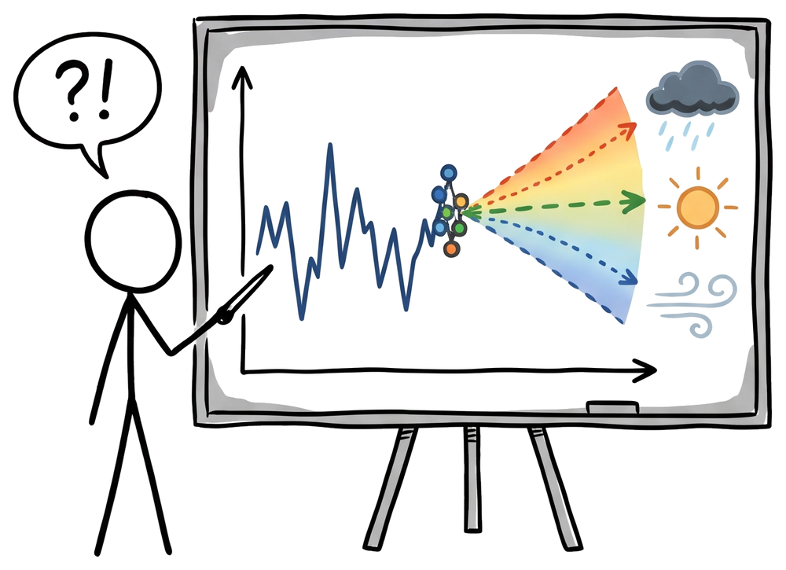
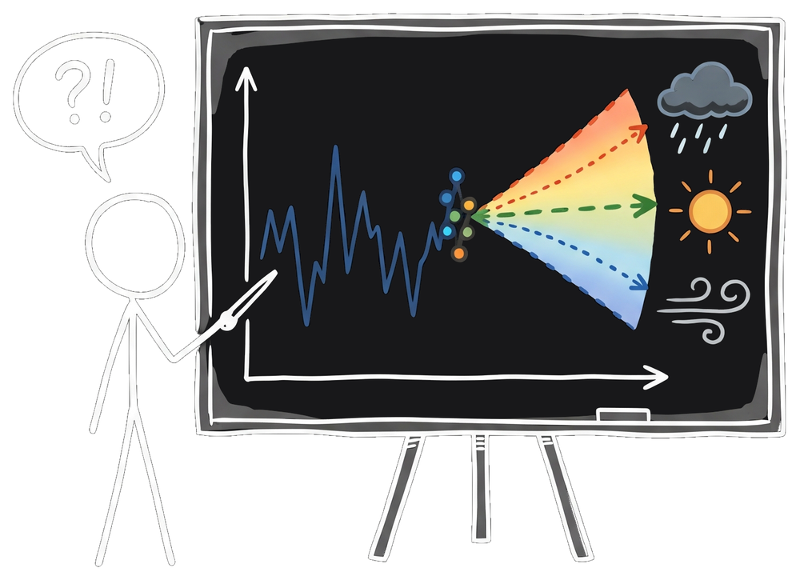

::: {.not-found}
::: {.eyebrow}
Error 404
:::

::: {.not-found-figure}
{.light-content fig-alt="A stick figure at a whiteboard with a speech bubble reading ?!"}
{.dark-content fig-alt="A stick figure at a chalkboard with a speech bubble reading ?!"}
:::

This forecast missed. The address you followed does not match any page in the
tutorial. It may have been mistyped, or the page may have moved.

::: {.home-actions}
[Back to Home](index.qmd){.tutorial-button .tutorial-button-primary}
[A guide to this tutorial](guides/start.qmd){.tutorial-button .tutorial-button-secondary}
:::
:::
