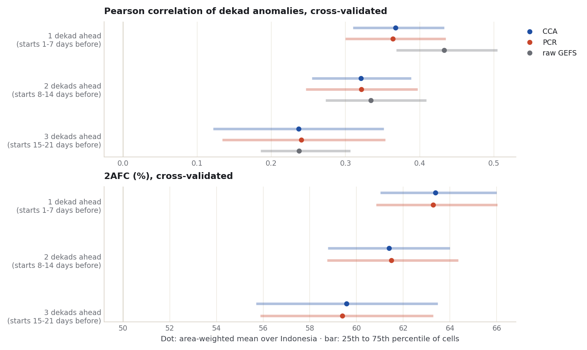
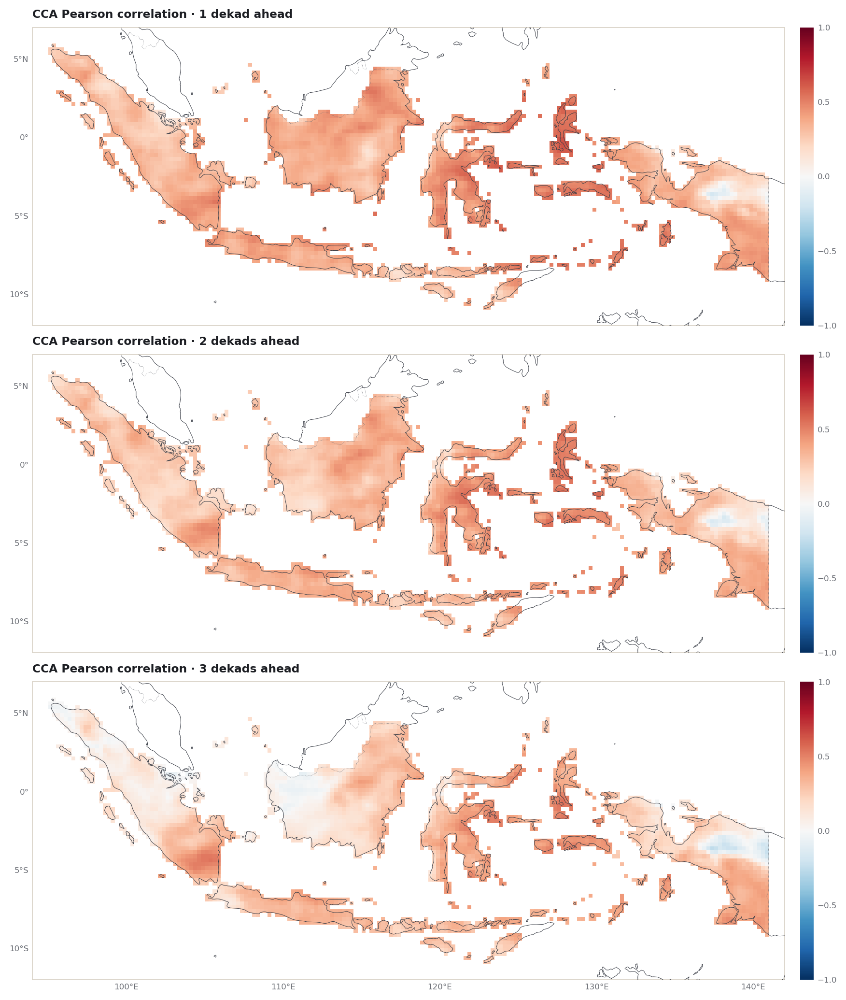
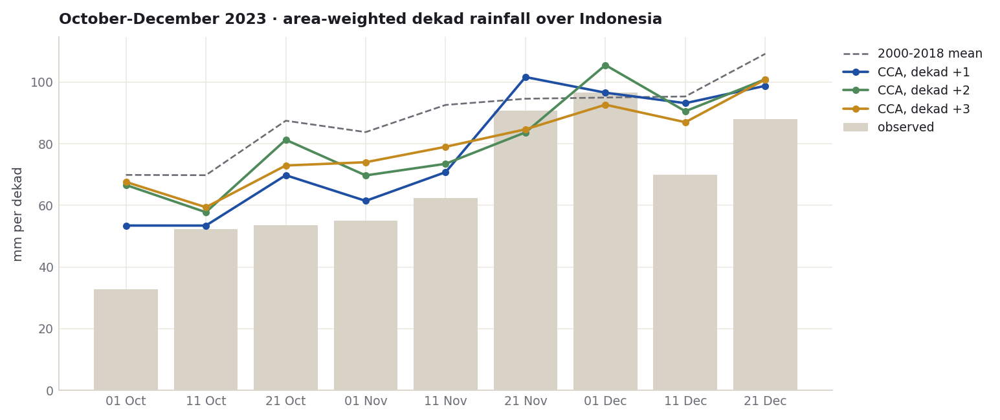

::: {.eyebrow}
Case 05 · Lead time · Subseasonal rainfall by dekad · Full Indonesia
:::

The [November](monthly-leads-2023.qmd) and [October-December](seasonal-leads-2023.qmd)
cases measured how forecasts change when made months ahead. This case shortens
both the target and the lead: rainfall over a **dekad** (*dasarian*: days 1-10,
11-20 and 21 to the end of a month), forecast one, two and three dekads ahead,
for every dekad of October-December. Dekads are the unit
[BMKG](https://www.bmkg.go.id/iklim/peringatan-dini-hujan-tinggi) uses for its
rainfall early warnings, and the CHIRPS v3.0 archive used throughout this tutorial
is stored in them. All numbers come from the
[executed notebook](../notebooks/dekad-leads-2023.ipynb).

::: {.callout-note title="The short result"}
- Skill **falls steadily with lead**: the area-mean cross-validated CCA
  correlation is 0.37 one dekad ahead, 0.32 two dekads ahead and 0.24 three
  dekads ahead. PCR is within 0.01 at every lead.
- The **raw GEFS** model, without calibration, correlates better one and two
  dekads ahead and about as well three dekads ahead: 0.43, 0.33 and 0.24.
- October-December 2023 was dry: the area-mean anomaly was below the 2000-2018
  average in 8 of its 9 dekads. One dekad ahead, the forecasts leaned dry every
  time and beat climatological odds (RPSS 0.22). Two and three dekads ahead
  their hit rate fell below that of always forecasting "below normal".
:::

## A different model and a different calendar

PyCPT's subseasonal catalog has one model, **GEFSv12**, NOAA's Global Ensemble
Forecast System, served by the IRI Data Library and described in its reforecast
paper ([Guan et al. 2022](https://doi.org/10.1175/MWR-D-21-0245.1)). Its hindcasts
start every **Wednesday** with 11 members and run 35 days; its forecasts start
every day with 31 members. Training uses the hindcasts of 2000-2018, and 2023
is forecast from the real-time branch.

Dekads follow the calendar while the hindcasts start on Wednesdays, so the lead
needs a precise rule. Here **lead k** is the dekad that begins 7(k-1)+1 to 7k days
after a Wednesday start:

| Lead | Dekad begins after the start | Model days used |
| --- | --- | --- |
| 1 dekad | 1 to 7 days | up to day 17 |
| 2 dekads | 8 to 14 days | up to day 24 |
| 3 dekads | 15 to 21 days | up to day 31 |

Each window contains exactly one Wednesday, so every October-December dekad has
exactly one forecast at each lead: 171 training dekads (9 per year, 2000-2018)
and 9 in 2023, **the same targets at all three leads**. A fourth lead would need
model days beyond 35. The 293 start dates were downloaded once (about 1.2 GB);
every file was checked for units, members, lead days and grid, and no value was
missing or negative.

Observations are the local CHIRPS v3.0 dekad totals on the tutorial's 0.25°
Indonesia land grid, with stored time bounds checked and exact zeros kept; all
3,240 cells are complete in the 171 training dekads.

## Anomalies, and three things CPT needed

October-December rainfall rises through the season: from about 70 mm per dekad in
early October to 109 mm in late December (2000-2018 area mean). A correlation over
all dekads would partly score that rise. Both the model and the observations are
therefore converted to **anomalies** from the 2000-2018 mean of the same calendar
dekad (and lead, for the model). These means include the year held out in
cross-validation. For correlations that makes no difference: leaving a year out of
its own dekad mean multiplies every anomaly by the same factor (19/18), and the
raw-model correlations computed both ways were identical to four decimals. Inside
CPT's cross-validated fits it shifts the training anomalies slightly; that effect
was not measured.

The fits use CCA (3/3/2) and PCR (3) through `cptcore`, the layer under PyCPT's
`evaluate_models`, because PyCPT's own subseasonal driver does not run unchanged in
this version. Three adjustments were needed, each found by a failed run:

1. **Placeholder years.** With the real dekad dates, CPT stopped while reading its
   input. The samples are given consecutive placeholder years in their original
   order, as PyCPT's
   [`redate`](https://github.com/iri-pycpt/pycpt/blob/084bb5c380c200b5f65f11ba224a965547b91da1/pycpt/src/cptextras/redate.py)
   does for its own in-sample fit; cross-validation depends only on the order.
2. **Field name.** CPT refused negative values in a field named `precipitation`
   ("zero-bound is set"); the anomaly fields are named `anomaly`.
3. **Latitude order.** `cptcore` expects latitudes from north to south.

Cross-validation leaves out 17 samples, at least the held-out dekad's whole
October-December season. Both checks on the returned results passed: hindcasts
keep their negative anomalies (about half are negative), and CPT's correlation
maps equal correlations recomputed from its hindcasts (largest gap below 0.000001).

## Skill falls steadily

{fig-alt="Two dot-and-bar charts stacked vertically. Top: Pearson correlation by lead for CCA, PCR and raw GEFS. Bottom: 2AFC by lead for CCA and PCR."}

| Lead | CCA Pearson | PCR Pearson | Raw GEFS Pearson | CCA 2AFC (%) | CCA ROC below | CCA ROC above |
| --- | --- | --- | --- | --- | --- | --- |
| 1 dekad | 0.37 | 0.36 | 0.43 | 63.4 | 0.70 | 0.68 |
| 2 dekads | 0.32 | 0.32 | 0.33 | 61.4 | 0.67 | 0.66 |
| 3 dekads | 0.24 | 0.24 | 0.24 | 59.6 | 0.65 | 0.63 |

: Area-weighted means over 3,240 cells, 171 dekads. 2AFC is 50% and ROC area 0.5 for no skill [(Mason and Weigel 2009)](https://doi.org/10.1175/2008MWR2553.1). Source: [skill-by-lead.csv](../data/dekad-leads-2023/skill-by-lead.csv).

1. **Each extra dekad of lead costs skill.** Unlike the monthly and seasonal
   cases, the decline here is smooth: correlation 0.37, 0.32, 0.24 and 2AFC 63.4%,
   61.4%, 59.6%. Three dekads ahead, skill is still above zero on average.
2. **Calibration does not beat the raw model.** Raw GEFS is ahead by 0.07 one
   dekad ahead and by 0.01 two dekads ahead; three dekads ahead the three
   correlations are within 0.004 of each other. As in the November case, the calibrated
   scores are cross-validated and the raw score involves no fitting, a comparison
   known to work against the calibrated forecasts when skill is small
   ([Barnston and van den Dool 1993](https://doi.org/10.1175/1520-0442(1993)006%3C0963:ADICVS%3E2.0.CO;2));
   that was not tested separately.
3. **CCA and PCR agree** to within 0.01 at every lead.

Read by eye from the maps: one dekad ahead, correlations are positive almost
everywhere, highest over Sulawesi and Maluku. Three dekads ahead, western
Kalimantan and northern Sumatra are near zero, while southern Sumatra, Sulawesi,
Maluku and southern Papua keep more. A patch of central Papua is near or below
zero at every lead.

{fig-alt="Three maps of Indonesia stacked vertically showing CCA cross-validated correlation per 0.25 degree cell at leads of one, two and three dekads."}

## The nine dekads of October-December 2023

{fig-alt="Bar chart of the observed area-mean anomaly for each of nine dekads in October-December 2023, with three lines for the CCA forecasts at leads one to three."}

The observed area-mean anomaly was negative in 8 of the 9 dekads; only 1-10
December was slightly above the 2000-2018 average. The one-dekad-ahead forecasts
were negative every time and followed the dry spells of October and November, at
about 70% of the observed size on average (-15.6 mm against -21.8 mm, from the
[saved series](../data/dekad-leads-2023/ond-2023-area-anomalies.csv)). Two and three
dekads ahead, the forecasts were weaker and missed the very dry start of October.

| Lead | Method | Hit rate (%) | RPSS 2023 | RMSE 2023 (mm) | Forecast below normal (% of area x dekads) |
| --- | --- | --- | --- | --- | --- |
| 1 dekad | CCA | 56.6 | 0.22 | 35.1 | 77.2 |
| 1 dekad | PCR | 56.7 | 0.21 | 35.5 | 76.7 |
| 2 dekads | CCA | 48.9 | 0.10 | 39.1 | 60.9 |
| 2 dekads | PCR | 47.4 | 0.10 | 39.3 | 61.2 |
| 3 dekads | CCA | 48.9 | 0.12 | 38.4 | 67.0 |
| 3 dekads | PCR | 48.6 | 0.12 | 38.5 | 65.9 |

: Nine dekads of 2023, all cells, area-weighted. Observed: below normal 54.5%, near normal 31.1%, above normal 14.4%. Source: [ond-2023-dekad-forecasts.csv](../data/dekad-leads-2023/ond-2023-dekad-forecasts.csv).

- **Categories** follow CPT's own definition for this fit: the 33rd and 67th
  percentiles of the 171 training anomalies at each cell.
- **Hit rate**: forecasting "below normal" everywhere every dekad would have scored
  **54.5%**. One dekad ahead the forecasts scored 56.6-56.7%, about 2 points more;
  two and three dekads ahead they scored 47-49%, less than that reference.
- **RPSS 2023** against climatological odds, using the ranked probability score
  ([Epstein 1969](https://doi.org/10.1175/1520-0450(1969)008%3C0985:ASSFPF%3E2.0.CO;2)),
  was positive at every lead (0.22, 0.10 and 0.12 for CCA). For nine dekads of one
  season this rewards leaning the right way in 2023, not skill in general.

## Three time scales side by side

The three lead-time cases share the observations, the grid, the calibration
settings and the idea of a lead counted to the start of the target. They differ
in model (CFSv2 for months and seasons, GEFSv12 for dekads), training years
(1991-2020 and 2000-2018) and sample size (30 and 171), so the numbers are not a
ranking. What they show together, for Indonesia in October-December:

| Case | Target | Leads | CCA correlation, shortest to longest lead | Raw model vs calibrated |
| --- | --- | --- | --- | --- |
| [November](monthly-leads-2023.qmd) | one month | 1-6 months | 0.27 to 0.05 | raw higher at 5 of 6 leads |
| [October-December](seasonal-leads-2023.qmd) | one season | 1-6 months | 0.50 to 0.36 | calibrated higher at all 6 |
| This case | one dekad | 1-3 dekads | 0.37 to 0.24 | raw higher at 2 of 3, level at the third |

## What this does and does not show

This is one season of dekads, one model, one set of fixed settings, 19 training
years and one verifying year. It shows that, for GEFSv12 dekad rainfall over
Indonesia in October-December, cross-validated skill falls steadily from one to
three dekads ahead, and that calibration with these settings did not add to the
raw model's correlation. The observations are retrospective CHIRPS v3.0 Final
data, not what was available when each forecast was issued. The 2023 forecasts
average 31 GEFS members while the hindcasts have 11; refitting lead 1 with only 11
of the 2023 members changed the 2023 hit rate from 56.6% to 56.5% and left RPSS at
0.22.

Weekly targets, the international convention for subseasonal forecasts, would
need daily observations. CHIRPS v3.0 daily values divide pentad totals using ERA5
or IMERG timing ([CHC daily readme](https://data.chc.ucsb.edu/products/CHIRPS/v3.0/daily/readme.txt)),
and the tutorial now has a
[downloader](https://github.com/bennyistanto/pycpt-tutorial/blob/main/research/scripts/download_chirps3_daily.py)
for them.

## Files

- [Executed notebook](../notebooks/dekad-leads-2023.ipynb): every number and figure on this page
- [Skill by lead (CSV)](../data/dekad-leads-2023/skill-by-lead.csv) · [2023 forecasts and scores (CSV)](../data/dekad-leads-2023/ond-2023-dekad-forecasts.csv) · [2023 area-mean anomalies (CSV)](../data/dekad-leads-2023/ond-2023-area-anomalies.csv) · [Lead design: every target, lead and start (CSV)](../data/dekad-leads-2023/lead-design.csv) · [Run summary (JSON)](../data/dekad-leads-2023/summary.json)
- [Correlation maps (NetCDF)](../data/dekad-leads-2023/dekad-leads-2023-maps.nc)
- [GEFS download script](https://github.com/bennyistanto/pycpt-tutorial/blob/main/research/scripts/download_gefs_dekads.py)

## References {.unnumbered .reference-section}


