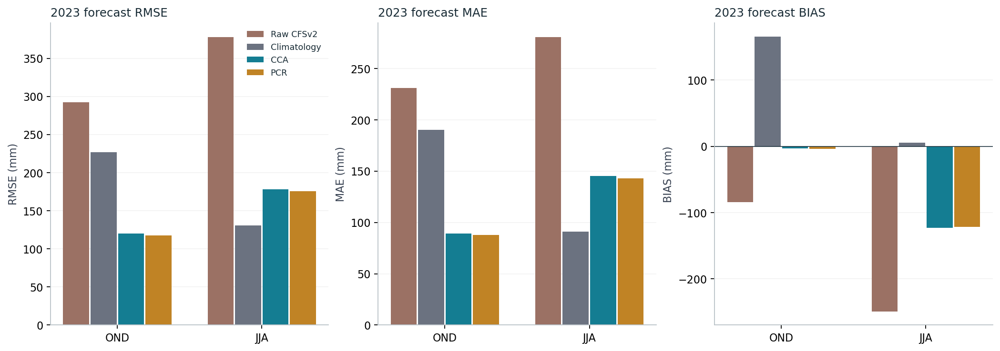
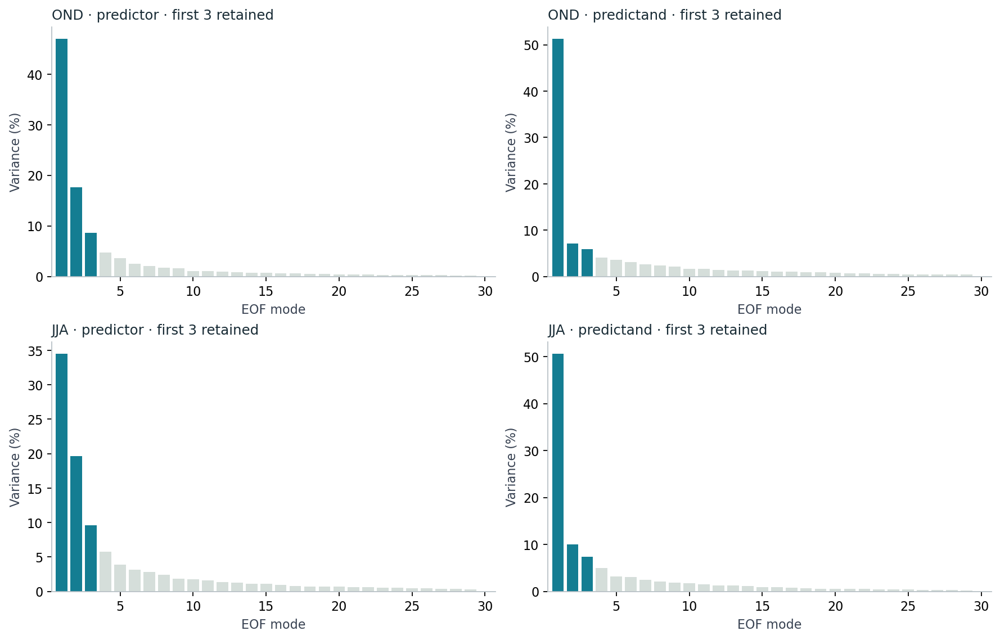
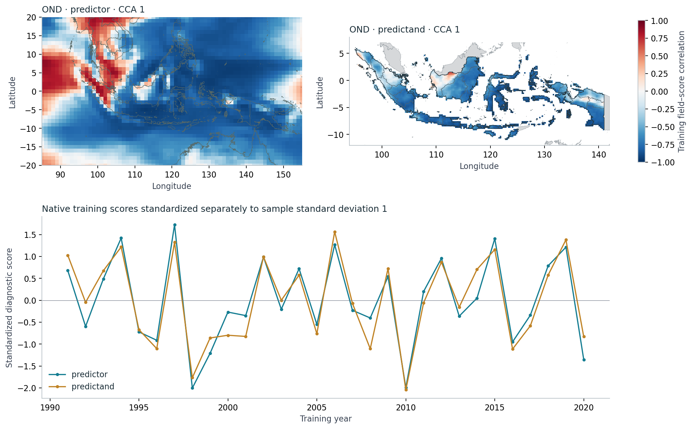
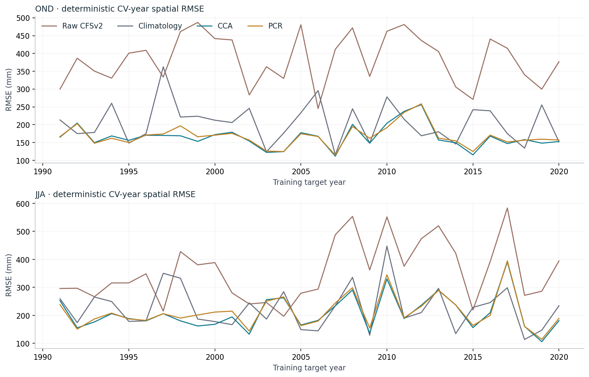
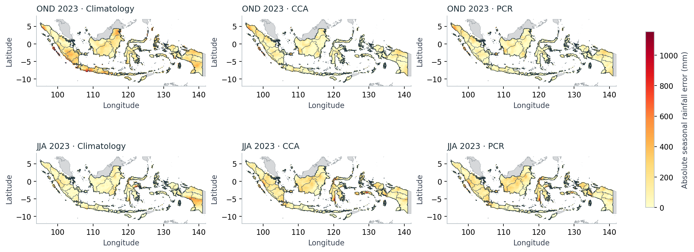

```{ojs}
//| echo: false
//| output: false
import {selectControl, inputSummary, fittingScores, fittingScree, fittingPatterns, fittingCv, fittingErrors} from "../assets/fitting-2023/fitting.js"
fitData = FileAttachment("../assets/fitting-2023/interactive-data.json").json()
geo = ({predictor: await FileAttachment("../data/fitting-2023/predictor-boundaries.geojson").json(),
  indonesia: await FileAttachment("../data/boundaries/indonesia.geojson").json(),
  provinces: await FileAttachment("../data/boundaries/provinces.geojson").json(),
  neighbours: await FileAttachment("../data/boundaries/neighbours.geojson").json()})
seasonChoices = [["OND", "OND 2023"], ["JJA", "JJA 2023"]]
trainingSeasonChoices = [["OND", "OND · 1991–2020"], ["JJA", "JJA · 1991–2020"]]
metricChoices = [["rmse", "RMSE"], ["mae", "MAE"], ["bias", "Bias"]]
```

::: {.eyebrow}
Case 02 · Model fitting and diagnostics · Full Indonesia
:::

The [first case](indonesia-seasons-2023.qmd) asked whether calibrated forecasts
were better than the raw model and a simple rainfall average. This case opens
the fitting workflow itself. What goes into PyCPT? What does it return? And what
should we learn from its model patterns before interpreting a forecast map?

We follow October–December (**OND**) 2023, then apply the same choices to
June–August (**JJA**) 2023. Both cover full Indonesia. The
[executed notebook](../notebooks/fit-diagnose-2023.ipynb) runs four actual PyCPT
fits (CCA and PCR for each season) and checks the results against the original
verified controls. All inputs are local seasonal fields.

::: {.callout-note title="Choose how to follow along"}
Read this story and the executed notebook in your browser. To execute the fitting
cells, use the **full tested PyCPT environment with its compatible CPT engine**.
The smaller analysis-only environment remains suitable for the first case and
for exploring exported NetCDFs. Neither local-input path requires an IRIDL key.
[Setup and complete fitting kit](../guides/reproduce.qmd#fitting-case-setup).
:::

The interactive views below share the notebook's computed outputs. Hover, tap or
focus chart marks to inspect values. Maps support arrow keys after receiving
focus. PNG downloads include the current selections; chart views also offer SVG.
For the pattern explorer, SVG contains the score series and PNG contains the maps
and series together. Labelled notebook-reference links retain the static figures.

## Begin with three inputs

Think of the fitting call as a relationship between **X, Y and F**. X contains
past model rainfall, Y contains observed rainfall for those same target seasons,
and F contains the model forecast for the new target. The relationship learned
from X and Y is applied to F.

Here X and F are CFSv2 ensemble-mean seasonal rainfall on a 1° grid. The predictor
domain extends beyond Indonesia, from 85–155°E and 20°S–20°N. Y is CHIRPS3
seasonal rainfall aggregated to the existing 0.25° country-land grid. It has
3,240 complete locations used by both calibrated methods and the baselines.
The finer output grid describes the aggregation and output locations; it does
not establish independent dynamical predictability at 0.25°.

::: {#fitting-inputs .story-interactive data-fitting-panel="inputs"}
```{ojs}
//| echo: false
viewof inputSeason = selectControl("Input season", seasonChoices, "OND")
inputSummary(fitData, inputSeason)
```
:::

[Download input summary CSV](../assets/fitting-2023/input-summary.csv).

Training uses 30 annual seasonal samples from 1991–2020. The 2023 predictor is
separate: OND starts from the September initialization, while JJA starts from May.
The notebook checks the actual target bounds, matching X/Y years, units and
complete support before calling PyCPT. The kit begins with prepared seasonal
totals in millimetres; the source and preprocessing hashes accompany those files.

## Fit a controlled comparison

The notebook uses PyCPT's direct fitting interface, demonstrated in the
[official core example](https://github.com/iri-pycpt/notebooks/blob/1c975316910b9e047ce685d9b8cdefb2c4b73551/Demo/cptcore_demo.ipynb).
CCA and PCR both retain **three predictor EOFs**. CCA also retains **three
predictand EOFs and two CCA modes**. These counts stay fixed between OND and JJA.
They make the comparison reproducible; they have not been shown to be optimal.

Both fits use the audited **five-sample cross-validation window**. For each
training target, the calculation omits that sample and two neighbours on either
side, wrapping at the ends of the training sequence. It refits the model for
that hindcast. The separate 2023 forecast is then made with the final model
fitted to all 30 training seasons. The
[IRI validation reference](https://iri.columbia.edu/~awr/pycpt/seasonal-jupyterbook/html_2sep2023/cpt.html)
introduces the distinction between validation and the fitted regression model.

CCA returns five datasets: hindcasts, forecasts, native skill, X patterns and
Y patterns. PCR returns four, with X patterns and no Y pattern decomposition.
The notebook retains every dataset and writes additional cleaned diagnostics.
Each fit has its own directory, command record, log and numerical control checks.
There are no source downloads or fitted-probability scoring steps in this lesson.

::: {.callout-tip title="Start with the forecast result, then inspect the model"}

:::

::: {#fitting-scores .story-interactive data-fitting-panel="scores"}
```{ojs}
//| echo: false
viewof scoreMetric = selectControl("Forecast score", metricChoices, "rmse")
viewof scorePeriod = selectControl("Verification sample", [["forecast_2023", "Separate 2023 forecasts"], ["cross_validation", "Training CV5 diagnostics"]], "forecast_2023")
fittingScores(fitData, scoreMetric, scorePeriod)
```
:::

[Notebook reference PNG · all three forecast metrics and both seasons](../assets/fitting-2023/forecast-scores.png)

<noscript></noscript>

RMSE and MAE measure spatial rainfall errors over the shared land cells. Bias is
forecast minus observed rainfall: negative means too little rain. The score is
not the error of a single national-average rainfall estimate. The sample selector
keeps the 2023 comparison separate from pooled training CV diagnostics; these
cover different years and answer different questions.

## What was compressed?

An EOF represents a pattern of variation in a training field. Its score describes
how that pattern varies through the training years. PCR uses a small collection
of predictor scores in its regression. CCA first compresses both the predictor
and predictand fields, then relates their component combinations.

A scree plot shows how much training-field variance each EOF accounts for. The
complete spectrum here has 30 entries, while the model retains only the first
three. A larger retained percentage is a statement about compression. It is
not a percentage of correctly forecast rainfall or a forecast-skill score. The
[official scree-plot reference](https://cptplus.org/Help/Tools_Models_Scree.html)
describes the variance interpretation.

::: {#fitting-scree .story-interactive data-fitting-panel="scree"}
```{ojs}
//| echo: false
viewof screeSeason = selectControl("Spectrum season", trainingSeasonChoices, "OND")
viewof screeSide = selectControl("Training field", [["predictor", "X · CFSv2 predictor"], ["predictand", "Y · CHIRPS3 predictand"]], "predictor")
viewof screeView = selectControl("Spectrum display", [["variance", "Variance by mode"], ["cumulative", "Cumulative variance"]], "variance")
fittingScree(fitData, screeSeason, screeSide, screeView)
```
:::

[Notebook reference PNG · X/Y spectra for both seasons](../assets/fitting-2023/scree.png)

<noscript></noscript>

In these controlled fits, the saved predictor EOF files are identical between
CCA and PCR for each season. They start with the same predictor compression.
Their later regression construction differs. We keep the first three modes
throughout this lesson rather than searching for a more flattering 2023 result.

## Read patterns alongside their time series

CCA constructs pairs of predictor and predictand component series whose training
correlation is maximized within the retained spaces. The maps below show how
each original rainfall field relates to its own saved score. The score lines
are standardized separately so their variations can be viewed together.

These are **field–score correlations calculated from the training data**. Native
exported weights have a different meaning; the
[EOF output reference](https://cptplus.org/Help/Tools_Models_YEOF.html)
and [CCA reference](https://cptplus.org/Help/Tools_Models_CCA.html)
distinguish saved weights from displayed correlations. The notebook verifies
missing-value masks and exports the two quantities under separate names.

::: {#fitting-patterns .story-interactive data-fitting-panel="patterns"}
```{ojs}
//| echo: false
viewof patternSeason = selectControl("Pattern season", trainingSeasonChoices, "OND")
viewof patternKind = selectControl("Diagnostic family", [["cca", "CCA pairs"], ["eof", "Independent X/Y EOFs"]], "cca")
viewof patternMode = selectControl("Diagnostic mode", patternKind === "cca" ? ["1", "2"] : ["1", "2", "3"], "1")
fittingPatterns(fitData, geo, patternSeason, patternKind, patternMode)
```
:::

[Notebook reference PNG · OND CCA pair 1](../assets/fitting-2023/ond-cca-patterns.png) ·
[JJA CCA pair 1](../assets/fitting-2023/jja-cca-patterns.png)

<noscript></noscript>

The X map includes the whole predictor domain, including ocean model rainfall.
The Y map shows Indonesia's evaluated land support, with neighbouring countries
grey and country/province boundaries outlined. A blank cell is outside that
support, not an observed zero. The colours describe training associations, not
2023 rainfall anomalies. An EOF and its score can change sign together without
changing their product; independently numbered X/Y EOFs are not canonical pairs.

::: {.callout-important title="Canonical correlation is a training diagnostic"}
A high correlation between CCA score series does not establish a good forecast.
It depends partly on retained dimensions, as the official CCA guidance explains.
Full-training patterns are also distinct from the EOFs rebuilt inside each CV
fold. We do not infer a climate mechanism, empirical probability reliability or
optimized settings from these maps. A small absolute EOF-scale discrepancy in
the independent audit remains unresolved, so amplitude reconstruction is outside
this lesson; correlation maps and variance percentages are checked separately.
:::

## Ask what the withheld years reveal

The CV residuals test deterministic predictions inside the training interval.
The calibrated model excludes the five-sample window for each target. The
climatology baseline below excludes the same five observations; the raw model
is left uncalibrated. A simple average of all 30 observations would not be that
withheld-target climatology baseline.

::: {#fitting-cv .story-interactive data-fitting-panel="cv"}
```{ojs}
//| echo: false
viewof cvSeason = selectControl("CV season", trainingSeasonChoices, "OND")
viewof cvMetric = selectControl("CV score", metricChoices, "rmse")
fittingCv(fitData, cvSeason, cvMetric)
```
:::

[Notebook reference PNG · CV-year RMSE for both seasons](../assets/fitting-2023/cv-residuals.png)

<noscript></noscript>

Some years are harder than others. Pooled CV RMSE takes the square root after
averaging annual spatial squared errors; it is not an average of annual RMSE.
Mean bias can cancel across years, and the balanced cyclic climatology mean
can have essentially zero pooled bias while still making substantial errors.
Keep the annual series visible alongside any pooled score.

These diagnostics also have limits. Repeated model selection against CV results
can introduce selection bias. The input archive mixes reforecasts and an
operational append from April 2011, so temporal completeness does not prove
homogeneity. The [methods guide](../guides/methods.qmd) explains the archive and
validation context. No settings are tuned within this worked example.

## Return to JJA with a baseline in view

The four new fits reproduce the original controls, including the JJA outcome.
Both calibrations improve on the raw model's national 2023 error in this season,
while climatology has lower error than either calibrated method. A successful
software run and a coherent training pattern therefore still need a forecast
comparison against a simple alternative.

::: {#fitting-errors .story-interactive data-fitting-panel="errors"}
```{ojs}
//| echo: false
viewof errorSeason = selectControl("Forecast-map season", seasonChoices, "JJA")
viewof errorView = selectControl("Forecast-map field", [["absoluteError", "Absolute error"], ["signedError", "Signed error"], ["rainfall", "Forecast rainfall"]], "absoluteError")
fittingErrors(fitData, geo, errorSeason, errorView)
```
:::

[Notebook reference PNG · absolute errors for climatology/CCA/PCR, both seasons](../assets/fitting-2023/forecast-errors.png)

<noscript></noscript>

All maps within a selected view share their colour scale. Signed errors identify
too-wet and too-dry predictions; absolute errors show magnitude. The two selected
seasons do not establish a general relationship between canonical correlation
and forecast error. Explaining the physical cause of the JJA residuals requires
additional evidence beyond this fitting exercise.

## Take the workflow with you

The [executed companion](../notebooks/fit-diagnose-2023.ipynb) contains the actual
four fitting calls, visible score formulas, control checks and six reference
figures. The [complete fitting kit](../downloads/fit-diagnose-2023-kit.zip) includes
the local inputs, frozen controls, helper code, executed notebook and tested Linux
environment lock. Each execution uses a new scratch directory.

- [2023 forecasts, observations and cell errors (NetCDF)](../assets/fitting-2023/forecast-comparison.nc)
- [Separate forecast/CV national scores (NetCDF)](../assets/fitting-2023/deterministic-scores.nc) · [CSV](../assets/fitting-2023/deterministic-scores.csv)
- [CV-year scores (NetCDF)](../assets/fitting-2023/cv-yearly-scores.nc) · [CV residual fields](../assets/fitting-2023/cv-residual-summary.nc)
- [Complete fitted output archive: all 30 NetCDFs](../downloads/fit-diagnose-2023-outputs.zip)
- [Control checks (CSV)](../assets/fitting-2023/control-checks.csv) · [Execution and source/output manifest](../assets/fitting-2023/execution-manifest.json)
- [Setup and reproduction](../guides/reproduce.qmd#fitting-case-setup)

This remains a retrospective learning case with fixed settings and deliberately
selected outcomes. It establishes a reproducible fitting workflow, not general
operational performance, physical attribution or calibrated probability frequencies.

## References {.unnumbered .reference-section}


