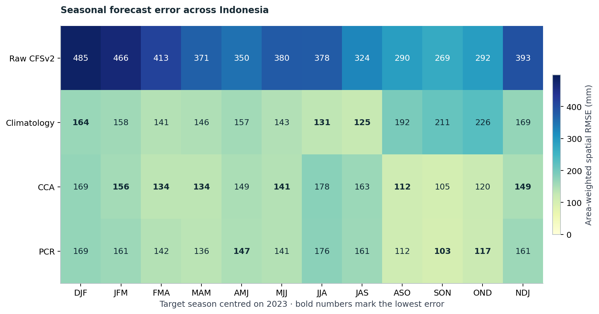
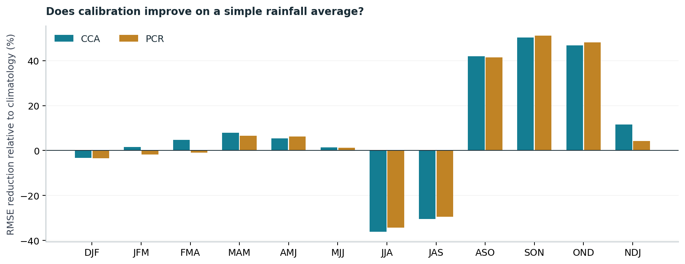
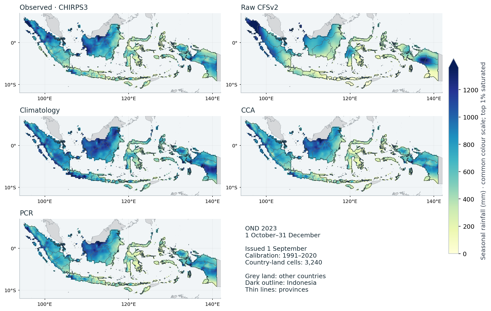
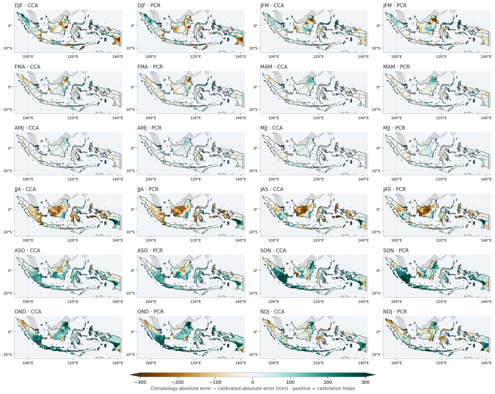
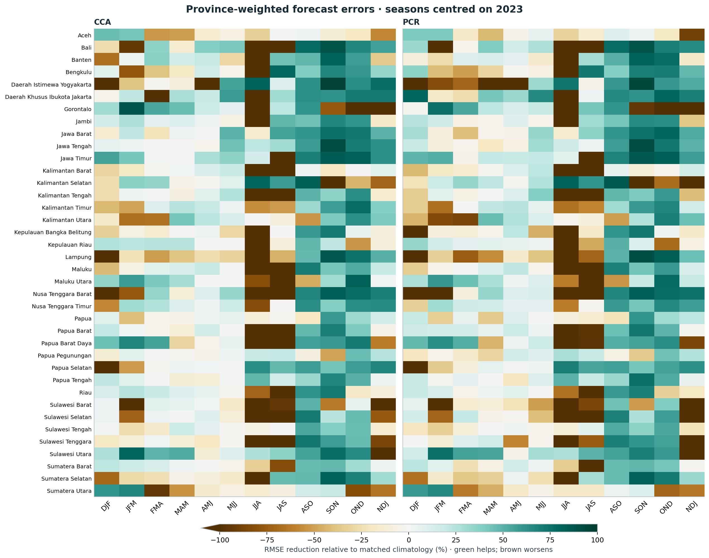
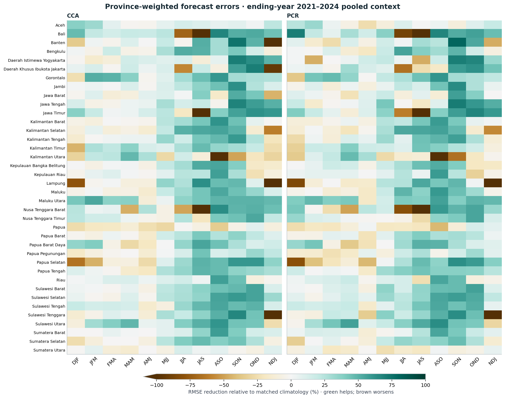
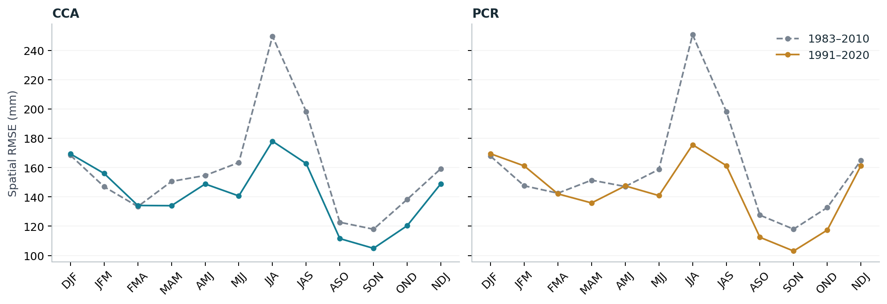
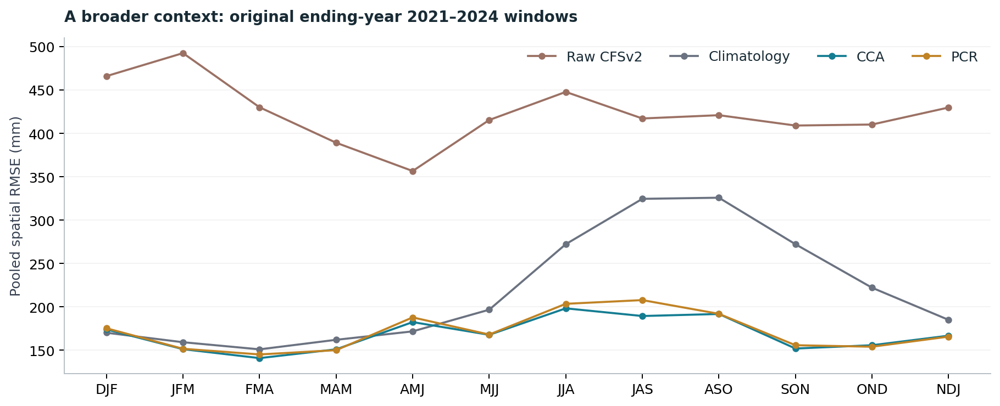

```{ojs}
//| echo: false
//| output: false
import {selectControl, nationalHeatmap, gainBars, rainfallMaps, errorMaps, provinceView, sensitivity, nationalContext} from "../assets/story/story.js"
storyData = FileAttachment("../assets/story/metrics.json").json()
trainingOptions = [["1991_2020", "1991–2020 (main)"], ["1983_2010", "1983–2010 (sensitivity)"]]
mapFiles = ({fields: FileAttachment("../assets/story/fields.json").url(),
  indonesia: FileAttachment("../data/boundaries/indonesia.geojson").url(),
  provinces: FileAttachment("../data/boundaries/provinces.geojson").url(),
  neighbours: FileAttachment("../data/boundaries/neighbours.geojson").url()})
```

::: {.eyebrow}
Seasonal rainfall · Indonesia · 0.25° observation grid
:::

Imagine receiving a rainfall forecast for October to December. A map full of
detail tells you where the model expects rain. It does not tell you whether
those details are useful. For that, the forecast needs to face an observation
reference and an alternative that asks very little of the model: the average
rainfall observed in previous years.

Here we make that comparison across twelve seasons. Each is a three-month
window, shifted forward by one month, with its midpoint in 2023. The question is
whether statistical calibration improves the raw forecast, whether it also
improves on climatology, and how the answer changes across seasons and locations.

Hover or tap a figure to inspect its values. The controls let you explore other
seasons, score types and provinces; the story's main comparison remains 1991–2020.
Use **Download current view (PNG)** to save a figure with your selections and its
legend. Charts also offer **Download current view (SVG)** for scalable vector
figures with editable text. **Notebook reference PNG** links open the original executed figures;
their labels identify the metric or coverage they contain. Expandable data
tables provide numeric downloads.

::: {.callout-note title="The short result"}

:::

## Four ways to forecast the same rainfall

All four methods are evaluated against the same CHIRPS3 rainfall totals on the
same 3,240 country-land grid cells. The **raw forecast** is the CFSv2 ensemble
mean, supplied at 1° and interpolated to the observation grid. **Climatology**
predicts the observed training-period average for each place and season.

**PCR** and **CCA** learn relationships between model rainfall patterns and
observed rainfall. PCR compresses the predictor field into a small set of
components before regression. CCA also compresses the observation field and
relates the two sets of patterns. The [IRI teaching reference](https://iri.columbia.edu/~awr/pycpt/seasonal-jupyterbook/html_2sep2023/cpt.html)
introduces both approaches and the role of cross-validation.

For this illustration, the calibrated models use 1991–2020 training data. They
retain fixed, small mode counts: three predictor EOFs for both methods, and
three predictand EOFs plus two CCA modes for CCA. These counts were held fixed
across the experiment; they are not claimed to be optimal for Indonesia.

The forecasts are evaluated over full Indonesia, rather than a selection of
locations where calibration happened to work. The 0.25° grid describes the
observation aggregation and forecast output. It does not establish that the
dynamical model predicts rainfall independently at that spatial resolution.

## A year needs a careful calendar

DJF in this story means December 2022–February 2023. At the other end of the
sequence, NDJ means November 2023–January 2024. That final window is stored as
**NDJ 2024** in the research files, because those files label seasons by their
ending year. We preserve that label and show actual dates in the notebook.

Each forecast is initialized one month before its target begins. This holds the
lead design consistent across seasons. These are archived historical forecasts,
verified later against current-vintage observations, not a reconstruction of
every data product exactly as it existed on the original issue date.

::: {.callout-important title="Twelve windows are not twelve independent years"}
Adjacent seasons share two months. Counting more overlapping windows does not
turn this one-year case study into twelve independent annual validation samples.
:::

## Start with the national comparison

The chart measures spatial error across the country. Lower RMSE means smaller
errors, with larger local errors receiving more weight. It is **not** the error
of a single national-mean rainfall value. Every method uses identical observed
totals and country-land weights.

::: {#interactive-national .story-interactive data-story-panel="national"}

```{ojs}
//| echo: false
viewof nationalMetric = selectControl("National score", [["rmse", "RMSE"], ["mae", "MAE"], ["bias", "Bias"]], "rmse")
nationalHeatmap(storyData, nationalMetric)
```

<p class="story-caption">National forecast scores across twelve seasons.</p>
<p class="story-downloads"><a href="../assets/seasonal-2023/rmse-overview.png">Notebook reference PNG (RMSE)</a> · <a href="../notebooks/indonesia-seasons-2023.ipynb#fig-rmse-overview">Executed notebook figure</a></p>
<noscript></noscript>

:::


The first benchmark asks whether calibration improves on the raw model. The
second asks whether it beats climatology. These are different hurdles. A model
can become much less biased after calibration yet still offer little advantage
over the historical average for a particular season.

The next chart makes the second comparison explicit. Values below zero favour
climatology. Small positive differences deserve the same caution as small
negative ones: this experiment reports their size, without assigning statistical
significance to them.

::: {#interactive-gains .story-interactive data-story-panel="gains"}

```{ojs}
//| echo: false
viewof gainPeriod = selectControl("Calibration period for reduction chart", trainingOptions, "1991_2020")
gainBars(storyData, gainPeriod)
```

<p class="story-caption">RMSE reduction against the selected training-period climatology. Positive is better.</p>
<p class="story-downloads"><a href="../assets/seasonal-2023/gain-bars.png">Notebook reference PNG (1991–2020)</a> · <a href="../notebooks/indonesia-seasons-2023.ipynb#fig-gain-bars">Executed notebook figure</a></p>
<noscript></noscript>

:::


For the main 2023 selection, DJF, JJA and JAS are reminders to keep the simple
baseline in view. Neither calibrated method has the lowest national RMSE there.
That finding would disappear from a tutorial restricted to a successful OND example.

## Work through OND

OND is a useful place to examine the workflow in detail. A forecast initialized
on 1 September 2023 is compared with accumulated rainfall from 1 October to
31 December. In the notebook, the exact training inputs are loaded, their dates
are checked, and their observed average is compared with the saved climatology.
An optional cell shows the CCA and PCR calls and can rerun them in new scratch
directories in the tested PyCPT fitting environment. Reading the executed notebook
or running its default saved-results analysis needs no PyCPT/CPT installation or
IRI Data Library key; the [requirements guide](../guides/start.qmd) explains the distinction.

::: {#interactive-rainfall .story-interactive data-story-panel="rainfall"}

```{ojs}
//| echo: false
viewof rainfallSeason = selectControl("Rainfall map season", storyData.seasons, "OND")
viewof rainfallPeriod = selectControl("Rainfall map training period", trainingOptions, "1991_2020")
rainfallPlot = {
  const view = rainfallMaps(storyData, mapFiles, rainfallSeason, rainfallPeriod);
  invalidation.then(() => view.dispose());
  return view;
}
```

<p class="story-caption">Start with OND, then explore the other windows. The five maps always use one common rainfall scale for the selected season.</p>
<p class="story-downloads"><a href="../assets/seasonal-2023/ond-maps.png">Notebook reference PNG (OND 2023; 1991–2020)</a> · <a href="../notebooks/indonesia-seasons-2023.ipynb#fig-ond-maps">Executed notebook figure</a></p>
<noscript></noscript>

:::




Grey land shows other countries. Indonesia is unfilled by the boundary overlay,
with a dark country outline and thin province lines over the rainfall fields.
These display boundaries do not change the evaluation footprint or scores.

The common map scale helps expose differences between the raw field, the
observed reference and the calibrated fields. Inspecting these patterns is
useful, but visual resemblance is not the scoring rule. The reported ranking
comes from cell-by-cell errors on the shared footprint.

## National improvement can hide local deterioration

The map explorer below compares local absolute errors with climatology. Green cells
show where calibration reduced the error; brown cells show where the average
was closer to the observation. Choose any of the twelve windows or display
them together; both CCA and PCR remain available.

::: {#interactive-error-maps .story-interactive data-story-panel="error-maps"}

```{ojs}
//| echo: false
viewof errorSeason = selectControl("Local-error map season", [["all", "All twelve seasons"], ...storyData.seasons.map(s => [s,s])], "JJA")
viewof errorPeriod = selectControl("Local-error map training period", trainingOptions, "1991_2020")
errorPlot = {
  const view = errorMaps(storyData, mapFiles, errorSeason, errorPeriod);
  invalidation.then(() => view.dispose());
  return view;
}
```

<p class="story-caption">Explore both calibrated methods in any season, or show all twelve. Positive local absolute-error reduction favours calibration; colours saturate beyond ±300 mm.</p>
<p class="story-downloads"><a href="../assets/seasonal-2023/error-atlas.png">Notebook reference PNG (all 12 seasons; 1991–2020)</a> · <a href="../notebooks/indonesia-seasons-2023.ipynb#fig-error-atlas">Executed notebook figure</a></p>
<noscript></noscript>

:::


A favourable national score does not mean every island or district benefited.
It would be premature to translate these maps directly into recommendations for
planting, drought response or rainfall onset.

## Do the provinces tell the same story?

We now summarize the same cell errors for all 38 supplied provinces, using
unchanged model forecasts. The analysis assigns original country-native 0.05°
pixel centres to the unsimplified province polygons and sums their area-weight
shares within each existing 0.25° cell. It uses no province-specific fitting or
selection of favourable locations.



::: {#interactive-province .story-interactive data-story-panel="province"}

```{ojs}
//| echo: false
viewof provinceRegion = selectControl("Province", [["all", "All 38 provinces"], ...storyData.support.filter(r => r.isProvince).map(r => [r.name,r.name]).sort((a,b) => a[0].localeCompare(b[0]))], "all")
viewof provincePeriod = selectControl("Province training period", trainingOptions, "1991_2020")
provinceView(storyData, provinceRegion, provincePeriod, false)
```

<p class="story-caption">All 38 provinces are included. Choose one province for a four-method seasonal comparison. These are province-weighted views of existing 0.25° cell errors.</p>
<p class="story-downloads"><a href="../assets/seasonal-2023/province-gains-2023.png">Notebook reference PNG (all 38 provinces; 1991–2020)</a> · <a href="../notebooks/indonesia-seasons-2023.ipynb#fig-province-gains">Executed notebook figure</a></p>
<noscript></noscript>

:::


Each province gets its own normalized weights, so small and large provinces can
be compared against their own climatology. The colour scale shows relative
error reduction; the numeric downloads retain RMSE, MAE and bias for both
training periods, the raw model and matched climatologies.



::: {#interactive-province-context .story-interactive data-story-panel="province-context"}

```{ojs}
//| echo: false
provinceView(storyData, provinceRegion, provincePeriod, true)
```

<p class="story-caption">Original ending-year 2021–2024 pooled context, including 2023. This view follows the province and training-period controls above.</p>
<p class="story-downloads"><a href="../assets/seasonal-2023/province-gains-context.png">Notebook reference PNG (all 38 provinces; 1991–2020)</a> · <a href="../notebooks/indonesia-seasons-2023.ipynb#fig-province-context">Executed notebook figure</a></p>
<noscript></noscript>

:::


The second figure adds the original ending-year 2021–2024 context, including 2023.
It is not an independent validation set. A green cell in one year does not
establish stable provincial forecast skill.

These are **province-weighted views of coarse-cell errors**. A grid cell shared
by two provinces retains the same forecast and observation error in both, with
different weight shares. This does not resolve province-only rainfall inside
the cell. The notebook reports cell support and the largest single-cell weight
share, which matter especially for small provinces, alongside an assignment
audit map. See the [regional provenance](../data/regions/provenance.json) and
[province scores](../assets/seasonal-2023/province-verification-2023.nc), or the
[four-method OND table](../notebooks/indonesia-seasons-2023.ipynb#tbl-province-ond).

## How much depends on the training period?

We also keep the 1983–2010 fits. Comparing them with 1991–2020 changes the sample
count as well as the years and fitted patterns. It is a sensitivity experiment,
not a rule to choose whichever period happens to give the most attractive map
for a particular season.

::: {#interactive-sensitivity .story-interactive data-story-panel="sensitivity"}

```{ojs}
//| echo: false
viewof sensitivityMethod = selectControl("Method for period comparison", ["CCA", "PCR"], "CCA")
sensitivity(storyData, sensitivityMethod)
```

<p class="story-caption">Compare fixed training intervals for the same targets. Changing the interval changes both sample count and fitted relationships.</p>
<p class="story-downloads"><a href="../assets/seasonal-2023/training-sensitivity.png">Notebook reference PNG (CCA and PCR)</a> · <a href="../notebooks/indonesia-seasons-2023.ipynb#fig-training-sensitivity">Executed notebook figure</a></p>
<noscript></noscript>

:::


The older interval starts in 1983 so that every season has a common set of
available initializations. This is a design choice, not a universal CPT training
period. Climatology baselines are calculated from each fit's own training years.

## Look beyond this one selection

The original research benchmark contains four ending-year labels, 2021–2024.
Its pooled comparison provides context for the 2023 case and shows whether the
same broad conclusions persist across more than one target year.

::: {#interactive-context .story-interactive data-story-panel="context"}

```{ojs}
//| echo: false
viewof contextMetric = selectControl("Pooled context score", [["rmse", "RMSE"], ["mae", "MAE"], ["bias", "Bias"]], "rmse")
nationalContext(storyData, contextMetric)
```

<p class="story-caption">Pooled scores retain the original ending-year 2021–2024 labels. Equal-year MSE precedes the square root for RMSE.</p>
<p class="story-downloads"><a href="../assets/seasonal-2023/multiyear-context.png">Notebook reference PNG (RMSE; 1991–2020)</a> · <a href="../notebooks/indonesia-seasons-2023.ipynb#fig-multiyear-context">Executed notebook figure</a></p>
<noscript></noscript>

:::


Here the year convention is the original one: for NDJ, the four windows run from
November 2020–January 2021 through November 2023–January 2024. This is not four
complete collections of seasons centred on calendar years. AMJ climatology
remains competitive in this broader comparison even though the main 2023
selection favours calibration there. That difference is a reason to retain the
broader context rather than treating one year as a forecast-system verdict.

## What this first study supports

Calibration can substantially change the errors in these historical forecasts,
and its value depends on season, location, baseline and training interval. A
useful tutorial should show those dependencies and the cases where calibration
does not win.

This study does not establish general operational skill or probability
reliability. It uses gridded observations, a mixed reforecast/operational model
archive and only a few verification years. Longer independent validation,
regional diagnostics and physical interpretation of the fitted patterns remain
necessary before a recommended forecasting configuration.

Continue with the [executed notebook](../notebooks/indonesia-seasons-2023.ipynb),
the [reproduction guide](../guides/reproduce.qmd), or the
[methods and limitations](../guides/methods.qmd). The notebook exports the
[numeric scores](../assets/seasonal-2023/verification-2023.nc),
[calendar](../assets/seasonal-2023/calendar.csv), and
[computed findings](../assets/seasonal-2023/findings.json) behind this story.

## References {.unnumbered .reference-section}


