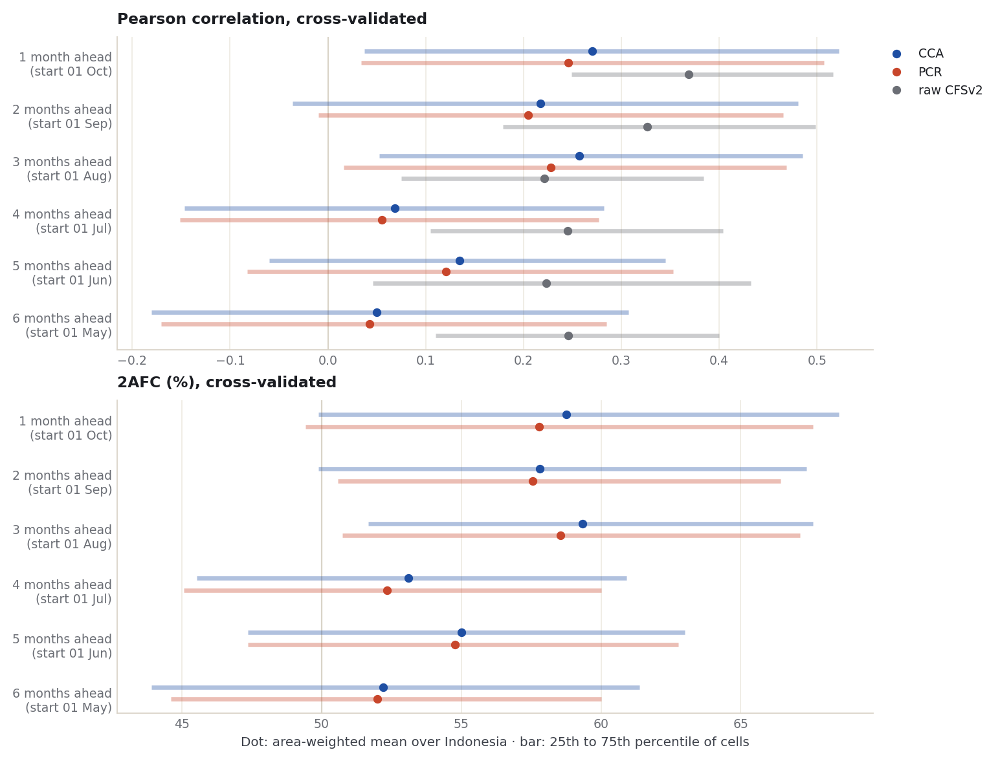
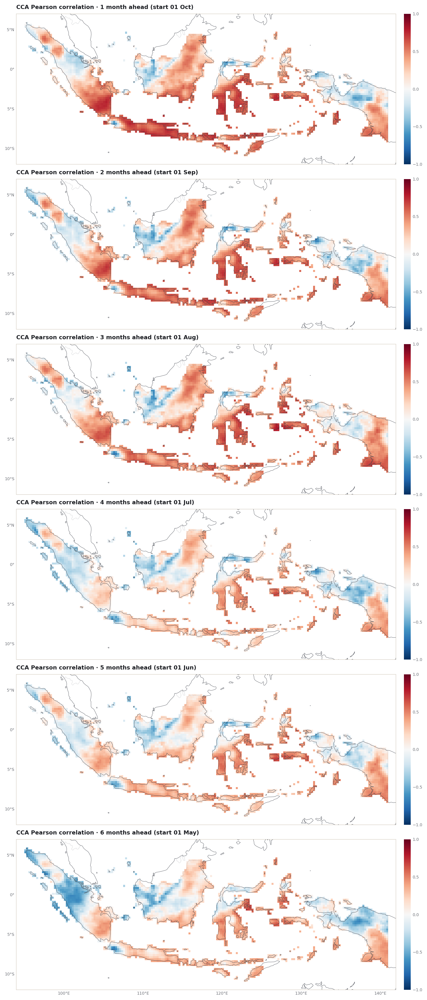
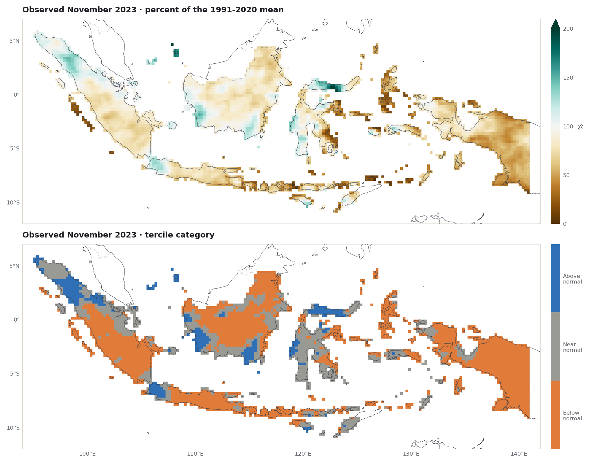
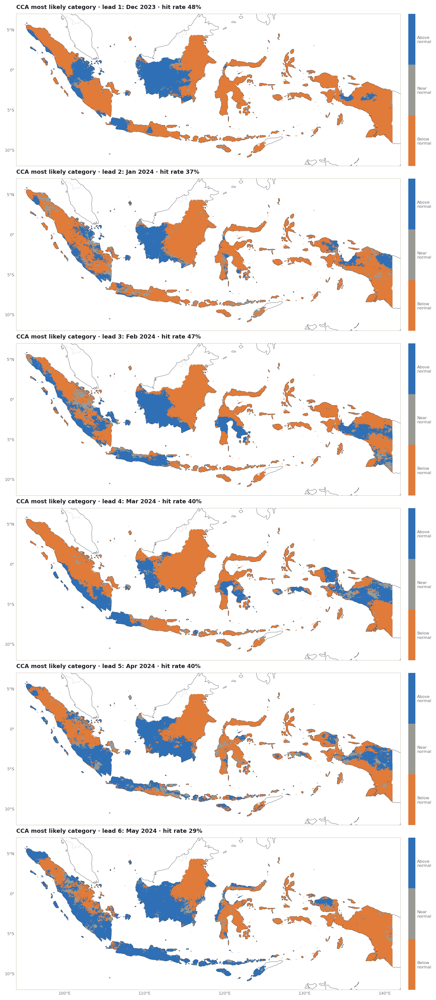

::: {.eyebrow}
Case 03 · Lead time · Monthly rainfall · Full Indonesia
:::

A forecast for November can be issued at the start of October, or in September,
or as early as May. The earlier it is issued, the more time there is to act on it,
and, usually, the less there is to trust. This case measures that trade-off for
one month, November 2023, over Indonesia.

The setup is the one used throughout the tutorial, with one change: the target is
a **single month** rather than a three-month season. Six forecasts were made for
the same month, starting one to six months before it. Everything else is fixed:
the model (CFSv2), the observations (CHIRPS v3.0), the calibration settings, and
the 30 training years. So the only difference between them is how far ahead each
was made. All numbers on this page come from the
[executed notebook](../notebooks/monthly-leads-2023.ipynb).

::: {.callout-note title="The short result"}
- Cross-validated skill is modest at every lead and **roughly halves beyond three
  months**: the area-mean CCA correlation is 0.22 to 0.27 for starts one to three
  months ahead and 0.05 to 0.13 for starts four to six months ahead.
- The decline is **not smooth**. Three months ahead scores slightly better than
  two, and five better than four.
- The **raw CFSv2** correlation, with no calibration, is higher than the
  calibrated one at five of the six leads.
- November 2023 was **dry**: below normal over 60% of Indonesia's area. Every
  forecast leaned dry and beat climatological odds (RPSS 0.16 to 0.31), but its
  hit rate was no better than forecasting "below normal" everywhere.
:::

## Six questions, one target month

The **lead** on this page is the number of whole months between the start date and
1 November. PyCPT counts from the start to the middle of the target month, so its
own lead values are half a month larger.

| Lead | Start | PyCPT lead | Hindcast starts |
| --- | --- | --- | --- |
| 1 month | 1 Oct 2023 | 1.5 | 1 Oct, 1991-2020 |
| 2 months | 1 Sep 2023 | 2.5 | 1 Sep, 1991-2020 |
| 3 months | 1 Aug 2023 | 3.5 | 1 Aug, 1991-2020 |
| 4 months | 1 Jul 2023 | 4.5 | 1 Jul, 1991-2020 |
| 5 months | 1 Jun 2023 | 5.5 | 1 Jun, 1991-2020 |
| 6 months | 1 May 2023 | 6.5 | 1 May, 1991-2020 |

Each start is downloaded into its own PyCPT case folder with `download_data` and
fitted with `evaluate_models`, using **CCA** (3 predictor and 3 predictand EOFs,
2 CCA modes) and **PCR** (3 predictor EOFs), cross-validation with a window of
5 years, and training on Novembers 1991-2020. These settings are the ones used in
the [Fit & diagnose case](fit-diagnose-2023.qmd) and were fixed before any skill
was computed. The twelve fits took 32 to 37 seconds each.

## November rainfall from dekads

The observations are **CHIRPS v3.0** November totals. The local archive stores
rainfall by **dekad** (days 1-10, 11-20 and 21 to the end of the month), with exact
zeros kept. A November total is the sum of its three dekads; the notebook checks
from the stored time bounds that they run contiguously from 1 November to
1 December in every year before adding them.

As a cross-check against a separately stored product, October to December built
from nine dekads matches the archive's own 3-month total to within 0.0002 mm for
1991 and 2023, with the same missing pixels. The 0.05° totals are then averaged to
the tutorial's 0.25° Indonesia land grid
([chapter 3](../learn/03-local-observations.ipynb)): 3,240 cells, all complete in
the 30 training Novembers. The 1991-2020 November mean over these cells is
257 mm.

## Skill fades with lead, but not smoothly

The chart shows three cross-validated scores for each lead. The dot is the
area-weighted mean over Indonesia; the bar spans the middle half of the cells,
from the 25th to the 75th percentile. **Pearson correlation** is 0 for no linear
relationship. **2AFC** is the chance that the forecast ranks two different years
in the observed order, 50% for no skill
[(Mason and Weigel 2009)](https://doi.org/10.1175/2008MWR2553.1).

{fig-alt="Two dot-and-bar charts stacked vertically. Top: Pearson correlation by lead for CCA, PCR and raw CFSv2. Bottom: 2AFC by lead for CCA and PCR."}

| Lead | CCA Pearson | PCR Pearson | Raw CFSv2 Pearson | CCA 2AFC (%) | PCR 2AFC (%) |
| --- | --- | --- | --- | --- | --- |
| 1 month | 0.27 | 0.25 | 0.37 | 58.8 | 57.8 |
| 2 months | 0.22 | 0.20 | 0.33 | 57.8 | 57.6 |
| 3 months | 0.26 | 0.23 | 0.22 | 59.3 | 58.6 |
| 4 months | 0.07 | 0.06 | 0.24 | 53.1 | 52.3 |
| 5 months | 0.13 | 0.12 | 0.22 | 55.0 | 54.8 |
| 6 months | 0.05 | 0.04 | 0.25 | 52.2 | 52.0 |

: Area-weighted means over 3,240 cells, 1991-2020. Source: [skill-by-lead.csv](../data/monthly-2023/skill-by-lead.csv).

Three observations:

1. **One to three months ahead the calibrated forecasts carry some skill; four
   to six months ahead, little.** CCA's mean correlation drops from 0.22-0.27 to
   0.05-0.13, and its 2AFC from 58-59% to 52-55%.
2. **The decline is not monotonic.** With 30 years per cell, differences of a few
   hundredths in a mean correlation may be sampling variation. This was not
   tested here, so the ordering of neighbouring leads should not be read as real.
3. **CCA is slightly ahead of PCR at every lead**, by up to 0.03 in correlation.

## The raw model correlates better than the calibrated forecasts

The raw CFSv2 hindcasts, interpolated from 1° to the cells and with no calibration
at all, have a higher mean correlation than CCA and PCR at five of the six leads,
and they lose much less with lead (0.37 at one month, 0.25 at six). Only at three
months is the calibrated forecast ahead.

This is a measurement, not an explanation. Two features of the comparison are
known to work against the calibrated forecasts, and neither was tested here:

- The calibrated scores are **cross-validated**: each year is predicted by a model
  fitted without it and its neighbours. Cross-validated correlations of
  regression forecasts are known to be biased low when the true skill is small
  [(Barnston and van den Dool 1993)](https://doi.org/10.1175/1520-0442(1993)006%3C0963:ADICVS%3E2.0.CO;2).
  The raw model has nothing fitted, so it pays no such cost.
- CCA and PCR see the predictor through **3 EOF patterns** of a large domain
  (85-155°E, 20°S-20°N). A local signal that the raw model has at a cell may not
  survive that compression.

Correlation also ignores bias, which is the raw model's main weakness: its
1991-2020 November mean over the predictand box is 190-230 mm depending on the
lead, against an observed 257 mm. Calibration maps the forecasts onto observed
November amounts, so it removes that bias by design. What
this case shows is narrower: for November, calibration with these fixed settings
did not improve the correlation the model already had. Choosing settings per lead
(for example, a range of modes instead of fixed numbers) is a possible next step,
but it would need its own cross-validation to avoid tuning to the same 30 years.

## Where the skill is

Area means hide where skill sits. The maps show CCA's cross-validated correlation
at each lead, one month ahead at the top to six months at the bottom. Read by eye:
at one to three months the higher correlations are in southern Sumatra, Java and
the islands to its east, Sulawesi and eastern Kalimantan, while western Kalimantan
and northern Papua stay near or below zero at every lead.

{fig-alt="Six maps of Indonesia stacked vertically, one per lead from one to six months, showing CCA cross-validated correlation per 0.25 degree cell."}

## What happened in November 2023

November 2023 was dry over most of Indonesia: area-weighted mean rainfall was
208 mm, against the 1991-2020 November mean of 257 mm. By tercile category,
**60.3%** of the area was below normal, 30.6% near normal and 9.2% above normal.
The wetter exceptions were mainly northern Sumatra, parts of southern Kalimantan,
western Java and the northern arm of Sulawesi.

{fig-alt="Two maps of Indonesia stacked vertically: November 2023 rainfall as percent of normal, and its tercile category."}

Every forecast favoured below normal, over 75% to 97% of the area depending on
lead and method. The map column shows CCA's most likely category at each lead
under the observed categories.

{fig-alt="Seven maps of Indonesia stacked vertically: observed tercile category for November 2023, then CCA's most likely category at leads one to six months."}

Three scores for this one month, each area-weighted:

| Lead | Method | Hit rate (%) | RPSS 2023 | RMSE 2023 (mm) | Mean forecast (mm) |
| --- | --- | --- | --- | --- | --- |
| 1 month | CCA | 60.0 | 0.29 | 71.0 | 178 |
| 1 month | PCR | 59.7 | 0.29 | 72.2 | 176 |
| 2 months | CCA | 59.0 | 0.27 | 62.7 | 215 |
| 2 months | PCR | 56.9 | 0.25 | 64.8 | 215 |
| 3 months | CCA | 60.6 | 0.31 | 61.0 | 204 |
| 3 months | PCR | 60.1 | 0.29 | 62.5 | 204 |
| 4 months | CCA | 59.5 | 0.18 | 66.8 | 236 |
| 4 months | PCR | 59.5 | 0.17 | 67.7 | 237 |
| 5 months | CCA | 60.8 | 0.27 | 59.9 | 218 |
| 5 months | PCR | 60.1 | 0.25 | 61.9 | 219 |
| 6 months | CCA | 55.2 | 0.17 | 68.5 | 235 |
| 6 months | PCR | 54.1 | 0.16 | 69.8 | 234 |

: November 2023, observed mean 208 mm. Source: [november-2023-forecasts.csv](../data/monthly-2023/november-2023-forecasts.csv).

- **Hit rate** is the share of area where the most likely category was the one
  observed. Forecasting "below normal" everywhere would have scored **60.3%**,
  and the best forecast scored 60.8%. Beyond leaning dry, the forecasts added no
  measurable skill in placing the categories this month.
- **RPSS 2023** compares the forecast probabilities with climatological odds
  (33/34/33%) using the ranked probability score
  [(Epstein 1969)](https://doi.org/10.1175/1520-0450(1969)008%3C0985:ASSFPF%3E2.0.CO;2).
  It is positive at every lead: leaning dry was better than having no opinion in
  a month that was mostly dry. For a single month this rewards being right about
  2023, not the forecast's skill in general.
- **The deterministic forecasts** were closest in mean amount at two and three
  months ahead (215 and 204 mm against 208 mm). The one-month forecast was the
  driest, at 178 mm.

## What this does and does not show

This is one target month, one model, one set of fixed settings and one verifying
year. It shows, for CFSv2 November rainfall over Indonesia, that cross-validated
skill is concentrated in the first three months of lead and that calibration with
these settings did not raise the correlation above the raw model's. It does not
show how other months, models or settings behave, and the 2023 scores describe
one outcome only.

The same design is applied to the season in the
[October-December case](seasonal-leads-2023.qmd), which also compares the two lead
by lead: the season's forecasts score much higher than the month's. The
[dekad case](dekad-leads-2023.qmd) goes to the subseasonal scale: October-December
dekads forecast one to three dekads ahead with GEFSv12.

## Files

- [Executed notebook](../notebooks/monthly-leads-2023.ipynb): every number and figure on this page
- [Skill by lead (CSV)](../data/monthly-2023/skill-by-lead.csv) · [November 2023 forecasts and scores (CSV)](../data/monthly-2023/november-2023-forecasts.csv) · [Run summary (JSON)](../data/monthly-2023/summary.json)
- [Maps (NetCDF)](../data/monthly-2023/monthly-2023-maps.nc): observed 2023 rainfall and category, correlation and most likely category for every lead and method

## References {.unnumbered .reference-section}


