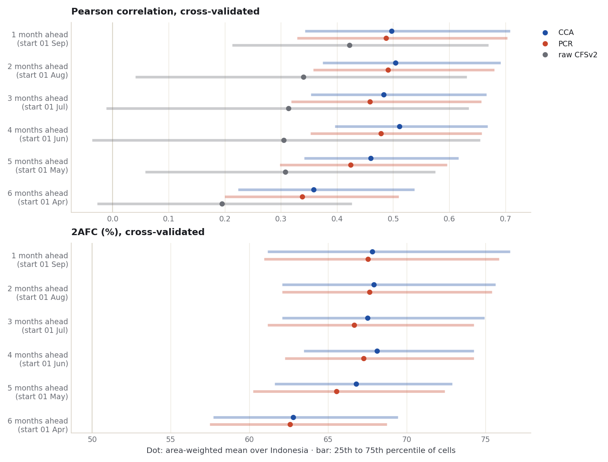
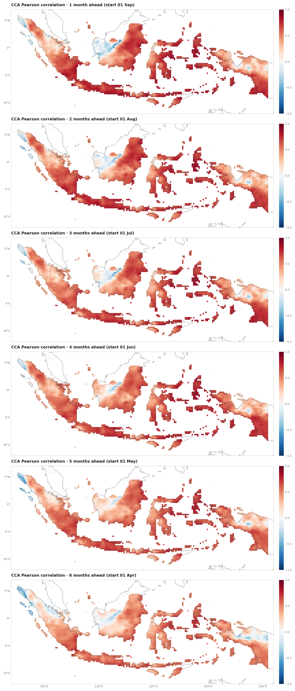
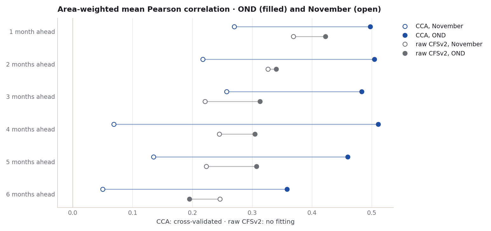
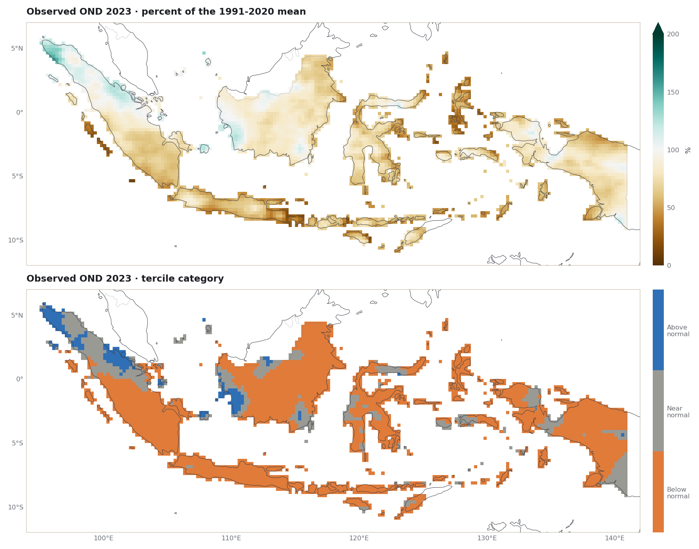
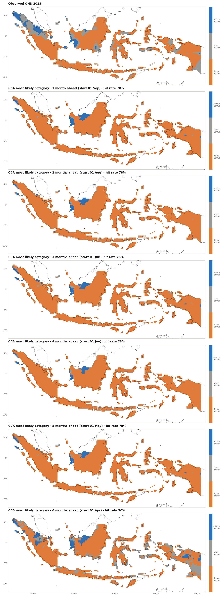

::: {.eyebrow}
Case 04 · Lead time · Seasonal rainfall · Full Indonesia
:::

The [November case](monthly-leads-2023.qmd) asked how a forecast for one month
changes as it is made earlier. This case asks the same question for the season
used throughout the tutorial, **October to December (OND) 2023**, with the same
model, observations, grid, settings and lead definition. Only the target changes,
from one month to three. All numbers on this page come from the
[executed notebook](../notebooks/seasonal-leads-2023.ipynb).

::: {.callout-note title="The short result"}
- Cross-validated skill **holds from one to five months ahead** and drops at six:
  the area-mean CCA correlation is 0.46 to 0.51 for starts one to five months
  ahead and 0.36 six months ahead.
- Here **calibration beats the raw model at every lead**, by 0.08 to 0.21 in
  correlation. In the November case it was the other way round.
- At every lead the OND forecasts are **much more skilful than the November
  ones**: CCA's correlation is 0.23 to 0.44 higher.
- OND 2023 was **dry**: below normal over 77% of Indonesia's area. Every forecast
  leaned dry and beat climatological odds (RPSS 0.30 to 0.60), but no hit rate
  was more than 1.3 points above forecasting "below normal" everywhere.
:::

## Six starts for one season

The **lead** is the number of whole months between the start date and 1 October,
the first day of the season. PyCPT gives a lead for each month of the season,
measured to the middle of that month, so each start covers three PyCPT leads.

| Lead | Start | PyCPT leads | Hindcast starts |
| --- | --- | --- | --- |
| 1 month | 1 Sep 2023 | 1.5 to 3.5 | 1 Sep, 1991-2020 |
| 2 months | 1 Aug 2023 | 2.5 to 4.5 | 1 Aug, 1991-2020 |
| 3 months | 1 Jul 2023 | 3.5 to 5.5 | 1 Jul, 1991-2020 |
| 4 months | 1 Jun 2023 | 4.5 to 6.5 | 1 Jun, 1991-2020 |
| 5 months | 1 May 2023 | 5.5 to 7.5 | 1 May, 1991-2020 |
| 6 months | 1 Apr 2023 | 6.5 to 8.5 | 1 Apr, 1991-2020 |

The one-month-ahead start, 1 September, is the running example of
[Learn PyCPT](../learn/01-first-case.ipynb). The CFSv2 entry in PyCPT's catalog
supplied hindcasts and a 2023 forecast for every start, including the April start
that reaches PyCPT lead 8.5. Each request multiplies the daily mean by the 92 days
of the season, so the values are seasonal totals in millimetres although the files
are labelled `mm/day`.

CCA (3 predictor and 3 predictand EOFs, 2 CCA modes) and PCR (3 predictor EOFs)
were fitted at each start with `evaluate_models`, cross-validated with a window of
5 years and trained on OND 1991-2020. Twelve fits took 32 to 34 seconds each.

**Observations.** OND totals are the sum of nine CHIRPS v3.0 dekads, with the
stored time bounds checked to run from 1 October to 1 January in every year. Two
checks against the files used elsewhere in the tutorial: at 0.05° they match the
archive's own 3-month totals to within 0.0002 mm, and on the 0.25° grid they match
the OND observations of [chapter 3](../learn/03-local-observations.ipynb) and the
Fit & diagnose case to within 0.0003 mm, with the same 3,240 cells. As a further
consistency check, the one-month-ahead fit gives the same OND 2023 errors as the
0.25° fit of the [0.05° trial](https://github.com/bennyistanto/pycpt-tutorial/blob/main/research/cases/indonesia-ond-2023-005deg-trial/README.md),
which used the same predictor and settings: 124.08 mm for CCA and 118.68 mm for PCR.

## Skill holds for five months

The dot is the area-weighted mean over Indonesia; the bar spans the middle half of
the cells, from the 25th to the 75th percentile. Pearson correlation is 0 for no
linear relationship; 2AFC is 50% for no skill
[(Mason and Weigel 2009)](https://doi.org/10.1175/2008MWR2553.1).

{fig-alt="Two dot-and-bar charts stacked vertically. Top: Pearson correlation by lead for CCA, PCR and raw CFSv2. Bottom: 2AFC by lead for CCA and PCR."}

| Lead | CCA Pearson | PCR Pearson | Raw CFSv2 Pearson | CCA 2AFC (%) | PCR 2AFC (%) |
| --- | --- | --- | --- | --- | --- |
| 1 month | 0.50 | 0.49 | 0.42 | 67.8 | 67.5 |
| 2 months | 0.50 | 0.49 | 0.34 | 67.9 | 67.6 |
| 3 months | 0.48 | 0.46 | 0.31 | 67.5 | 66.6 |
| 4 months | 0.51 | 0.48 | 0.30 | 68.1 | 67.3 |
| 5 months | 0.46 | 0.42 | 0.31 | 66.8 | 65.5 |
| 6 months | 0.36 | 0.34 | 0.19 | 62.8 | 62.6 |

: Area-weighted means over 3,240 cells, 1991-2020. Source: [skill-by-lead.csv](../data/ond-leads-2023/skill-by-lead.csv).

1. **Calibrated skill is nearly flat from one to five months ahead.** CCA's mean
   correlation stays between 0.46 and 0.51 and its 2AFC between 66.8% and 68.1%.
   The small ups and downs (four months ahead scores highest) were not tested
   against sampling variation and should not be read as real.
2. **Six months ahead, skill drops** to 0.36 (CCA) and 62.8% 2AFC, still well
   above no skill on average.
3. **Calibration adds to the raw model at every lead.** The raw correlation falls
   from 0.42 one month ahead to 0.30-0.34 at two to five months and 0.19 at six;
   CCA is above it by 0.08 one month ahead and by 0.15 to 0.21 at longer leads.
   PCR is 0.01 to 0.04 below CCA.

The map column shows where. From one to five months ahead the higher
correlations cover most of Sumatra's south, Java and the islands to its east,
eastern Kalimantan, Sulawesi and southern Papua; the weakest area at every lead,
read by eye, is western Kalimantan.

{fig-alt="Six maps of Indonesia stacked vertically, one per lead from one to six months, showing CCA cross-validated correlation for OND per 0.25 degree cell."}

## The season scores higher than the month

The November case used the same model, observations, grid, settings and lead
definition, so the two can be compared lead by lead. The chart puts November
(open circles) and OND (filled) on one axis.

{fig-alt="Dot chart with one row per lead: open and filled circles for November and OND correlation, for CCA and for raw CFSv2, joined by a line."}

| Lead | CCA, OND | CCA, November | Raw, OND | Raw, November |
| --- | --- | --- | --- | --- |
| 1 month | 0.50 | 0.27 | 0.42 | 0.37 |
| 2 months | 0.50 | 0.22 | 0.34 | 0.33 |
| 3 months | 0.48 | 0.26 | 0.31 | 0.22 |
| 4 months | 0.51 | 0.07 | 0.30 | 0.24 |
| 5 months | 0.46 | 0.13 | 0.31 | 0.22 |
| 6 months | 0.36 | 0.05 | 0.19 | 0.25 |

: Area-weighted mean Pearson correlation. Source: [seasonal-vs-monthly.csv](../data/ond-leads-2023/seasonal-vs-monthly.csv).

Two differences stand out, and neither is explained by this comparison:

- **Calibrated skill is far higher for the season**, by 0.23 to 0.44, and it does
  not fall away after three months as November's did. A common explanation is
  that a three-month total averages out more of the weather within it than a
  single month does; that was not tested here.
- **Calibration helps the season but not the month.** For OND, CCA is above the
  raw model at every lead; for November, below it at five of six. The raw model's
  own correlation is similar for the two targets (within 0.1 at every lead), so
  the difference lies in what the calibration achieves. The November page lists
  two possible reasons, neither tested.

Lead is counted to the first month of each target, so at the same lead the OND
forecast also covers two later months. A comparison that matched the November
forecast with OND from the same start, or every month of the season separately,
would be a natural next step.

## What happened in October-December 2023

OND 2023 was dry over most of Indonesia: area-weighted mean rainfall was 602 mm,
against a 1991-2020 OND mean of 775 mm. By tercile category, **76.7%** of the area
was below normal, 18.2% near normal and 5.1% above normal.

{fig-alt="Two maps of Indonesia stacked vertically: OND 2023 rainfall as percent of normal, and its tercile category."}

From one to five months ahead, every forecast made below normal the most likely
category over 95% to 97% of the area (94.9% for PCR three months ahead). Six months ahead the CCA forecast still
favoured below normal over 73% of the area, with near normal over 20%.

{fig-alt="Seven maps of Indonesia stacked vertically: observed tercile category for OND 2023, then CCA's most likely category at leads one to six months."}

| Lead | Method | Hit rate (%) | RPSS 2023 | RMSE 2023 (mm) | Mean forecast (mm) |
| --- | --- | --- | --- | --- | --- |
| 1 month | CCA | 77.6 | 0.59 | 124.1 | 602 |
| 1 month | PCR | 77.2 | 0.58 | 118.7 | 602 |
| 2 months | CCA | 77.5 | 0.59 | 125.3 | 599 |
| 2 months | PCR | 77.3 | 0.59 | 121.5 | 596 |
| 3 months | CCA | 78.0 | 0.51 | 138.6 | 653 |
| 3 months | PCR | 77.2 | 0.50 | 137.1 | 652 |
| 4 months | CCA | 77.5 | 0.60 | 125.2 | 583 |
| 4 months | PCR | 77.4 | 0.59 | 126.2 | 582 |
| 5 months | CCA | 77.8 | 0.57 | 126.5 | 621 |
| 5 months | PCR | 77.1 | 0.56 | 129.2 | 620 |
| 6 months | CCA | 69.7 | 0.31 | 179.2 | 714 |
| 6 months | PCR | 69.3 | 0.30 | 183.3 | 716 |

: OND 2023, observed mean 602 mm. Source: [ond-2023-forecasts.csv](../data/ond-leads-2023/ond-2023-forecasts.csv).

- **Hit rate**: forecasting "below normal" everywhere would have scored
  **76.7%**. The forecasts one to five months ahead scored 77.1% to 78.0%, at
  most 1.3 points more; six months ahead they scored less. As in November, the
  forecasts got the dry season right but added little in placing the exceptions.
- **RPSS 2023**, against climatological odds with the ranked probability score
  [(Epstein 1969)](https://doi.org/10.1175/1520-0450(1969)008%3C0985:ASSFPF%3E2.0.CO;2),
  was 0.50 to 0.60 from one to five months ahead and about 0.30 at six. For one
  season this rewards leaning the right way in 2023, not skill in general.
- **The amounts**: from one to five months ahead the mean forecast was 582 to
  653 mm against 602 mm observed; six months ahead it was 714 to 716 mm, the
  wettest and the largest error (RMSE 179 to 183 mm).

## What this does and does not show

This is one season, one model, one set of fixed settings and one verifying year.
For CFSv2 OND rainfall over Indonesia, cross-validated skill changes little from
one to five months ahead, drops at six, and calibration with these settings adds
to the raw model at every lead. Set beside the November case, the season's forecasts score much
higher than the month's at every lead. Whether that holds for other
seasons, months and models was not tested.

The next time scale is **subseasonal**: the [dekad case](dekad-leads-2023.qmd)
forecasts each October-December dekad one to three dekads ahead with GEFSv12.

## Files

- [Executed notebook](../notebooks/seasonal-leads-2023.ipynb): every number and figure on this page
- [Skill by lead (CSV)](../data/ond-leads-2023/skill-by-lead.csv) · [Seasonal vs monthly (CSV)](../data/ond-leads-2023/seasonal-vs-monthly.csv) · [OND 2023 forecasts and scores (CSV)](../data/ond-leads-2023/ond-2023-forecasts.csv) · [Run summary (JSON)](../data/ond-leads-2023/summary.json)
- [Maps (NetCDF)](../data/ond-leads-2023/ond-leads-2023-maps.nc): observed 2023 rainfall and category, correlation and most likely category for every lead and method

## References {.unnumbered .reference-section}


