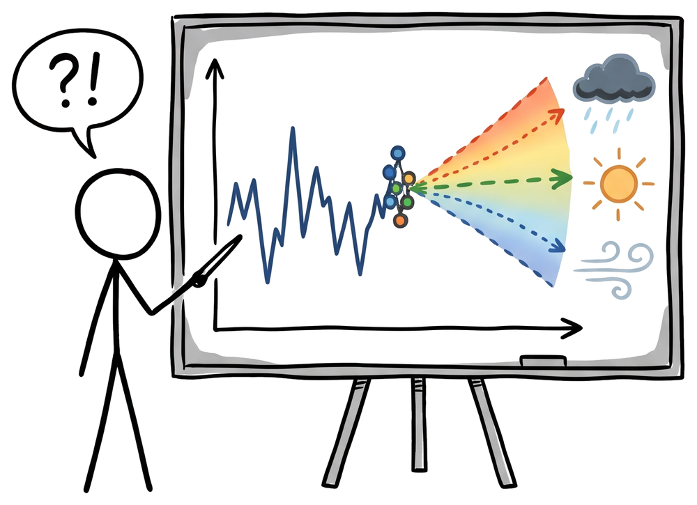
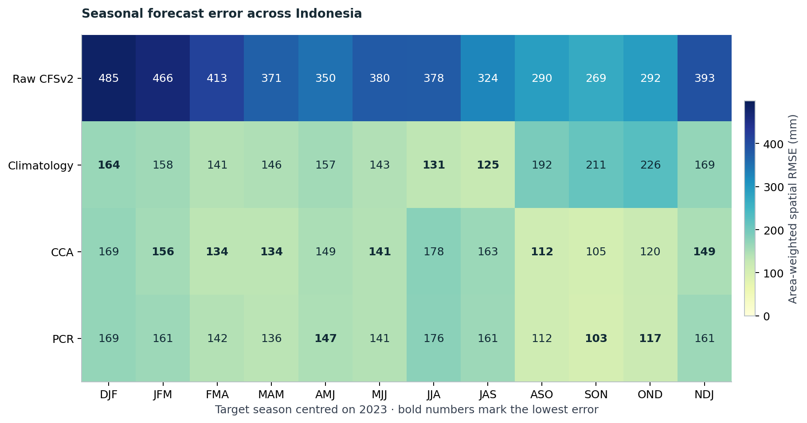
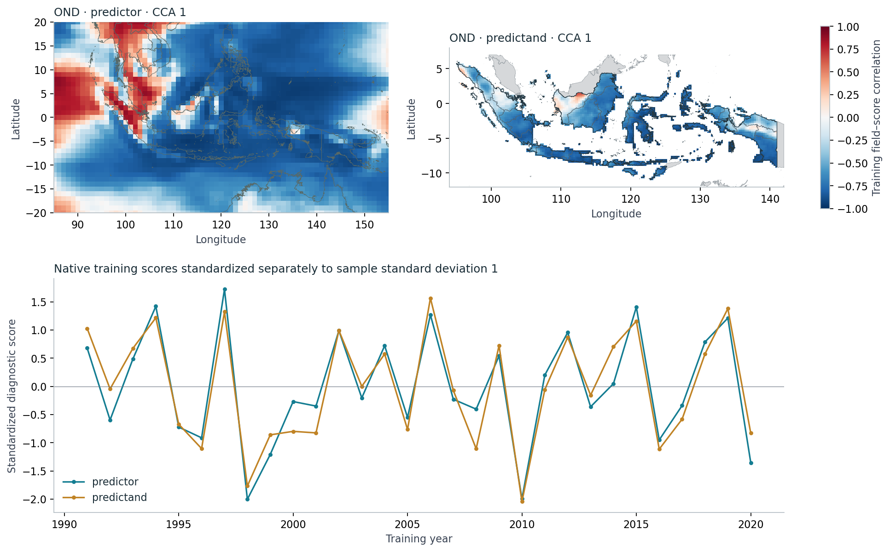

::: {.home-hero}
::: {.home-hero-text}
::: {.eyebrow}
A practical guide to climate prediction
:::

# Rainfall forecasts, *put to the test.* {.home-title .unnumbered}

::: {.home-intro}
Explore PyCPT through a real Indonesia case. Learn what calibration changes,
when a simple climatology forecast does better, and how to reproduce the evidence.
:::

::: {.home-actions}
[Explore the first case](chapters/indonesia-seasons-2023.qmd){.tutorial-button .tutorial-button-primary}
[Find your starting point](guides/start.qmd){.tutorial-button .tutorial-button-secondary}
:::

::: {.home-footnote}
Read in your browser. Run the companion notebooks when you are ready.
:::
:::

::: {.home-hero-art}
{.light-content .home-logo fig-alt="A stick figure points at a whiteboard chart that fans out into rain, sun and wind"}
{.dark-content .home-logo fig-alt="A stick figure points at a chalkboard chart that fans out into rain, sun and wind"}
:::
:::

::: {.home-section-intro}
## Choose your way in

You can follow the findings, work through the code, or prepare your environment.
:::

::: {.learning-paths}
::: {.learning-path}
::: {.path-number}
01 / Learn
:::

### Learn PyCPT step by step

Set up a case, download hindcasts and observations from the IRI Data Library,
bring your own observations, fit CCA with `evaluate_models`, read its
probabilities, combine seven models and adapt it all to your own region.
Every page is an executed notebook with real data.

[Start chapter 1 →](learn/01-first-case.ipynb){.path-link}
:::

::: {.learning-path}
::: {.path-number}
02 / Read
:::

### Follow the story

Explore interactive charts and maps. Compare CCA, PCR, the raw model and
climatology, including the seasons where calibration falls short.

[Read the Indonesia story →](chapters/indonesia-seasons-2023.qmd){.path-link}
:::

::: {.learning-path}
::: {.path-number}
03 / Reproduce
:::

### Work through the notebook

Follow the executed steps, inspect the calculations and use the saved data
bundle to reproduce the figures and scores offline.

[Open the executed notebook →](notebooks/indonesia-seasons-2023.ipynb){.path-link}
:::

::: {.learning-path}
::: {.path-number}
04 / Get ready
:::

### Set up your workspace

Check the requirements, download the complete tutorial kit and choose between
offline analysis and the optional PyCPT model-fitting workflow.

[Setup and downloads →](guides/reproduce.qmd){.path-link}
:::
:::

::: {.featured-case}
::: {.eyebrow}
Case 01 · Seasonal rainfall · Ready to explore
:::

## Twelve seasons over Indonesia

Does statistical calibration improve a rainfall forecast? Follow twelve
overlapping three-month windows centred on 2023, from the national comparison
to province-weighted outcomes. OND provides the worked example.

::: {.case-facts}
::: {.case-fact}
**Full Indonesia**

National and province views
:::
::: {.case-fact}
**CCA · PCR · Raw · Climatology**

Four methods, one observation reference
:::
::: {.case-fact}
**Story + executed notebook**

Figures, code and NetCDF downloads
:::
:::

{.case-preview}

::: {.preview-caption}
A preview from the executed notebook. The story adds interactive exploration;
PNG and SVG downloads let you take selected charts into your own work.
:::

::: {.home-actions}
[Read the case study](chapters/indonesia-seasons-2023.qmd){.tutorial-button .tutorial-button-primary}
[Review methods and limitations](guides/methods.qmd){.tutorial-button .tutorial-button-secondary}
:::
:::

::: {.featured-case}
::: {.eyebrow}
Case 02 · Fitting and diagnostics · Ready to explore
:::

## From rainfall inputs to a calibrated forecast

Run the workflow behind the maps. Follow four actual PyCPT fits for OND and JJA
2023, inspect model patterns and cross-validated residuals, and compare the
forecasts with a simple climatology baseline. The inputs are local and traceable.

{.case-preview}

::: {.preview-caption}
Training patterns describe fitted relationships. The story pairs them with
separate forecast errors and explains what each diagnostic can establish.
:::

::: {.home-actions}
[Read the fitting story](chapters/fit-diagnose-2023.qmd){.tutorial-button .tutorial-button-primary}
[Open the executed fitting notebook](notebooks/fit-diagnose-2023.ipynb){.tutorial-button .tutorial-button-secondary}
:::
:::

::: {.featured-case}
::: {.eyebrow}
Cases 03 to 05 · Lead time · Monthly, seasonal and dekad rainfall
:::

## How far ahead?

November 2023 and October-December 2023 forecast one to six months ahead, and
every October-December dekad forecast one to three dekads ahead. Skill by lead for
CCA, PCR and the raw model, and what each forecast said about a dry end to 2023.

::: {.home-actions}
[Read the November story](chapters/monthly-leads-2023.qmd){.tutorial-button .tutorial-button-primary}
[Read the OND story](chapters/seasonal-leads-2023.qmd){.tutorial-button .tutorial-button-secondary}
[Read the dekad story](chapters/dekad-leads-2023.qmd){.tutorial-button .tutorial-button-secondary}
:::
:::

::: {.home-closing}
## Learn the workflow behind the figure

The tutorial connects forecast maps to observations, baselines, calendars and
verification. Every case pairs an accessible story with an executed notebook
and traceable inputs. All cases are retrospective learning examples;
their results do not establish operational forecast skill or probability reliability.

[How to use this tutorial](guides/start.qmd) · [About the project and its sources](guides/about.qmd)
:::

::: {.home-colophon}
::: {.colophon-item}
**Who made this**

PyCPT Tutorial is a casual weekend project by
[Benny Istanto](https://benny.istan.to), written to learn PyCPT
in the open with real data. Corrections are welcome through the
[issue tracker](https://github.com/bennyistanto/pycpt-tutorial/issues).
:::

::: {.colophon-item}
**Independent project**

This tutorial is not affiliated with, endorsed by or maintained by the
International Research Institute for Climate and Society (IRI) or the developers
of PyCPT and CPT. PyCPT, CPT and the IRI Data Library are their work; see
[About & credits](guides/about.qmd) for the upstream sources.
:::
:::
