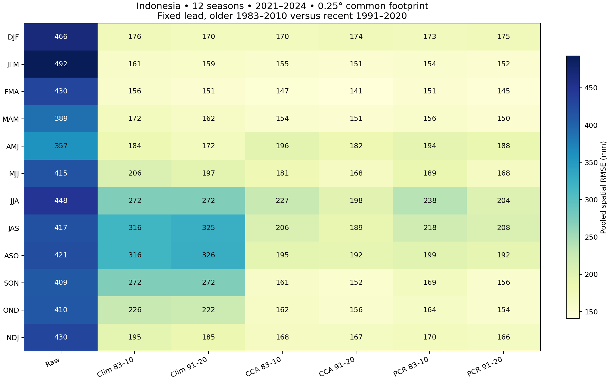
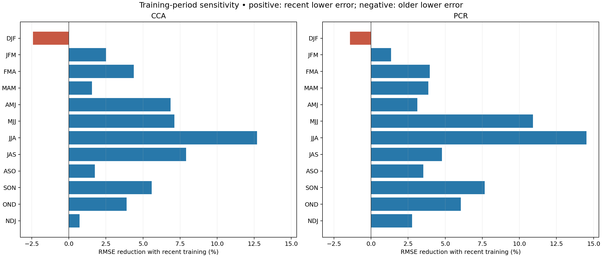
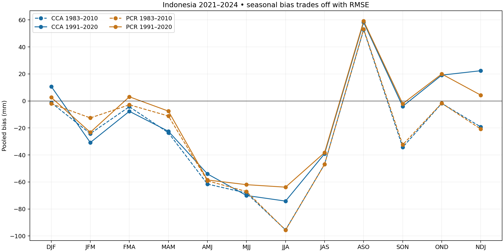
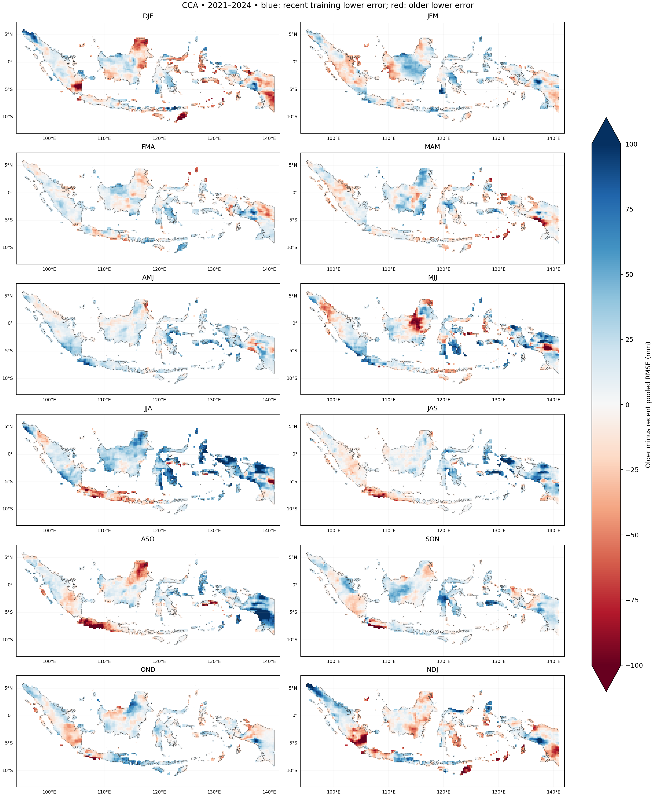
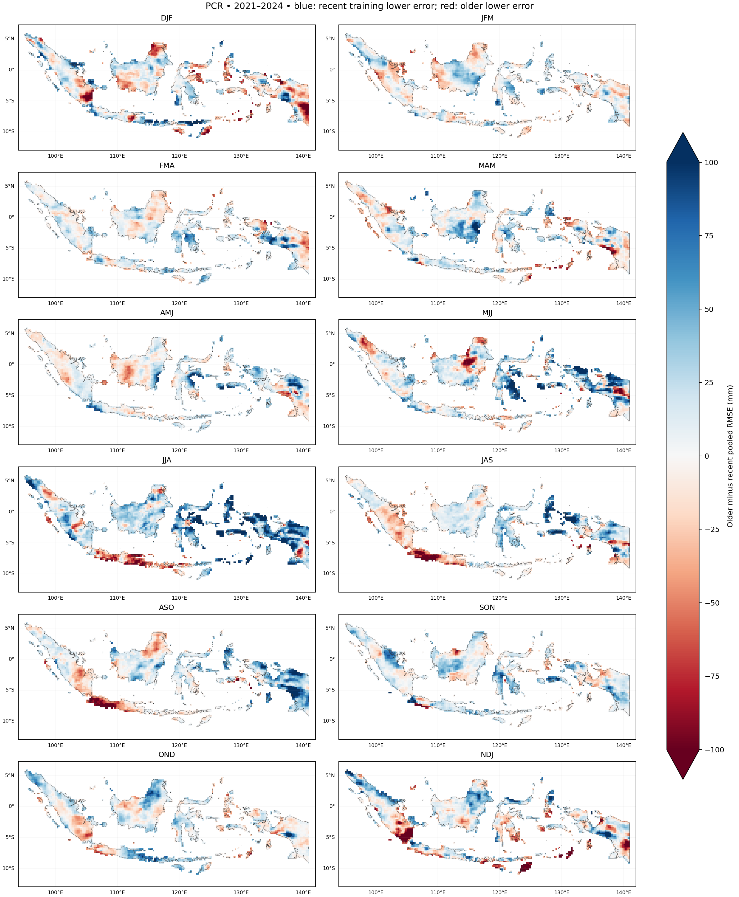

# Indonesia: all twelve seasonal rainfall forecasts at 0.25°

**Methodology audit, 2026-11-01:** see the the tutorial's [Methods & limitations](https://bennyistanto.github.io/pycpt-tutorial/guides/methods.html).
CPT uses a cyclic five-sample CV window and automatically zero-bounds rainfall.
Native category climatologies are 1991–2010 / 1991–2020 for within-year seasons;
DJF/NDJ use ending years 1992–2010 / 1992–2020. They are not necessarily the
training periods. Empirical probability reliability has not been demonstrated.

Completed 2026-10-31 with PyCPT 2.10.4, cptio 1.4.0 and packaged
CPT 17.8.3 in Debian. **192 calibrated forecasts** cover twelve rolling seasons,
four ending-year labels (2021–2024), two methods and two training periods.
Each of the **48 native CPT calls** forecasts four years together.

The result is a comparison of when calibration helps, including neutral and
negative outcomes. It is not a claim of year-round operational reliability.

## Calendar and training periods

The older period is **1983–2010 (28 seasons)** and the recent period is
**1991–2020 (30 seasons)** for every season. This differs from the original
1982–2010 OND pilot: the source starts in January 1982, whereas DJF/JFM/NDJ 1982
would require 1981 initializations under the ending-year convention. The common
1983 start avoids silently changing sample availability between seasons.
The [calendar decision](calendar_decision.json) records the source evidence.

DJF 2022 means December 2021–February 2022, initialized 1 November 2021. NDJ 2022
means November 2021–January 2022, initialized 1 October 2021. JFM 2022 is initialized
1 December 2021. Other windows lie within their labelled calendar year. Every
forecast is issued on the first day of the month preceding its first target month,
with CFSv2 lead centres 1.5/2.5/3.5. Real month lengths, including February 29, are used.
Actual initialization/target dates and `season_year` are saved; `T.year` alone
does not label NDJ correctly because its midpoint is in the preceding December.

CCA uses three predictor EOFs, three predictand EOFs and two CCA modes. PCR uses
three predictor EOFs. Each season is fitted separately; settings are retained
without test-year tuning. Both methods use synchronous predictors and CV window 5,
with no transformation, tailoring, dry mask or skill mask. Observational coverage
and constant-value exclusions are fitted from training data only.

## Data audit and shared footprint

Every season has 42 annual predictor sets with three monthly rates on the same
2,911-cell predictor domain,85–155°E and 20°S–20°N. All
**4,401,432 requested monthly mean values** are finite.
CHIRPS rolling endpoints were checked against exact start/end-exclusive bounds
for every training/evaluation season, then country-only native 0.05° pixels were
averaged in 5×5 blocks with cosine-latitude weights and 99% valid-land coverage.

| Season | Valid members, min–max | Older training cells | Recent training cells |
| --- | ---: | ---: | ---: |
| DJF | 28 | 3240 | 3240 |
| JFM | 24 | 3240 | 3240 |
| FMA | 24 | 3240 | 3240 |
| MAM | 24 | 3240 | 3240 |
| AMJ | 22–24 | 3240 | 3240 |
| MJJ | 24 | 3240 | 3240 |
| JJA | 24 | 3240 | 3240 |
| JAS | 24 | 3240 | 3240 |
| ASO | 24 | 3240 | 3240 |
| SON | 23–24 | 3240 | 3240 |
| OND | 24 | 3240 | 3240 |
| NDJ | 24 | 3240 | 3240 |

Mean fields are complete, but ensemble coverage varies by initialization month
and year. Counts were calculated before averaging and are retained at every
requested grid/month/year. Completeness does not imply unchanged ensemble
composition or statistical homogeneity. The source retains the previously audited
April 2011 reforecast-to-operational append; no transition adjustment is applied.
That boundary refers to initialization dates, so its corresponding target-season
year differs between windows.

All primary scores use **3,240 shared 0.25° cells** and identical weights across
all twelve seasons, both periods and four years. This retains
**99.9967%** of approximate native country land weight.
The common mask restricts scoring only; it never refits any model.

## Four-year pooled RMSE

Units are mm accumulated over each three-month window. Pooled RMSE is the square
root of mean annual spatial MSE, with equal year weights and shared spatial
weights. It is not an arithmetic mean of annual RMSE. Bold marks the lowest
national RMSE among the seven variants in each season; this is descriptive ranking.

| Season | Raw | Clim 83–10 | Clim 91–20 | CCA 83–10 | CCA 91–20 | PCR 83–10 | PCR 91–20 |
| --- | ---: | ---: | ---: | ---: | ---: | ---: | ---: |
| DJF | 465.92 | 176.10 | 170.24 | **169.96** | 174.07 | 172.90 | 175.37 |
| JFM | 492.45 | 161.03 | 159.31 | 155.19 | **151.31** | 153.83 | 151.75 |
| FMA | 430.01 | 156.26 | 151.11 | 147.45 | **141.01** | 151.22 | 145.24 |
| MAM | 389.17 | 172.21 | 162.09 | 153.53 | 151.13 | 156.19 | **150.15** |
| AMJ | 356.58 | 183.75 | **171.81** | 195.93 | 182.50 | 193.98 | 187.91 |
| MJJ | 415.37 | 206.37 | 196.79 | 180.70 | **167.85** | 188.76 | 168.16 |
| JJA | 447.73 | 272.23 | 272.28 | 227.16 | **198.35** | 238.15 | 203.57 |
| JAS | 417.13 | 315.96 | 324.53 | 205.78 | **189.50** | 218.31 | 207.86 |
| ASO | 420.92 | 315.96 | 325.83 | 195.29 | **191.86** | 199.04 | 192.02 |
| SON | 409.00 | 272.10 | 272.23 | 161.05 | **152.06** | 168.80 | 155.85 |
| OND | 410.16 | 226.38 | 222.14 | 162.15 | 155.84 | 164.05 | **154.12** |
| NDJ | 429.75 | 195.34 | 185.09 | 168.07 | 166.84 | 170.49 | **165.78** |



Recent training has lower pooled RMSE in **11 of 12 seasons for CCA**
and **11 of 12 for PCR**. The table below reports matched-climatology
and raw-model comparisons, rather than interpreting low dry-season RMSE alone
as high forecast skill.

| Calibrated variant | Lower error than own-period climatology | Lower error than raw |
| --- | ---: | ---: |
| CCA 1983–2010 | 11/12 | 12/12 |
| CCA 1991–2020 | 10/12 | 12/12 |
| PCR 1983–2010 | 11/12 | 12/12 |
| PCR 1991–2020 | 10/12 | 12/12 |

**AMJ is the clearest failure against a simple baseline:**1991–2020 climatology
has the lowest pooled error among all seven variants. Both methods under both
training periods lose to their own climatology there. In DJF, recent-period CCA
and PCR also lose to their matched climatology, despite beating the raw model.
The older CCA fit has the lowest DJF error, with only a small margin over the
recent climatology. These exceptions matter when interpreting the 11/12 result.

## Relative gains and bias tradeoffs

Positive reductions favour 1991–2020; negative values favour 1983–2010.

| Season | CCA RMSE reduction | PCR RMSE reduction |
| --- | ---: | ---: |
| DJF | -2.42% | -1.43% |
| JFM | +2.50% | +1.36% |
| FMA | +4.37% | +3.96% |
| MAM | +1.56% | +3.87% |
| AMJ | +6.85% | +3.13% |
| MJJ | +7.11% | +10.91% |
| JJA | +12.68% | +14.52% |
| JAS | +7.91% | +4.79% |
| ASO | +1.76% | +3.53% |
| SON | +5.58% | +7.67% |
| OND | +3.89% | +6.05% |
| NDJ | +0.73% | +2.76% |



The deterministic MSE skill score below is `1 − MSE(calibrated)/MSE(climatology)`
using each variant's own-period climatology. Positive means lower error than that
baseline; negative means calibration worsens it. These descriptive values do not
establish statistical significance or probabilistic skill.

| Season | CCA 83–10 | CCA 91–20 | PCR 83–10 | PCR 91–20 |
| --- | ---: | ---: | ---: | ---: |
| DJF | +6.9% | -4.6% | +3.6% | -6.1% |
| JFM | +7.1% | +9.8% | +8.7% | +9.3% |
| FMA | +10.9% | +12.9% | +6.3% | +7.6% |
| MAM | +20.5% | +13.1% | +17.7% | +14.2% |
| AMJ | -13.7% | -12.8% | -11.4% | -19.6% |
| MJJ | +23.3% | +27.2% | +16.3% | +27.0% |
| JJA | +30.4% | +46.9% | +23.5% | +44.1% |
| JAS | +57.6% | +65.9% | +52.3% | +59.0% |
| ASO | +61.8% | +65.3% | +60.3% | +65.3% |
| SON | +65.0% | +68.8% | +61.5% | +67.2% |
| OND | +48.7% | +50.8% | +47.5% | +51.9% |
| NDJ | +26.0% | +18.7% | +23.8% | +19.8% |

Lower RMSE and smaller absolute bias need not coincide. Seasons where recent
training lowers pooled RMSE while increasing absolute pooled bias are:
**CCA: JFM, FMA, MJJ, ASO, OND, NDJ; PCR: JFM, FMA, ASO, OND**. Opposite annual biases can also cancel in a pooled mean.
Full annual RMSE/MAE/bias and both evaluation subsets are saved, so the pooled
summary should be read alongside year-specific errors.



## Additional-year sensitivity

This table excludes the motivating 2023 case and pools 2021,2022 and 2024 only.
The same footprint and settings are retained. Three years provide limited
evidence, and the conclusions should not depend solely on the four-year table.

| Season | Raw | Clim 83–10 | Clim 91–20 | CCA 83–10 | CCA 91–20 | PCR 83–10 | PCR 91–20 |
| --- | ---: | ---: | ---: | ---: | ---: | ---: | ---: |
| DJF | 459.49 | 178.08 | 172.31 | **170.48** | 175.62 | 174.57 | 177.30 |
| JFM | 500.88 | 161.79 | 159.62 | 157.85 | 149.72 | 155.87 | **148.49** |
| FMA | 435.39 | 159.52 | 154.39 | 151.85 | **143.22** | 154.01 | 146.28 |
| MAM | 395.17 | 177.39 | 167.25 | **154.51** | 156.43 | 157.75 | 154.62 |
| AMJ | 358.71 | 189.94 | **176.38** | 207.89 | 192.42 | 207.26 | 199.57 |
| MJJ | 426.61 | 222.73 | 211.79 | 186.10 | **175.99** | 197.75 | 176.32 |
| JJA | 468.73 | 304.78 | 305.21 | 219.17 | **204.69** | 233.84 | 212.08 |
| JAS | 443.75 | 356.04 | 367.75 | 208.24 | **197.61** | 224.59 | 221.19 |
| ASO | 456.26 | 343.22 | 359.52 | 214.09 | **211.98** | 217.72 | 212.02 |
| SON | 446.10 | 287.01 | 289.81 | 173.05 | **164.81** | 182.62 | 169.84 |
| OND | 442.50 | 224.89 | 220.67 | 169.35 | 165.99 | 173.23 | **164.56** |
| NDJ | 419.51 | 192.16 | 183.41 | 164.12 | **161.26** | 167.40 | 164.12 |

## Where the training-period change helps or hurts

The maps show older-minus-recent four-year temporal RMSE at each cell. Positive
blue values favour recent training; negative red values favour older training.
CCA/PCR maps share one colour scale. These are descriptive error differences,
not local significance or reliability assessments.





## Bridge to the original OND experiment

Dropping 1982 changes the older fit. This control separates that adjustment from
moving to other seasons. Entries below are RMSE for
**1982–2010 /1983–2010 /1991–2020**, all rescored on the new shared footprint.

| OND year | CCA, mm | PCR, mm |
| --- | ---: | ---: |
| 2021 | 180.20 / 181.16 / 172.59 | 183.53 / 185.51 / 173.68 |
| 2022 | 176.93 / 173.86 / 172.08 | 179.37 / 177.30 / 161.89 |
| 2023 | 137.43 / 138.31 / 120.35 | 132.15 / 132.73 / 117.36 |
| 2024 | 151.68 / 151.61 / 152.51 | 154.27 / 155.49 / 157.70 |

The recent-period OND model inputs reuse the exact cached predictor amounts;
every overlapping monthly binary-vs-text value passed a printed-precision bound.
The maximum seasonal difference is 0.0045 mm, within its derived 0.0051 mm bound. Its
batched forecasts reproduce the earlier recent-period forecasts within 0.01 mm.
All earlier output artifacts remain unchanged.

## Outputs and reproduction

**209 compressed NetCDF files** and five figures are saved in `outputs/`.
The [manifest](case_manifest.json) inventories every file and hash; the
[availability audit](availability.json), [metrics](metrics.json) and
[independent verification](verification.json) record the checks and configuration.
The [48 per-fit records](fit_records.json) include exact mode/validation settings,
input/output hashes, native-score checks and date-parsing provenance.

- [verification_scores.nc](outputs/verification_scores.nc): annual and pooled national scores for all seasons/variants.
- [calibration_gains.nc](outputs/calibration_gains.nc): deterministic gains relative to matched climatology and raw model.
- [multiyear_error_fields.nc](outputs/multiyear_error_fields.nc): spatial RMSE/MAE/bias for four- and three-year sets.
- [evaluation_footprint.nc](outputs/evaluation_footprint.nc): shared scoring cells, country weights and seasonal masks.
- [OND_training_period_bridge.nc](outputs/OND_training_period_bridge.nc): original older, revised older and recent OND forecasts/baselines.
- Each `SEASON_METHOD_PERIOD_forecasts.nc` contains four years of rainfall, tercile probabilities and prediction-error variance.
- Corresponding `hindcasts.nc` and `native_skill.nc` files preserve deterministic CV diagnostics for that fit.
- Each season has `predictors.nc`, `observations.nc`, `monthly_audit.nc` and `footprint.nc` input/audit copies.
- Each `SEASON_forecast_comparison.nc` contains all seven variants, observations and errors.

For example, [DJF_cca_1991_2020_forecasts.nc](outputs/DJF_cca_1991_2020_forecasts.nc)
contains the recent-period DJF forecasts. Select an ending-year label explicitly:

```python
import xarray as xr
with xr.open_dataset("research/cases/indonesia-all-seasons-2021-2024-025deg/outputs/DJF_cca_1991_2020_forecasts.nc") as ds:
    rainfall = ds.deterministic.where(ds.season_year ==2023, drop=True).load()
```

From the repository root in Debian:

```bash
source ~/miniforge3/etc/profile.d/conda.sh
conda activate pycpt-tutorial
python research/scripts/prepare_indonesia_all_seasons.py
python research/scripts/run_indonesia_all_seasons.py
```

Caches and raw CPT files remain under `/home/bennyistanto/CPT/cases/indonesia-all-seasons-2021-2024-025deg`. Completed preparations/fits are
retained and hash-checked, so interrupted runs can resume. Use `--refresh-figures`
on the runner to regenerate plots/derived comparisons from saved data.

## Verification and limits

All **76 earlier artifacts** remain unchanged. Independent NumPy checks cover raw
bilinear interpolation, climatologies, month integration, training masks,
actual dates, annual/pooled/grid errors and all 192 calibrated forecasts.
Probability bounds/sums, finite counts and nonnegative variances pass. All 20
calendar/parser/aggregation/export tests pass. NetCDF exports were reopened and
compared with their decoded originals; figures were inspected separately.

The cross-year pilot exposed a CPT 17 date-only initialization output that cptio
rejects. A [scoped parser helper](../../../pycpt_tutorial/cpt_dates.py) adds midnight
only for independently audited initialization dates; raw text, parsing copies and
hashes are retained. No numerical forecast values or installed-library files are
changed. Full actual initialization/start/end arrays are checked after parsing.

Adjacent seasons share two months. Four years × twelve windows are **not 48
independent annual samples**, and thousands of spatial cells do not solve that
sample-size limitation. Cross-year labels can also share an initialization
calendar year. This remains a retrospective current-vintage experiment with
28-versus 30 training samples and a mixed reforecast/operational archive.
No test-year tuning, significance claim or probabilistic skill claim is made;
category thresholds use the effective CPT climatological periods recorded in the
project's working records (not published). Longer independent/blocked
validation and predefined regional diagnostics are needed before operational
recommendations.
