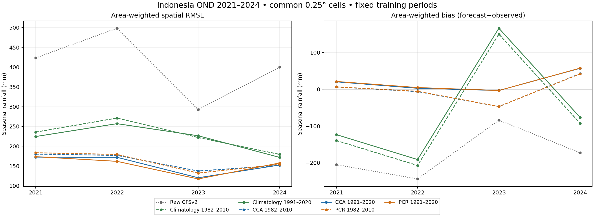
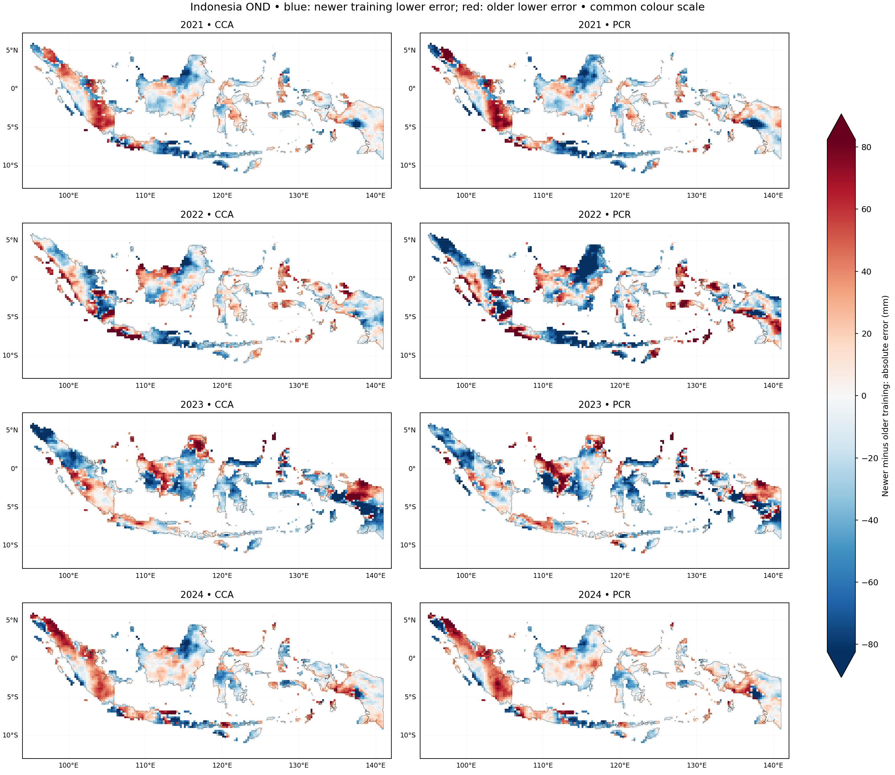

# Indonesia OND 2021–2024: does the training-period improvement persist?

**Methodology correction, 2026-11-01:** the tutorial's [Methods & limitations](https://bennyistanto.github.io/pycpt-tutorial/guides/methods.html).
Native probability categories use 1991–2010 for older fits and 1991–2020 for
recent fits. CPT automatically zero-bounds rainfall and uses Student's t
probabilities. Numeric checks do not demonstrate probability reliability.

Completed 2026-10-31 in Debian with PyCPT 2.10.4 and packaged CPT 17.8.3.
The new forecasts cover **2021, 2022 and 2024**. The verified 2023 forecasts are
reused from the [earlier sensitivity case](../indonesia-ond-2023-025deg-1991-2020/README.md).
All older forecast and data outputs remain unchanged.

**The newer training period improves RMSE in two of the three additional years,
but slightly worsens it in 2024, for both methods.** Pooled error across the three
new years decreases, while mean bias becomes more positive. The 2023 result
therefore persists in part, without becoming a universal advantage.

## Controlled experiment

| Item | Setting |
| --- | --- |
| AOI and grid | Full Indonesia; country-land means at 0.25° |
| Predictor | Same CFSv2 ensemble-mean source, supplied at 1° |
| Predictor domain | 85–155°E, 20°S–20°N |
| Observations | Same local CHIRPS3 rolling three-month source, native 0.05° |
| Forecast initialization | 1 September of each target year |
| Target | 1 October–31 December of that year; accumulated rainfall in mm |
| Older calibration | 1982–2010, 29 paired seasons |
| Recent calibration | 1991–2020, 30 paired seasons |
| CCA | 3 predictor EOFs, 3 predictand EOFs, 2 CCA modes |
| PCR | 3 predictor EOFs |
| Other settings | Synchronous; CV window 5; no transform, tailoring, dry mask or skill mask |
| Evaluation footprint | Same 3,240 cells and native-country land weights for every year/method |

All four forecast years are outside both training periods. The masks, component
counts and other settings were retained. Verification observations only determine
availability for scoring; they never fit either training mask or select settings.
Each new CPT run's deterministic training hindcasts reproduce the corresponding
frozen hindcasts exactly. Twelve new calls were made: three years × two methods
× two training periods. The four calibrated 2023 cases were reused unchanged.

## Input availability and continuity

All **12 target months × 2,911 predictor cells = 34,932 monthly values** are
finite, with **24 valid members** before ensemble averaging in every checked
month and cell. Raw monthly files and valid-member-count requests are cached.
Initialization dates, target-month bounds and 31/30/31-day integration passed.

Each CHIRPS December 21 endpoint has exact October 1–January 1 bounds. Native
country pixels are averaged in 5×5 blocks using cosine-latitude weights and the
same 99% valid-land coverage rule. All **3,240 cells** are available in all four
verification years, retaining **100%** of the previous shared analysis land weight.
Re-downloaded 2023 model input and reaggregated 2023 observations match the frozen
case exactly.

The earlier [training continuity audit](../indonesia-ond-2023-025deg-1991-2020/continuity.json)
still applies. The [IRI source](https://iridl.ldeo.columbia.edu/SOURCES/.Models/.NMME/.NCEP-CFSv2/.HINDCAST/.PENTAD_SAMPLES_FULL/.prec/)
appends operational forecasts from April 2011; completeness does not establish
statistical homogeneity. No archive-transition correction was applied.

## Year-by-year results

Values are area-weighted spatial RMSE in mm of accumulated OND rainfall. All
forecasts use identical observations, cells and weights within and across years.

| Forecast | 2021 | 2022 | 2023, cached | 2024 |
| --- | ---: | ---: | ---: | ---: |
| Raw CFSv2 | 423.33 | 498.29 | 292.39 | 399.91 |
| Climatology 1982–2010 | 235.78 | 271.26 | 222.03 | 179.48 |
| Climatology 1991–2020 | 224.54 | 257.10 | 226.50 | 171.94 |
| CCA 1982–2010 | 180.20 | 176.93 | 137.43 | **151.68** |
| CCA 1991–2020 | **172.59** | 172.08 | 120.35 | 152.51 |
| PCR 1982–2010 | 183.53 | 179.37 | 132.15 | 154.27 |
| PCR 1991–2020 | 173.68 | **161.89** | **117.36** | 157.70 |

Bold marks the lowest RMSE in each year. Both calibration methods and both
training periods outperform raw CFSv2 and both climatology baselines in all four
national comparisons. This does not imply improvement in every local cell.

The recent-minus-older RMSE differences show the period sensitivity directly;
negative values favour 1991–2020:

| Method | 2021 | 2022 | 2023 | 2024 |
| --- | ---: | ---: | ---: | ---: |
| CCA | −7.61 | −4.85 | −17.09 | +0.84 |
| PCR | −9.85 | −17.48 | −14.79 | +3.43 |

The larger 2023 improvement is not reproduced in every additional year. CCA is
best in 2021 and 2024; PCR is best in 2022 and 2023. There is no method/period
combination that wins every year.



## Primary summary: the three additional years

The following excludes the motivating 2023 case. Pooled RMSE is calculated as
the square root of mean annual spatial MSE, with equal year weights and the same
spatial weights. It is **not** an arithmetic mean of annual RMSE values.

| Forecast | Pooled RMSE, mm | MAE, mm | Bias, mm |
| --- | ---: | ---: | ---: |
| Raw CFSv2 | 442.50 | 358.55 | −207.12 |
| Climatology 1982–2010 | 231.94 | 178.60 | −146.32 |
| Climatology 1991–2020 | 220.67 | 169.50 | −130.30 |
| CCA 1982–2010 | 170.08 | 133.44 | +14.20 |
| CCA 1991–2020 | 165.99 | 131.51 | +26.62 |
| PCR 1982–2010 | 172.88 | 135.19 | +14.29 |
| PCR 1991–2020 | 164.56 | 130.46 | +27.74 |

Recent-period pooled RMSE decreases by **4.09 mm, about 2.40%, for CCA**, and
**8.31 mm, about 4.81%, for PCR**. MAE also decreases, but mean bias becomes more
positive. The near-zero bias improvement seen in 2023 does **not** hold generally.
For example, CCA bias in 2024 rises from +42.53 to +56.99 mm; PCR rises from
+42.01 to +57.38 mm.

Including all four years gives pooled RMSE **162.53 → 155.84 mm for CCA** and
**163.65 → 154.12 mm for PCR**. Older-period four-year bias is close to −1 mm,
partly because positive and negative annual biases cancel. A small pooled bias
alone should not be read as consistently accurate annual forecasts.

## Geographic differences and limits



Blue means lower absolute error with 1991–2020 training; red favours 1982–2010.
All panels share one colour scale. Improvement and degradation coexist within
each national map, including years with lower national RMSE.

These are three additional retrospective years plus the motivating 2023 case.
They are not a long validation record or a significance test. The periods also
have different sample counts, 29 and 30, and different fitted EOFs/regressions.
The observations and archive are current-vintage products rather than exact
as-issued historical vintages. No modes were tuned on these outcomes.

Probabilities and prediction-error variances are saved at their native 0.25° grid.
Category definitions use the effective CPT climatological period; this deterministic comparison does
not establish probabilistic skill or compare identical absolute-rainfall events.

The supported conclusion is that **the recent period gives lower pooled OND
error in this small sample, with a year-dependent benefit and a bias tradeoff**.
It is not enough to declare a universally preferred period or method.

## Saved NetCDF files

Thirteen compressed NetCDF files were reopened and checked against the decoded
in-memory data, coordinates and attributes.

| File | Contents |
| --- | --- |
| [cca_1982_2010_forecasts_2021_2024.nc](outputs/cca_1982_2010_forecasts_2021_2024.nc) | Older-period CCA forecasts, tercile probabilities and prediction-error variances |
| [cca_1991_2020_forecasts_2021_2024.nc](outputs/cca_1991_2020_forecasts_2021_2024.nc) | Recent-period CCA forecasts and uncertainties |
| [pcr_1982_2010_forecasts_2021_2024.nc](outputs/pcr_1982_2010_forecasts_2021_2024.nc) | Older-period PCR forecasts and uncertainties |
| [pcr_1991_2020_forecasts_2021_2024.nc](outputs/pcr_1991_2020_forecasts_2021_2024.nc) | Recent-period PCR forecasts and uncertainties |
| [forecast_comparison_025.nc](outputs/forecast_comparison_025.nc) | All seven forecast variants, observations, errors and absolute errors |
| [verification_scores.nc](outputs/verification_scores.nc) | Per-year and pooled RMSE/MAE/bias; additional-year and all-year sets |
| [multiyear_error_fields.nc](outputs/multiyear_error_fields.nc) | Cellwise temporal RMSE/MAE/bias for the three- and four-year sets |
| [observations_chirps3_ond_2021_2024.nc](outputs/observations_chirps3_ond_2021_2024.nc) | Four observed seasonal totals and valid native land weights |
| [evaluation_footprint.nc](outputs/evaluation_footprint.nc) | Both training masks, common verification mask and country weights |
| [cfsv2_forecast_predictors.nc](outputs/cfsv2_forecast_predictors.nc) | Four archived model predictors, dates and target bounds |
| [cfsv2_forecast_monthly_audit.nc](outputs/cfsv2_forecast_monthly_audit.nc) | Monthly model rates and full-domain valid-member counts |
| [training_hindcasts_1982_2010.nc](outputs/training_hindcasts_1982_2010.nc) | Unchanged CCA/PCR training CV hindcasts and training observations |
| [training_hindcasts_1991_2020.nc](outputs/training_hindcasts_1991_2020.nc) | Unchanged recent-period training CV hindcasts and observations |

Full [metrics](metrics.json), [availability audit](availability.json),
[manifest and hashes](case_manifest.json) and [independent verification](verification.json)
accompany the outputs. The four model-specific forecast files contain all four
years; select `T` by year when loading.

## Verification and reproduction

All **61 prior benchmark artifacts remain unchanged**. Independent NumPy
calculations reproduce monthly integration exactly and annual/pooled scores
within 1.3×10⁻¹² mm. Calendars, training/holdout separation, masks, finite counts,
probability bounds/sums and nonnegative variances passed. Cached 2023 forecasts
are identical. All ten aggregation/export tests pass; both figures were inspected.

```bash
source ~/miniforge3/etc/profile.d/conda.sh
conda activate pycpt-tutorial
python research/scripts/prepare_indonesia_ond_holdouts.py
python research/scripts/run_indonesia_ond_holdouts.py
```

Run from the repository root in Debian. Caches, raw requests, commands and CPT
logs remain under `/home/bennyistanto/CPT/cases/indonesia-ond-2021-2024-025deg`.
Training inputs are read from the preceding frozen cases. Completed cases are
retained, and per-fit forecast caches allow interrupted runs to resume.
Original E: data and prior case outputs were read only.

## Extending the tutorial to all seasons

All twelve rolling three-month seasons are a useful next experiment. They turn
the tutorial's question into **when and where calibration helps**, while this OND
case remains the detailed learner example. A separate seasonal benchmark can
summarize all windows without requiring every reader to rerun the full matrix.

The [all-season experiment plan](../../plans/SEASONAL_BENCHMARK_PLAN.md) defines a fixed
lead, explicit cross-year labels, separate seasonal calibration, data audits,
common evaluation rules and the earliest-hindcast issue. The
[all-twelve-season benchmark](../indonesia-all-seasons-2021-2024-025deg/README.md)
is now complete, using a common 1983–2010 older period after the earliest-date audit.
Its OND bridge retains and compares this original 1982–2010 control unchanged.
