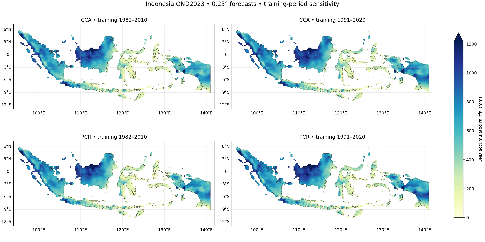
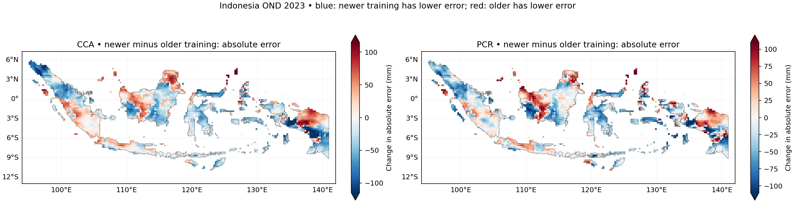

# Indonesia OND 2023 at 0.25°: 1991–2020 training sensitivity

**Methodology correction, 2026-11-01:** the tutorial's [Methods & limitations](https://bennyistanto.github.io/pycpt-tutorial/guides/methods.html).
Native probability categories use 1991–2010 for the older fit and 1991–2020 for
the recent fit. CPT automatically zero-bounds rainfall and uses Student's t
probabilities. Numeric checks do not demonstrate probability reliability.

Completed 2026-10-31 with PyCPT 2.10.4 and packaged CPT 17.8.3 in Debian.
CCA and PCR were refitted after the full-domain continuity audit, then compared
with the frozen [1982–2010 fit](../indonesia-ond-2023-025deg/README.md).
The original cases remain unchanged.

## What changed

| Item | Older fit | New fit |
| --- | --- | --- |
| Training years | 1982–2010 | 1991–2020 |
| Number of seasons | 29 | 30 |
| Output grid | 0.25° country-land means | Same |
| Predictor | CFSv2 ensemble mean, supplied at 1° | Same source/domain and monthly integration |
| CCA modes | 3 predictor EOFs, 3 predictand EOFs, 2 CCA modes | Same counts; bases refitted |
| PCR modes | 3 predictor EOFs | Same count; basis refitted |
| Validation | CPT built-in cross-validation, window 5 | Same setting |
| Forecast | 1 September 2023 initialization, OND 2023 target | Exact cached forecast predictor |

Both fits use synchronous predictors and no transform, tailoring, dry mask or
skill mask. No settings were selected using 2023 observations. Changing period
also changes sample count, EOF bases, regression coefficients, climatology and
probability categories. This experiment measures their combined effect.

## Continuity audit before fitting

The full predictor domain 85–155°E, 20°S–20°N contains **2,911 grid cells**.
All **90 monthly records** for October/November/December 1991–2020 are present:
**261,990 finite ensemble-mean values**, with no missing months, duplicate target
times, or nonfinite grid values. Source units are mm/day; seasonal totals use
actual 31/30/31-day weights and exact target-month bounds.

There are **24 valid members** in every requested month and predictor cell.
Counts were calculated before ensemble averaging.
The counting expression was independently checked against actual member values
at 110°E, 7°S over all 90 target months; individual-member availability there is
saved alongside the full-domain counts. Metadata provides 28 member slots;
at that point, slots 1–24 are valid and slots 25–28 are missing throughout.
Counts and numeric member identifiers do not establish unchanged model/member definitions.

Overlapping 1991–2010 seasonal model values match the original cached inputs
exactly: maximum difference **0.0 mm**. CHIRPS observations on the
common mask also match exactly over 1991–2010 and 2023. The local source contains
all requested seasonal endpoints, with exact October 1–January 1 bounds.

The [primary IRI source metadata](https://iridl.ldeo.columbia.edu/SOURCES/.Models/.NMME/.NCEP-CFSv2/.HINDCAST/.PENTAD_SAMPLES_FULL/.prec/)
explicitly appends operational forecasts from **April 2011**. Thus this is a
complete series that blends retrospective hindcasts and operational forecasts;
it is **not demonstrated to be statistically homogeneous**. No transition
adjustment was applied. Source metadata, URLs and hashes are retained in the
Debian cache and [continuity.json](continuity.json).

Descriptive Indonesia mean rainfall across the transition (mm accumulated over OND):

| Period | Years | Raw model mean | CHIRPS mean | Raw model bias |
| --- | ---: | ---: | ---: | ---: |
| 1991–2010 | 20 | 639.84 | 804.44 | -164.60 |
| 2011–2020 | 10 | 632.11 | 829.61 | -197.50 |

These differences mix climate variability and possible archive/system effects.
The 20-year and 10-year segments do not isolate a discontinuity or justify a correction.
Year-by-year diagnostics and member counts are in the continuity record.

## Common-footprint OND 2023 comparison

The new training mask has **3,240 cells**, versus
**3,240** previously. Both masks were fit using their own
training observations at the same 99% valid native country-land coverage rule.
All comparisons below use **3,240 shared 0.25° cells**, identical
CHIRPS 2023 observations and identical country-land weights. This retains
**100%** of the original fine analysis land weight.
Verification availability is applied separately from the training masks.

Scores are area-weighted spatial statistics for this one held-out season.
Bias is forecast minus observed; all numbers are mm accumulated over OND.

| Forecast | RMSE | MAE | Bias |
| --- | ---: | ---: | ---: |
| Climatology 1982–2010 | 222.0270 | 184.7793 | +149.7921 |
| Climatology 1991–2020 | 226.4961 | 190.4300 | +165.8099 |
| Raw CFSv2 | 292.3895 | 230.9178 | -83.9078 |
| CCA 1982–2010 | 137.4321 | 102.0829 | -47.0997 |
| PCR 1982–2010 | 132.1492 | 98.8236 | -46.9456 |
| CCA 1991–2020 | 120.3460 | 89.1884 | -3.3764 |
| PCR 1991–2020 | 117.3561 | 87.8384 | -3.4725 |

CCA RMSE **decreases by 17.09 mm (12.43%)**, from 137.43 to 120.35 mm. PCR RMSE **decreases by 14.79 mm (11.19%)**, from 132.15 to 117.36 mm.

Mean bias moves from approximately −47 mm to −3.4 mm for both methods. PCR has
the lowest RMSE in this 2023 comparison. Both calibrated forecasts outperform
the raw model and both climatology baselines for this target.

This is a sensitivity result for one held-out forecast. It does not establish
that either calibration period generally produces more skilful forecasts.
The raw forecast is unchanged; each climatology uses its corresponding annual
training observations, rather than substituting the separate 1991–2020 LTA files.





Blue indicates lower absolute error with the newer period; red favours the older
period. The two error maps have separate colour scales.

## Historical diagnostics: compare with care

Full-period CV summaries use different verification years and are saved as
descriptive diagnostics, not ranked as a like-for-like period comparison.
The table below restricts both sets of deterministic CV predictions to the
**shared 1991–2010 verification years**, on the same cells and weights.

| Forecast/training period | Mean grid RMSE, mm | Mean grid Pearson |
| --- | ---: | ---: |
| Raw CFSv2, older fit's verification subset | 352.2649 | 0.3981 |
| CCA 1982–2010 | 155.3243 | 0.5553 |
| PCR 1982–2010 | 155.9551 | 0.5472 |
| Raw CFSv2, newer fit's verification subset | 352.2649 | 0.3981 |
| CCA 1991–2020 | 157.3883 | 0.5539 |
| PCR 1991–2020 | 158.6325 | 0.5468 |

On these shared years, the newer fits have slightly higher historical RMSE and
slightly lower correlation for both methods. This does not support treating the
2023 improvement as a general advantage. The two raw rows match exactly because
the overlapping model inputs and verification samples are identical.

Even here, training sets and CV folds differ: older fits have 1982–1990 samples,
newer fits have 2011–2020 samples. These are area-weighted averages of cellwise
statistics, not RMSE/correlation of a national mean time series. No nested tuning
or out-of-sample probabilistic hindcast skill is claimed.

Forecast tercile probabilities and prediction-error variances are saved natively.
Probability categories use CPT's effective category-reference period, so a changed probability
does not describe the same absolute rainfall threshold. No probabilistic skill
comparison is inferred from this single outcome.

## Saved NetCDF files

There are **19 compressed NetCDF files**, verified by reopening and
comparing decoded data, coordinates and attributes with their in-memory originals.

| File | Contents |
| --- | --- |
| [cca_forecast_2023_025.nc](outputs/cca_forecast_2023_025.nc) | CCA seasonal rainfall, tercile probabilities, prediction-error variance and dates |
| [pcr_forecast_2023_025.nc](outputs/pcr_forecast_2023_025.nc) | PCR seasonal rainfall, tercile probabilities, prediction-error variance and dates |
| [cca_hindcasts_025.nc](outputs/cca_hindcasts_025.nc) | 1991–2020 CCA deterministic cross-validated hindcasts |
| [pcr_hindcasts_025.nc](outputs/pcr_hindcasts_025.nc) | 1991–2020 PCR deterministic cross-validated hindcasts |
| [cca_native_skill_025.nc](outputs/cca_native_skill_025.nc) | CPT CCA verification fields for the new training period |
| [pcr_native_skill_025.nc](outputs/pcr_native_skill_025.nc) | CPT PCR verification fields for the new training period |
| [cca_predictor_patterns_025.nc](outputs/cca_predictor_patterns_025.nc) | New CCA predictor diagnostics |
| [cca_predictand_patterns_025.nc](outputs/cca_predictand_patterns_025.nc) | New CCA predictand diagnostics |
| [pcr_predictor_patterns_025.nc](outputs/pcr_predictor_patterns_025.nc) | New PCR predictor diagnostics |
| [period_forecast_comparison_025.nc](outputs/period_forecast_comparison_025.nc) | Primary comparison: both calibrations/climatologies, raw model, identical observations and errors |
| [period_comparison_footprint_025.nc](outputs/period_comparison_footprint_025.nc) | Old/new training masks, common mask, evaluation mask and country weights |
| [observations_chirps3_ond_025.nc](outputs/observations_chirps3_ond_025.nc) | 30 training seasons plus 2023 CHIRPS3 observations and valid native land weights |
| [indonesia_analysis_mask_025.nc](outputs/indonesia_analysis_mask_025.nc) | 1991–2020 training-only country mask, country fractions and weights |
| [cfsv2_training_predictors.nc](outputs/cfsv2_training_predictors.nc) | 1991–2020 ensemble-mean predictor rainfall totals |
| [cfsv2_forecast_predictor_2023.nc](outputs/cfsv2_forecast_predictor_2023.nc) | Unchanged September 2023 forecast predictor |
| [cfsv2_monthly_continuity.nc](outputs/cfsv2_monthly_continuity.nc) | Full-domain monthly rates/member counts; individual-member availability at the Java audit point |
| [training_period_historical_diagnostics_025.nc](outputs/training_period_historical_diagnostics_025.nc) | Descriptive grid statistics using each variant's own training years |
| [shared_year_hindcasts_1991_2010_025.nc](outputs/shared_year_hindcasts_1991_2010_025.nc) | Both methods/periods and raw model on shared verification years 1991–2010 |
| [shared_year_historical_diagnostics_025.nc](outputs/shared_year_historical_diagnostics_025.nc) | Grid statistics on the shared verification years; training sets/folds differ |

Full [metrics](metrics.json), [continuity audit](continuity.json),
[preparation record](preparation.json), [manifest and hashes](case_manifest.json)
and [independent verification](verification.json) accompany the outputs.

## Verification and reproduction

All **40 original 1°/0.25° artifacts** remain unchanged.
Output/input hashes, dates, training years, finite counts, probability bounds/sums
and nonnegative variances pass. Independent NumPy calculations reproduce monthly
integration and every 2023 comparison score. CPT native scores agree with direct
calculations within printed precision. All 10 aggregation/export tests pass.

From the repository root in Debian:

```bash
source ~/miniforge3/etc/profile.d/conda.sh
conda activate pycpt-tutorial
python research/scripts/prepare_indonesia_1991_case.py
python research/scripts/run_indonesia_1991_case.py
```

The preparer completes its audit before the runner can fit either method.
Caches and CPT commands/logs remain under
`/home/bennyistanto/CPT/cases/indonesia-ond-2023-025deg-1991-2020`.
Completed runs are retained; use a different case directory for changed settings.
Original E: CHIRPS files and all older benchmark outputs were read only.

This retrospective replay uses current archive/CHIRPS3 products, with data
vintages that differ from those available as issued in 2023. More held-out years, regional
checks and investigation of the source transition are needed before selecting
a training period for operational use.

The [additional OND 2021/2022/2024 tests](../indonesia-ond-2021-2024-025deg/README.md)
are now complete. Recent training lowers RMSE in 2021 and 2022, slightly worsens
it in 2024, and lowers pooled error across the three new years with a bias tradeoff.
This 2023 case is reused unchanged in that comparison.
