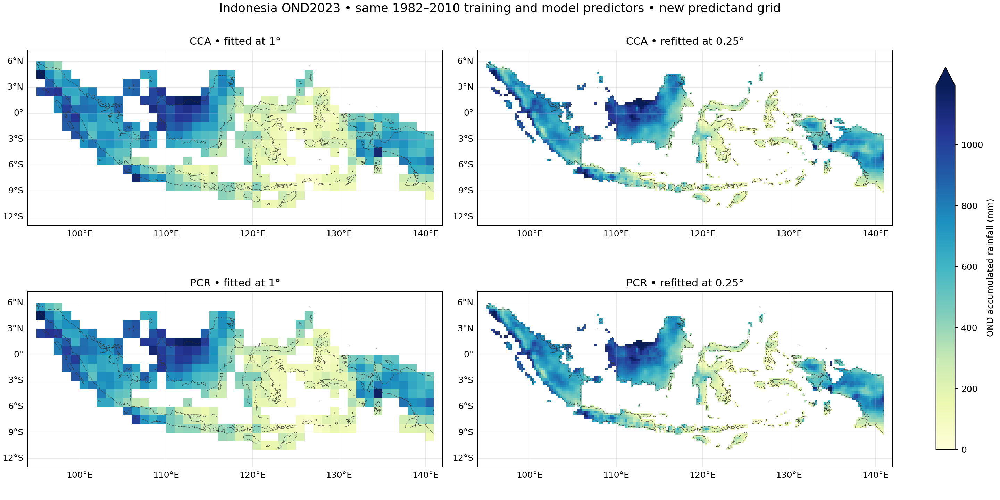
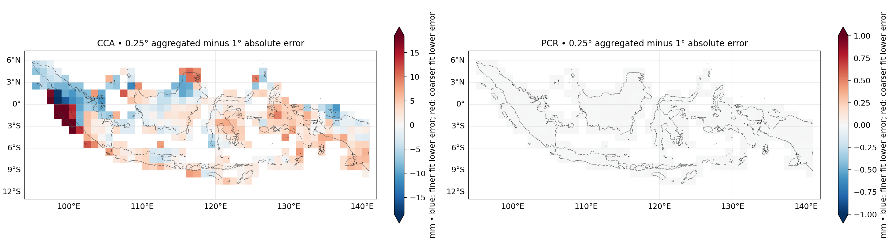

# Indonesia OND2023: CCA and PCR refitted at 0.25°

**Methodology correction, 2026-11-01:** the tutorial's [Methods & limitations](https://bennyistanto.github.io/pycpt-tutorial/guides/methods.html).
Native probability categories use 1991–2010, rather than the whole training
period. CPT automatically zero-bounds rainfall and uses Student's t probabilities.
Numeric checks do not demonstrate probability reliability.

Completed 2026-10-31 in Debian using PyCPT 2.10.4 / packaged CPT 17.8.3.
Both methods were refitted with newly prepared 0.25° CHIRPS3 observations.
The [original CCA case](../indonesia-ond-2023/README.md) and
[PCR comparison](../indonesia-ond-2023/pcr-comparison/README.md) remain unchanged.

## Controlled settings

| Item | Setting |
| --- | --- |
| Predictor | Exact cached CFSv2 ensemble-mean data from the 1° case; supplied on a 1° grid |
| Predictor domain | 85–155°E, 20°S–20°N |
| Observations | Same local CHIRPS v3.0 three-month rolling file, native 0.05° |
| New predictand grid | Country-masked, weighted means of 5×5 native pixels; 0.25° |
| Output domain | 94–142°E, 12°S–7°N; 76×192 bounding-box cells |
| Valid country cells | 3,240 of 3,242 blocks containing Indonesian pixels |
| Approximate country land-weight coverage | 99.9967% |
| Training | 1982–2010: 29 seasons |
| Initialization / target | 1 September 2023 / October–December 2023 |
| CCA | 3 predictor EOFs, 3 predictand EOFs, 2 CCA modes |
| PCR | 3 predictor EOFs |
| Other settings | Cross-validation window 5, synchronous predictors; no transform, tailoring, dry mask or skill mask |

Country geometry, seasonal windows, predictor values, training years and mode
counts were retained. The same coverage rule requires at least 99% valid native
country-land weight in every training year. The 2023 observations do not fit the
mask or select settings. Rainfall is averaged across space, not summed; units
remain mm accumulated over OND. Weights are sums of native cosine(latitude).

## Fair cross-resolution comparison

Native 1° and 0.25° RMSE evaluate different spatial scales. Fine observations
retain within-cell variations absent from coarse means, so their scores should
not be ranked directly against the original native-grid scores.

For the primary comparison, the fine **deterministic** forecasts are aggregated
into aligned 4×4 blocks using country-land weights, then scored against the
**original 1° observations and original country weights**. A common mask requires
at least 99% fine-footprint coverage. All **369 original evaluation cells** survive,
representing 100% of the original analysis land weight.

An independent check reconstructs the original coarse observations from the fine
observations over all 30 selected seasons. Maximum difference is below
0.000000000002 mm. Thus the spatial aggregation preserves the original observed
values on the comparison footprint.

Probabilities and prediction-error variances remain on their native fine grid.
They are not averaged into coarse-cell probabilities or uncertainties, which
would require additional definitions and covariance information.

## OND2023 results on the common 1° grid

All rows use identical observations, country cells and weights. Bias is forecast
minus observed; all values are mm of accumulated seasonal rainfall.

| Forecast | Area-weighted RMSE | Area-weighted MAE | Area-weighted bias |
| --- | ---: | ---: | ---: |
| Original climatology | 214.1004 | 181.3860 | +149.8022 |
| Original raw CFSv2 | 267.6860 | 219.3870 | −87.4025 |
| CCA fitted at 1° | 128.9881 | 97.1414 | −48.2815 |
| CCA fitted at 0.25°, aggregated | 128.6827 | 97.1014 | −47.0787 |
| PCR fitted at 1° | 123.3955 | 94.1595 | −46.9236 |
| PCR fitted at 0.25°, aggregated | 123.3955 | 94.1595 | −46.9235 |

CCA improves common-grid RMSE by about **0.31 mm (0.24%)** in this forecast. PCR
is nearly identical: its RMSE changes by about 0.00003 mm. This adds fine spatial
representation with little change in national coarse-scale error; it does not
demonstrate a large skill gain.

One interpretation consistent with the PCR result is that it uses the same three
predictor components in a linear regression at each target cell. With common
samples and fixed weights, averaging such predictions can reproduce predictions
fitted to averaged rainfall. CCA also changes its predictand EOF representation
when the target grid changes. This is not a proof of invariance for every setting.





Blue means the aggregated finer fit has lower error; red means the original fit
has lower error. The two error panels have different colour scales.

## Historical diagnostics on the common grid

These are area-weighted averages of grid-cell statistics over 1982–2010.
CCA/PCR use CPT's built-in cross-validated deterministic predictions.

| Forecast | Mean grid RMSE, mm | Mean grid Pearson |
| --- | ---: | ---: |
| Raw CFSv2 | 324.0699 | 0.4070 |
| CCA fitted at 1° | 141.0872 | 0.5489 |
| CCA fitted at 0.25°, aggregated | 141.2706 | 0.5538 |
| PCR fitted at 1° | 142.1423 | 0.5441 |
| PCR fitted at 0.25°, aggregated | 142.1403 | 0.5442 |

Finer CCA has slightly higher historical RMSE and slightly higher correlation.
There is no general winner by resolution here. These diagnostics are not nested
mode-selection validation; no out-of-sample probabilistic hindcast skill is claimed.

## Native 0.25° performance

These evaluate all 3,240 fine cells against their own fine CHIRPS observations.
They describe the delivered fine product rather than a like-for-like comparison
with native 1° scores.

| Forecast | RMSE, mm | MAE, mm | Bias, mm |
| --- | ---: | ---: | ---: |
| Fine-grid training climatology | 222.03 | 184.78 | +149.79 |
| Raw CFSv2 interpolated to fine centres | 292.39 | 230.92 | −83.91 |
| CCA refitted at 0.25° | 137.43 | 102.08 | −47.10 |
| PCR refitted at 0.25° | 132.15 | 98.82 | −46.95 |

The fine maps retain more local rainfall structure. Visual detail alone does not
establish reliable fine-scale skill: predictors are unchanged and training still
has only 29 seasons.

## NetCDF outputs

All 18 files are compressed and verified by reopening them and comparing decoded
data, coordinates and attributes with the in-memory originals.

| File | Contents |
| --- | --- |
| [cca_forecast_2023_025.nc](outputs/cca_forecast_2023_025.nc) | CCA rainfall, probabilities, prediction-error variance and dates |
| [pcr_forecast_2023_025.nc](outputs/pcr_forecast_2023_025.nc) | PCR rainfall, probabilities, prediction-error variance and dates |
| [cca_hindcasts_025.nc](outputs/cca_hindcasts_025.nc) | CCA deterministic cross-validated hindcasts |
| [pcr_hindcasts_025.nc](outputs/pcr_hindcasts_025.nc) | PCR deterministic cross-validated hindcasts |
| [cca_native_skill_025.nc](outputs/cca_native_skill_025.nc) | CPT CCA verification fields |
| [pcr_native_skill_025.nc](outputs/pcr_native_skill_025.nc) | CPT PCR verification fields |
| [cca_predictor_patterns_025.nc](outputs/cca_predictor_patterns_025.nc) | CCA predictor diagnostics |
| [cca_predictand_patterns_025.nc](outputs/cca_predictand_patterns_025.nc) | CCA predictand diagnostics |
| [pcr_predictor_patterns_025.nc](outputs/pcr_predictor_patterns_025.nc) | PCR predictor diagnostics |
| [native_025_forecast_comparison.nc](outputs/native_025_forecast_comparison.nc) | Fine climatology/raw/CCA/PCR forecasts, observations and errors |
| [native_025_hindcast_comparison.nc](outputs/native_025_hindcast_comparison.nc) | Fine historical deterministic diagnostics |
| [common_1deg_forecast_comparison.nc](outputs/common_1deg_forecast_comparison.nc) | Primary cross-resolution comparison against original 1° observations |
| [common_1deg_hindcast_comparison.nc](outputs/common_1deg_hindcast_comparison.nc) | Historical cross-resolution diagnostics |
| [cross_resolution_evaluation_footprint.nc](outputs/cross_resolution_evaluation_footprint.nc) | Common mask, land coverage and observation-aggregation differences |
| [observations_chirps3_ond_025.nc](outputs/observations_chirps3_ond_025.nc) | Fine observations and valid native land weights |
| [indonesia_analysis_mask_025.nc](outputs/indonesia_analysis_mask_025.nc) | Fine country fraction, weights and training-only mask |
| [cfsv2_training_predictors.nc](outputs/cfsv2_training_predictors.nc) | Reused original predictor values |
| [cfsv2_forecast_predictor_2023.nc](outputs/cfsv2_forecast_predictor_2023.nc) | Reused model forecast predictor |

Full results: [metrics.json](metrics.json). Source/grid/coverage details:
[preparation.json](preparation.json). Configuration and hashes:
[case_manifest.json](case_manifest.json). Independent checks:
[verification.json](verification.json).

## Verification and reproduction

All 20 original CCA/PCR artifact hashes and the model/boundary input hashes are
unchanged. Dates, training years, finite-cell counts, nonnegative variances and
probability bounds passed. Probability totals differ from 100% by at most about
0.000001 percentage points. Native CPT scores match independent calculations
within output precision. Separate NumPy aggregation reproduces both coarse
comparison forecasts, and all 30 observed seasons reconstruct the original grid.
Ten tests pass, including aggregation and NetCDF integrity checks.

From the repository root in Debian:

```bash
source ~/miniforge3/etc/profile.d/conda.sh
conda activate pycpt-tutorial
python research/scripts/prepare_indonesia_025_case.py
python research/scripts/run_indonesia_025_case.py
```

Prepared/completed cases are retained. Detailed caches and CPT logs are under
`~/CPT/cases/indonesia-ond-2023-025deg`. E: drive source files were
read only, and model data were reused without downloading. The native CPT calls
took approximately 4.9 seconds for CCA and 4.3 seconds for PCR; those timings
exclude preparation, export, verification and plotting.

```python
import xarray as xr

path = "research/cases/indonesia-ond-2023-025deg/outputs/cca_forecast_2023_025.nc"
with xr.open_dataset(path) as forecast:
    rainfall = forecast.deterministic.load()
```

This remains one retrospective replay with current CHIRPS3/archive products,
rather than exact as-issued 2023 data. More held-out years, regional diagnostics
and local probability verification are needed before operational recommendations.
The training period was not changed to 1991–2020 in this experiment.

A separate [1991–2020 training sensitivity](../indonesia-ond-2023-025deg-1991-2020/README.md)
is now complete. It preserves this benchmark, checks full-domain continuity, and
compares both methods on the same 0.25° cells and weights.
