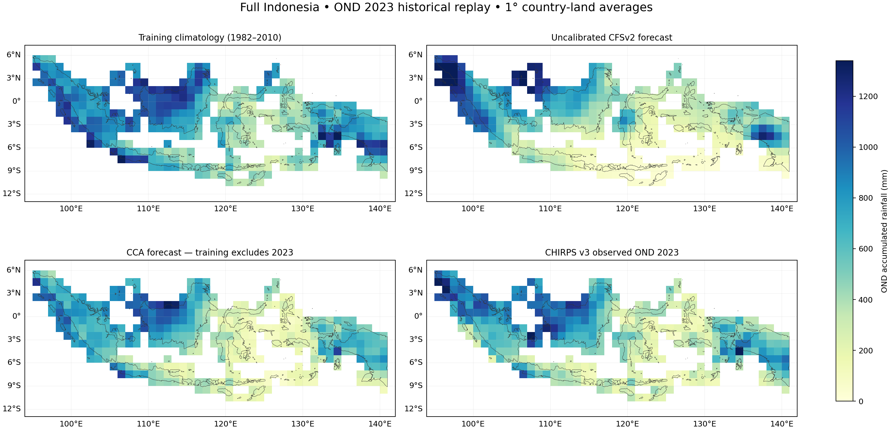

# Full Indonesia: OND 2023 historical seasonal replay

**Methodology correction, 2026-11-01:** the tutorial's [Methods & limitations](https://bennyistanto.github.io/pycpt-tutorial/guides/methods.html).
The deterministic baseline uses the full training mean; native probability
categories use 1991–2010. CPT automatically zero-bounds rainfall and uses
Student's t probabilities. Numeric checks do not demonstrate probability reliability.

Completed 2026-10-31 with the working Debian PyCPT environment. This is a real-data
case, not the earlier synthetic example. It uses an archived model forecast and
retrospectively available CHIRPS v3 observations; it is not an exact reconstruction
of the information available operationally in September 2023.

The [PCR comparison](pcr-comparison/README.md) is now complete on these exact frozen
inputs, with six additional NetCDF files and a four-method comparison. That report
also explains calibration/normal periods and higher-resolution options.
The [completed 0.25° experiment](../indonesia-ond-2023-025deg/README.md) refits both
methods with the same training period and uses this frozen 1° case as its reference.

## Case definition

| Item | Configuration |
| --- | --- |
| Forecast initialization | 1 September 2023 |
| Target | 1 October–31 December 2023, 92 days |
| Training / deterministic-baseline years | 1982–2010 inclusive: 29 seasons |
| Model | NCEP CFSv2 ensemble-mean precipitation from the IRI NMME catalog |
| Observational reference | User's local CHIRPS v3.0 three-month rolling dekadal dataset |
| Output domain | 94–142°E, 12°S–7°N; Indonesia land pixels only in aggregation |
| Predictor domain | 85–155°E, 20°S–20°N, selected before assessing the forecast |
| Output grid | 1° blocks: 19 latitude × 48 longitude cells; 369 valid country land cells |
| Country geometry | Natural Earth 1:10m admin_0_countries, ADM0_A3=IDN |
| Runtime | PyCPT 2.10.4, cptio 1.4.0, packaged CPT 17.8.3 |
| Method | CCA, fixed 3 predictor EOFs / 3 predictand EOFs / 2 CCA modes |
| Hindcast validation | CPT built-in cross-validation, window 5 |
| Transform / tailoring | None / None; no dry or skill mask |

The 2023 observations are excluded from calibration, mode selection and the
climatology baseline. The spatial completeness mask uses training years only.
Model input and observation dates were checked for exact alignment.

## Data availability and preparation

- The local dekadal and rolling CHIRPS files cover **1981–2025**. The 1991–2020 LTA
  is available but is not used here: the climatology baseline uses the same
  1982–2010 period as the calibration.
- IRI authenticated access succeeded. CFSv2 September hindcasts for every year
  **1982–2010** and the **September 2023 forecast** were downloaded successfully.
  These are the verified intervals for this case, not claims about the archive's
  complete available history.
- Follow-up checks confirm that the source already appends operational data from
  April 2011 and has valid 1991–2020 values at a tested point. The 1982–2010 pilot
  interval is a deliberate pre-transition selection, not a CPT requirement or a
  claim of maximum archive coverage; see the [period audit](pcr-comparison/training_period_availability.json).
- Observation source: `E:\temp\chirps\rolling_dekad\wld_cli_chirps3_month3_bydekad_1981_2025.nc`.
  Selecting the **21 December** record in each year gives time bounds from
  **1 October to 1 January**, covering OND exactly. Overlapping rolling records
  were not summed together.
- Six point/year checks in Sumatra, Java and Papua compared those rolling totals
  with the sum of nine original dekads; they agreed within float-rounding tolerance.
- Native 0.05° observations were masked to Indonesia before aggregation, using
  cosine-latitude weights within each 20×20-pixel block. Ocean and neighbouring
  countries do not contribute to each grid cell's rainfall average.
- A block needs at least 99% of its Indonesia-pixel weight available in every
  training year. **369 of 371** blocks containing Indonesian pixels passed. They
  represent about **99.95%** of the approximate country land weight. The two
  excluded edge blocks are represented in the saved mask, not filled with zeros.
- Model monthly mean rates were downloaded separately and multiplied by the
  actual **31, 30 and 31 days** before summing. The resulting model and observation
  data are all seasonal accumulated rainfall in **mm**.
- cptio 1.4.0 cannot directly parse the downloaded monthly file when several target
  months share one initialization S. Raw downloads are retained; parsing copies
  omit the repeated S labels, and the verified September initialization is restored
  to the seasonal aggregates. No installed PyCPT package was changed.

Exact model request URLs, sizes and hashes are in [availability.json](availability.json).
Raw text inputs, prepared caches and CPT command logs remain in Debian at
`~/CPT/cases/indonesia-ond-2023`.

## OND 2023 comparison

All three methods are evaluated against the same CHIRPS3 observations and country
grid cells. Spatial weighting uses country land fraction × cosine(latitude).
Bias is forecast minus observed.

| Forecast | Area-weighted RMSE, mm | Area-weighted MAE, mm | Area-weighted bias, mm |
| --- | ---: | ---: | ---: |
| 1982–2010 climatology | 214.10 | 181.39 | +149.80 |
| Uncalibrated CFSv2 | 267.69 | 219.39 | −87.40 |
| CCA-calibrated CFSv2 | **128.99** | **97.14** | −48.28 |

Calibration reduced spatial RMSE by approximately 52% relative to the uncalibrated
model in this particular forecast. A single successful replay does not establish
reliable skill for other seasons, years, or locations.



Across the 29 hindcast seasons, the area-weighted mean grid-cell RMSE was 141.09 mm
for CPT's cross-validated CCA predictions and 324.07 mm for the raw model. Mean
grid-cell Pearson correlation was 0.549 and 0.407 respectively. These are descriptive
diagnostics from this configuration. No nested mode-selection validation or
out-of-sample probabilistic hindcast skill is claimed.

Full numbers are in [metrics.json](metrics.json), with the configuration and output
hashes in [case_manifest.json](case_manifest.json).

## Saved NetCDF outputs

| File | Contents |
| --- | --- |
| [cca_forecast_2023.nc](outputs/cca_forecast_2023.nc) | Deterministic rainfall, three-category probabilities, prediction-error variance and forecast/target dates |
| [cca_hindcasts.nc](outputs/cca_hindcasts.nc) | Cross-validated deterministic predictions for 1982–2010 |
| [cca_native_skill.nc](outputs/cca_native_skill.nc) | CPT deterministic verification fields |
| [forecast_2023_baselines_and_observed.nc](outputs/forecast_2023_baselines_and_observed.nc) | Observations, raw/calibrated forecasts, climatology, anomalies and errors |
| [deterministic_hindcast_comparison.nc](outputs/deterministic_hindcast_comparison.nc) | Independently computed raw/calibrated RMSE and correlation maps |
| [observations_chirps3_ond.nc](outputs/observations_chirps3_ond.nc) | Prepared observed seasonal totals for the 29 training seasons and 2023 |
| [indonesia_analysis_mask.nc](outputs/indonesia_analysis_mask.nc) | Country land fraction and included/excluded cell mask |
| [cfsv2_training_predictors.nc](outputs/cfsv2_training_predictors.nc) | Prepared model predictors for the training period |
| [cfsv2_forecast_predictor_2023.nc](outputs/cfsv2_forecast_predictor_2023.nc) | Archived 2023 forecast predictor |
| [cca_predictor_patterns.nc](outputs/cca_predictor_patterns.nc) | Returned predictor EOF/CCA diagnostics |
| [cca_predictand_patterns.nc](outputs/cca_predictand_patterns.nc) | Returned predictand EOF/CCA diagnostics |

All NetCDF writes were reopened and compared with their in-memory datasets.
Probability totals agreed with 100% to approximately 0.000001 percentage points.
Independent RMSE/correlation calculations agreed with native CPT outputs within
0.002 mm / 0.00001, consistent with output precision. Hashes and source-dekad checks
are recorded in [verification.json](verification.json).

## Reproduce and inspect

From the repository root in Debian, with the local E: drive mounted:

```bash
source ~/miniforge3/etc/profile.d/conda.sh
conda activate pycpt-tutorial
python research/scripts/prepare_indonesia_case.py
python research/scripts/run_indonesia_case.py
```

The preparation script reuses its input cache and the runner retains a completed
case instead of replacing it. The case paths/settings are explicit constants in
the scripts; use a new case directory when changing the experiment. IRI credentials
are loaded from the private Debian credential file, never from project metadata.

```python
import xarray as xr

with xr.open_dataset("research/cases/indonesia-ond-2023/outputs/cca_forecast_2023.nc") as forecast:
    print(forecast)
    rainfall = forecast.deterministic.load()
```

## Limits and next experiments

This replay uses CHIRPS v3 and the archive as available now, rather than data
vintages frozen in 2023. The first case deliberately does not append 2011–2022
operational forecasts to the training archive. The 1° country-land grid is suitable
for a national demonstration and does not resolve every small island or local
administrative area. The forecast map displays block averages, including coastal
blocks, not a claim of rainfall over surrounding sea.

The same-input PCR comparison is complete. Useful next experiments are a second
held-out year, a finer predictand grid, regional diagnostics, and a stronger
validation design before comparing many settings. CPT 19.2.6 compatibility remains
separate work.

Data references: [CHIRPS v3](https://www.chc.ucsb.edu/data/chirps3),
[CHIRPS3 dataset DOI](https://doi.org/10.15780/G2JQ0P),
[IRI NMME](https://iridl.ldeo.columbia.edu/SOURCES/.Models/.NMME/),
[Natural Earth terms](https://www.naturalearthdata.com/about/terms-of-use/).
