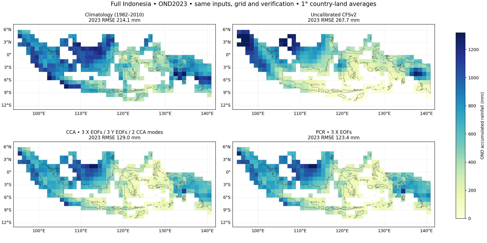
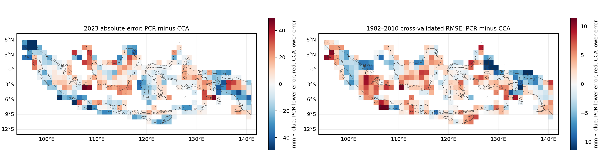

# PCR versus CCA, raw CFSv2 and climatology: Indonesia OND2023

**Methodology correction, 2026-11-01:** the tutorial's [Methods & limitations](https://bennyistanto.github.io/pycpt-tutorial/guides/methods.html).
The deterministic baseline uses the full training mean; native probability
categories use 1991–2010. CPT automatically zero-bounds rainfall and uses
Student's t probabilities. Numeric checks do not demonstrate probability reliability.

Completed 2026-10-31 in Debian with PyCPT 2.10.4 and packaged CPT 17.8.3.
The [original CCA case](../README.md) is retained as a frozen benchmark.

## Fair comparison setup

PCR uses the exact same prepared model predictors, CHIRPS3 observations, target
dates, country mask and spatial weights as CCA. Input hashes and all original CCA
output hashes were verified before and after the run; none changed.

- Initialization: 1 September 2023. Target: October–December 2023.
- Calibration: 29 seasons, 1982–2010. The 2023 observations are excluded from fitting.
- Output: 1° country-land averages, the same 369 grid cells.
- PCR: exactly 3 predictor EOFs, selected before examining its 2023 result.
- CCA: existing 3 predictor EOFs, 3 predictand EOFs and 2 CCA modes.
- Both: built-in cross-validation window 5, synchronous predictors, no transformation,
  tailoring, dry mask or skill mask. Different model structures do not have identical
  effective complexity, and no optimized-method superiority is claimed.

## OND2023 results

Errors use identical observed rainfall, grid cells and country-area weights.
Bias is forecast minus observed; values are in mm of OND accumulated rainfall.

| Forecast | Area-weighted RMSE | Area-weighted MAE | Area-weighted bias |
| --- | ---: | ---: | ---: |
| Training-period climatology | 214.10 | 181.39 | +149.80 |
| Raw CFSv2 | 267.69 | 219.39 | −87.40 |
| CCA | 128.99 | 97.14 | −48.28 |
| PCR | **123.40** | **94.16** | −46.92 |

PCR has approximately 4.3% lower spatial RMSE than CCA for this one held-out
forecast. It is not a general method ranking or evidence of a statistically
significant difference. The difference also varies geographically.



## Historical deterministic diagnostics

These figures are country-area-weighted averages of grid-cell statistics across
the same 1982–2010 seasons. CCA/PCR use their CPT cross-validated predictions;
raw CFSv2 has no locally fitted calibration.

| Forecast | Mean grid-cell RMSE, mm | Mean grid-cell Pearson correlation |
| --- | ---: | ---: |
| Raw CFSv2 | 324.07 | 0.4070 |
| CCA | **141.09** | **0.5489** |
| PCR | 142.14 | 0.5441 |

CCA is slightly better on these historical diagnostics, while PCR is slightly
better for 2023. No nested model-selection validation or out-of-sample
probabilistic hindcast skill is claimed. The fixed training-period mean is not
reported as if it were an independently cross-validated historical forecast.



Blue means lower PCR error; red means lower CCA error. The two panels use
different scales and summarize different evaluation sets.

## NetCDF outputs

| File | Contents |
| --- | --- |
| [pcr_forecast_2023.nc](outputs/pcr_forecast_2023.nc) | Deterministic rainfall, category probabilities, prediction-error variance and dates |
| [pcr_hindcasts.nc](outputs/pcr_hindcasts.nc) | Cross-validated deterministic PCR predictions, 1982–2010 |
| [pcr_native_skill.nc](outputs/pcr_native_skill.nc) | CPT's deterministic skill fields |
| [pcr_predictor_patterns.nc](outputs/pcr_predictor_patterns.nc) | Returned predictor EOF diagnostics |
| [forecast_2023_four_method_comparison.nc](outputs/forecast_2023_four_method_comparison.nc) | Four forecasts, observations, errors and absolute errors; `forecast_method` dimension |
| [deterministic_hindcast_three_method_comparison.nc](outputs/deterministic_hindcast_three_method_comparison.nc) | Raw/CCA/PCR historical RMSE, MAE, bias and correlation maps |

Exact metrics are in [metrics.json](metrics.json). Input/output hashes and checks
are in [comparison_manifest.json](comparison_manifest.json). Every NetCDF was
reopened and checked against its in-memory data. PCR native RMSE and correlation
also match independent calculations within output precision; forecast probabilities
sum to 100% within approximately 0.000001 percentage points. All 369 included cells
have finite predictions and valid probability/variance bounds.

From the repository root in the working environment:

```bash
python research/scripts/run_indonesia_pcr_comparison.py
```

Completed results are retained rather than silently overwritten. Detailed native
CPT logs are in Debian under
`/home/bennyistanto/CPT/cases/indonesia-ond-2023/pcr-comparison`.

```python
import xarray as xr

path = "research/cases/indonesia-ond-2023/pcr-comparison/outputs/forecast_2023_four_method_comparison.nc"
with xr.open_dataset(path) as comparison:
    pcr_rainfall = comparison.forecast_rainfall.sel(forecast_method="pcr").load()
```

## Why 1982–2010 rather than 1991–2020?

**1982–2010 was our conservative pilot choice, not a CPT default or a hard limit
of the selected IRI source.** It gives 29 verified paired seasons before the
operational-data transition. The original public CFS reforecast program ended in
early 2011; [NOAA documents the transition](https://cfs.ncep.noaa.gov/cfsv2.info/).

The selected IRI `PENTAD_SAMPLES_FULL` source explicitly appends operational
forecast data from April 2011 onward. We now checked its metadata and requested
1991–2020 at a Java grid point: **all 30 years are present and valid**. A second
1982–2023 point query also returned every year. These checks establish temporal
availability at the sample point, not full-domain completeness or homogeneity.
See [training_period_availability.json](training_period_availability.json).

The frozen run selected only the pre-transition slice. No manual concatenation
was performed by our script, but the provider's full virtual source already
contains the later operational data. Do not interpret the original bounded
availability check as proof that post-2010 data were unavailable.

Three periods serve different purposes:

| Period | Purpose |
| --- | --- |
| Calibration / training | Annual paired model and observation seasons used to fit the statistical relationship |
| Climatological reference | Period used to express normal rainfall, anomalies or category thresholds |
| Verification | Seasons withheld to evaluate predictions; 2023 here |

They can overlap or share the same dates, but need not be identical.
[WMO's standard normals include 1991–2020](https://community.wmo.int/site/knowledge-hub/programmes-and-initiatives/climate-services/wmo-climatological-normals).
Our 1982–2010 baseline is explicitly a 29-year training-period mean, not a WMO
30-year standard normal. We matched it to the calibration window for this comparison.

Training on 1991–2020 is therefore a feasible next experiment, after checking
full-domain completeness, ensemble construction and consistency across the 2011
transition. It requires refitting both methods and recomputing relevant fitted
quantities. The 1991–2020 LTA alone is a summary, not the annual paired data needed
for regression; your original CHIRPS files provide those annual observations.
A separately labelled 1991–2020 observational normal can also be used as an
additional reference without pretending that it was the current calibration period.

## Why 1°, and can resolution increase?

**The 1° predictand grid was chosen for the pilot, not imposed by CPT.** The model
data we downloaded are provided on a 1° grid, while local CHIRPS3 is 0.05°.
We explicitly averaged 20×20 native observation pixels into each 1° block.
The predictor and predictand grids do not have to have equal spacing.

For the current 48° longitude by 19° latitude box:

| Predictand spacing | Approx. north–south spacing | Bounding-box grid cells | Relative to 1° |
| --- | ---: | ---: | ---: |
| 1° | 111 km | 912 | 1× |
| 0.25° | 28 km | 14,592 | 16× |
| 0.1° | 11 km | 91,200 | 100× |
| 0.05° | 5.6 km | 364,800 | 400× |

Counts include sea and neighbouring-country cells before masking; they are not
predictions of runtime or valid Indonesian-cell counts. Spatial distance also
varies with latitude/direction. [CHIRPS v3 documents its native 0.05° grid](https://www.chc.ucsb.edu/data/chirps3).

To produce finer forecasts, prepare the observations and country mask at the
chosen spacing and **refit** CCA/PCR. Simply resampling the saved 1° forecast makes
a denser image without adding independent forecast information. Finer predictand
grids can represent local climatology and learned statistical patterns, but the
coarse predictor information and limited training sample still constrain skill.

Recommended next steps are a 0.25° benchmark with the current period unchanged,
followed by 0.1° if resource/quality checks support it, and a separate 1991–2020
calibration sensitivity case. Changing one factor at a time makes the comparisons
interpretable. The [0.25° experiment](../../indonesia-ond-2023-025deg/README.md) is
now complete with 1982–2010 held fixed. New-period and 0.1° experiments remain unrun.
