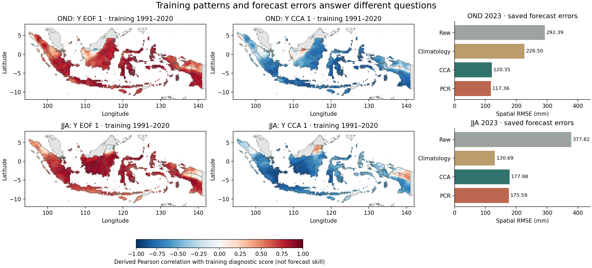

# OND/JJA fitting diagnostics: readiness for the second tutorial

Audited2026-11-02. **The saved archive is sufficient to begin the fitting and
diagnostics case without new data downloads or diagnostic-recovery fits.** It
contains the training inputs, model patterns, time series, spectra and forecast
controls for both seasons. Physical attribution and optimized model selection
remain unverified.

Follow-up: the [second case has now been built and executed](FITTING_TUTORIAL_2023.md),
including four new teaching fits and a separate extracted-kit run. The results
below describe the original diagnostic-readiness audit; its frozen controls remain unchanged.

## Scope and provenance

Four original fits: OND/JJA × CCA/PCR,1991–2020 training, full Indonesia predictand.
CCA retains3X EOFs,3Y EOFs and2CCA modes; PCR retains3X EOFs. Both use the audited
cyclic five-sample CV window. These fixed settings are controls, not an optimum.
Training covers30seasons; native X has2,911cells and Y has3,240complete land cells.
Predictor patterns describe CFSv2 seasonal rainfall over85–155°E,20°S–20°N.

Native session files remain under
`/home/bennyistanto/CPT/cases/indonesia-all-seasons-2021-2024-025deg/`.
The audit checks100native files, hashes of the fitting inputs and12forecast/
hindcast/skill NetCDF controls against the original fit records, and records the
installed wrapper, command-file and session-log hashes. The original runner saved
only the first three returned datasets; diagnostic text files were retained but
the returned pattern datasets were not exported into the benchmark NetCDF set.

Recovered data: [six diagnostic NetCDFs](../audits/fitting-diagnostics/outputs/),
with X and Y grids separate, explicit EOF/CCA/spectrum axes and source provenance.
No fit was run. All214benchmark output files, canonical notebook and kit remained
unchanged during extraction (216protected files).

## What the saved diagnostics establish

| Diagnostic | OND | JJA | Interpretation |
| --- | ---: | ---: | --- |
| X variance retained by3EOFs |73.277595%|63.789640%|Full-training input compression; same X files for CCA/PCR |
| Y variance retained by3EOFs, CCA |64.354505%|67.982988%|Full-training predictand compression |
| CCA pair1 correlation |0.945254|0.739972|Training score-pair relationship |
| CCA pair2 correlation |0.469345|0.596654|Training score-pair relationship |

All time series contain1991–2020. Independent SVD of the actual printed training
inputs, using standardized anomalies and square-root cosine-latitude weights,
reproduces retained EOF score directions to absolute correlations greater than
0.999999999999999. Explained-variance percentages agree within0.0000005percentage
points. This supports treating them as full-training diagnostics, not per-fold
EOF outputs. The saved CCA pair correlations independently agree with the
correlations between the corresponding score series within0.000000925.

Absolute eigenvalues have a small remaining scale discrepancy: maximum0.017006
for X and0.001317for Y. The audit allows absolute0.002plus relative2e-5tolerance;
it does not establish exact native amplitude/normalization equivalence. Use native
scores/weights as labeled diagnostics and explicitly derived dimensionless
correlation maps. Resolve the remaining scale convention before teaching an
amplitude reconstruction from EOF weights.

## Two export details that matter

**Weights and correlations are different outputs.** The
[official EOF help](https://cpthelp.iri.columbia.edu/Tools_Models_YEOF.html) distinguishes
the correlations displayed by the application from the loadings written to files.
The [CCA help](https://cpthelp.iri.columbia.edu/Tools_Models_CCA.html) likewise
distinguishes saved weights from field–score correlations. The recovered files
retain native weights and separately calculate Pearson correlations between each
original training field and the saved score. They never relabel weights as
correlations or rainfall forecasts.

**Some pattern headers omit the missing-value tag.** Outside Y's complete-input
support, native EOF and CCA weights contain exactly-999. The parser therefore
leaves those values numerical. The audit verifies every outside-mask value against
the original training-input mask, then replaces it with NaN only in the derived
copies. Each Y EOF cube decodes34,056values (3modes ×11,352outside cells).
Original native files are unchanged. A raw min/max or map without this step would
be misleading. Separate axes also avoid interpreting the wrapper's merged
30-mode spectrum axis as30retained score/loading modes.

## Why OND and JJA make a useful teaching contrast

Existing national2023spatial RMSE,mm, on the same3,240cells:

| Target | Raw |1991–2020climatology | CCA | PCR |
| --- | ---: | ---: | ---: | ---: |
| OND2023 |292.39|226.50|120.35|117.36|
| JJA2023 |377.82|130.69|177.98|175.59|

The pattern maps use training correlations, while the bars use saved2023forecast
errors. Their colours do not show2023rainfall anomalies; paired score/pattern
signs must be interpreted together. Calibration beats the raw model in both examples; climatology beats both
calibrations in JJA2023. This shows why compression and training relationships
must be checked alongside separate forecast errors. The
[CCA reference](https://cpthelp.iri.columbia.edu/Tools_Models_CCA.html) specifically
cautions against treating high canonical correlation as predictive-model quality.
Two deliberately selected examples do not establish a general relationship between
canonical correlation and forecast performance.

## Remaining work before publishing case two

1. Package the local fitting inputs for JJA alongside OND, with dates, units,
   provenance and masks. They already exist; no source download is needed.
2. Execute four new isolated teaching fits with the pinned PyCPT runtime, save the
   diagnostics as well as forecasts/hindcasts, and compare against these controls.
   This executes the learner workflow; it is not needed to recover diagnostics.
3. Inspect and explain X/Y patterns and temporal scores, using explicit references
   for any physical interpretation. No ENSO/IOD mechanism or cause of the JJA
   error has been established by this audit. Regions have differing rainfall regimes.
4. Explain deterministic CV diagnostics versus full-training model patterns,
   fixed counts versus selection, and illustrative test-year results versus
   independent configuration validation. Do not tune settings on these examples.
5. Build story/notebook and portable kit; verify fitting requirements separately
   from browser reading and analysis of exported files. Preserve case one.

The [IRI configuration guide](https://iri.columbia.edu/~awr/pycpt/seasonal-jupyterbook/html_2sep2023/configuration.html)
supports inspecting patterns and deterministic diagnostics. Its historical API
examples and general CPT help do not replace checks of the installed version.
Our [methodology audit](METHODOLOGY_AUDIT.md) and
[pinned notebook review](NOTEBOOK_REFERENCE_REVIEW.md) retain priority for
version-specific validation and probability provenance.

Evidence: [inventory](../audits/fitting-diagnostics/inventory.json),
[verification](../audits/fitting-diagnostics/verification.json),
[case outline](../plans/FITTING_DIAGNOSTICS_TUTORIAL.md).
Reproduce with `research/scripts/audit_fitting_diagnostics.py`, followed by
`research/scripts/plot_fitting_diagnostics_audit.py`, in the full fitting environment.
