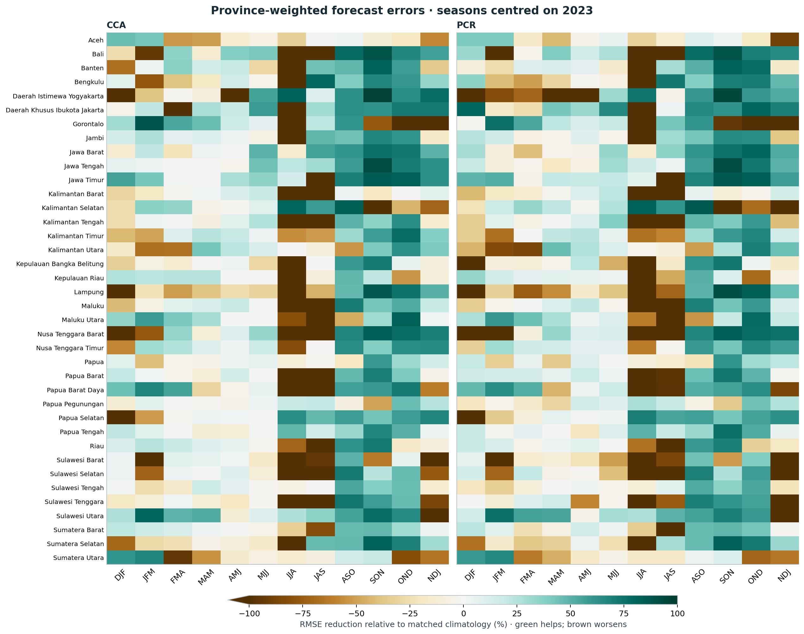
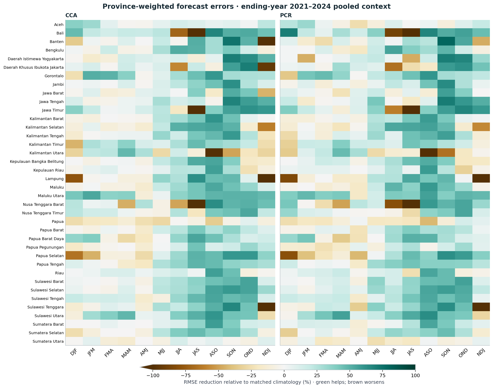

# Province-weighted verification of the Indonesia seasonal case

Completed 2026-11-01 from frozen CFSv2/CHIRPS3 forecasts. No CPT refits,
model tuning, changes to national evaluation masks or new observation downloads.

## Design and footprint

All 38 supplied provinces are retained. Analysis uses the original unsimplified
`idn_bnd_adm1.shp`; the simplified GeoJSON remains a display layer. Native0.05°
country-pixel centres inherit the original cosine-latitude weights, partitioned
into each province within the existing0.25° cells. A shared coarse cell retains
the same forecast/observation error in every participating province. These are
province-weighted coarse-cell errors, not newly reconstructed province rainfall.

Of 61,190 native country pixels in the evaluation footprint,
803 are not contained in any province: **1.3113%**
of original country weight. They remain an explicit residual category. There
are 0 multiply assigned pixels. Region-plus-residual MSE,
MAE and bias recombine to national scores; RMSE follows the square root of MSE.

Main windows have midpoints in2023, so NDJ uses ending-year2024. The context uses
the original ending-year2021–2024 labels and includes2023; it is not an independent
confirmation set. Equal-year pooled errors average MSE before taking its square
root. All seven variants include raw CFSv2, both period climatologies and both
CCA/PCR fits (1983–2010 and1991–2020).

## Number of provinces beating1991–2020 climatology

These counts refer to recent-period CCA/PCR only. No significance or independence
claim follows from the counts; overlapping seasons and correlated regions are
not independent annual samples.

| Season |2023 CCA|2023 PCR|Four-year pooled CCA|Four-year pooled PCR|
| --- | ---: | ---: | ---: | ---: |
| DJF | 19 | 20 | 17 | 21 |
| JFM | 21 | 15 | 23 | 23 |
| FMA | 22 | 14 | 22 | 22 |
| MAM | 20 | 20 | 22 | 24 |
| AMJ | 25 | 25 | 13 | 15 |
| MJJ | 22 | 25 | 32 | 30 |
| JJA | 8 | 8 | 32 | 28 |
| JAS | 17 | 14 | 31 | 27 |
| ASO | 34 | 34 | 33 | 33 |
| SON | 32 | 33 | 35 | 34 |
| OND | 32 | 31 | 32 | 32 |
| NDJ | 21 | 20 | 21 | 23 |

OND 2023 improves over climatology in 32 provinces for CCA and 31 for PCR. In JJA 2023,
the counts are 8 and 8 provinces, whereas pooled context counts are 32 and 28. A single
target year therefore gives a different regional picture from the four-year context.

## Spatial and scientific limits

Daerah Khusus Ibukota Jakarta has only 3 contributing coarse cells; its largest cell carries 63.16% of
its province weight. Support counts and maximum single-cell fractions are
reported for every region. They are not independent sample sizes. Administrative
boundaries are the supplied snapshot, not certified current or historical limits.
No operational, probabilistic-reliability, drought, planting or onset claim is made.

## Outputs and audit

- [Executed notebook](../../docs/notebooks/indonesia-seasons-2023.ipynb)
- [2023 province scores NetCDF](../../docs/assets/seasonal-2023/province-verification-2023.nc)
- [All four methods: OND province table](../../docs/assets/seasonal-2023/province-ond-2023-rmse.csv)
- [Annual context NetCDF](../../docs/data/regions/province-context-annual.nc)
- [Pooled context NetCDF](../../docs/data/regions/province-context-pooled.nc)
- [Weights and support](../../docs/data/regions/province-weights.nc)
- [Assignment provenance](../../docs/data/regions/provenance.json)
- [Independent NumPy verification](../audits/regional-2023/verification.json)
- [Assignment methods and limits](../../docs/data/regions/README.md)

All 13,104 region/year/variant/season combinations were checked independently.
Five original tutorial input NetCDFs remain byte-identical; the broader protected
research inventory is checked by scripts/verify_tutorial.py. Regression tests
cover shared-cell conservation, MSE pooling, missing support and grid mismatch.
